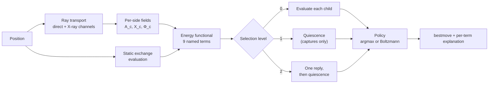

<div align="center">

# Nabla (∇)

**A UCI chess engine that plays by energy descent on ray-transport fields**

[](LICENSE)
[](https://www.rust-lang.org)
[](docs/roadmap.md)

</div>

Nabla evaluates a chess position the way a physicist would describe a field.
Every piece emits influence along its exact attack rays; the influence is
attenuated by the pieces it passes through, which separates **direct control**
from **X-ray pressure** (batteries, pins, skewers). A small energy functional
over those fields scores the position, and every score decomposes exactly into
nine named terms. Nabla then moves by **steepest ascent of that energy over the
legal moves**: the discrete gradient ∇ on the game graph that gives the engine
its name. There is no deep tree search; at most, Nabla looks one reply ahead.

> **Status:** v0.1. The full energy functional, all three selection levels, the
> Boltzmann policy, and the UCI front end are implemented and tested, and the
> engine passes the fastchess UCI compliance check. The coefficients are hand-set
> initial values (not yet tuned), and playing strength has not yet been measured
> against an anchored pool; self-play confirms that each level beats the one below
> it by several hundred Elo. See the [roadmap](docs/roadmap.md).

## Contents

- [Features](#features)
- [How it works](#how-it-works)
- [Building](#building)
- [Using Nabla](#using-nabla)
- [Repository layout](#repository-layout)
- [Development](#development)
- [Documentation](#documentation)
- [Citing and licence](#citing-and-licence)

## Features

- **Ray-transport evaluation.** Direct and X-ray channels, with transmission that
  depends on what blocks the ray (battery partner, own piece, enemy piece, enemy pawn).
- **Nine-term energy functional, 57 coefficients.** Material, safe mobility,
  saturating territory, side-to-move-aware exchange, breakdown king safety,
  tropism, pawn passage with a light-cone rule, endgame confinement, tempo.
- **Exact explanations.** Every candidate move comes with its per-term energy
  gradient; the terms sum exactly to the move's score minus the current position's value.
- **Three selection levels.** No lookahead beyond the move (and forced replies to a check), capture-only quiescence, or one reply.
- **Strength control by temperature.** A Boltzmann policy whose temperature is in
  pawn units; seeded and reproducible.
- **Exactly colour-symmetric.** The evaluation is antisymmetric under the colour
  flip bit for bit, enforced by tests on more than 10,000 positions.
- **Standard UCI.** Works with any UCI GUI and with match runners such as fastchess.

## How it works



### 1. Ray transport

Influence travels along each slider ray and is multiplied by a transmission
coefficient θ at every occupied square it passes, like light through absorbers
(Beer–Lambert):

```math
T_1 = 1, \qquad T_{k+1} = T_k\,\theta(i_k), \qquad a(k) = \frac{1}{1 + \lambda (k-1)}
```

Up to and including the first blocker, the ray is the piece's exact attack set
(the **direct field** $`A_c`$). Beyond it, influence continues at strength $T_k$
(the **X-ray field** $`X_c`$). A battery partner transmits strongly
($`\theta_\text{bat} = 0.9`$), other own pieces weakly (0.25), enemy pieces
moderately (0.5, the pin channel), enemy pawns barely (0.1). The influence field is
$\Phi_c = A_c + \chi X_c$.

### 2. Energy functional

```math
E(S) = E_\text{mat} + E_\text{flux} + E_\text{terr} + E_\text{ex} + E_\text{king} + E_\text{trop} + E_\text{pawn} + E_\text{conf} + E_\text{tempo}
```

| Term | Meaning |
| --- | --- |
| `mat` | Tapered material (rest mass); the pawn defines the unit. |
| `flux` | Safe mobility: attacked squares not occupied by own pieces or covered by enemy pawns. |
| `terr` | Square control, saturating: $`\sum_i w(i) \tanh\big((\Phi_W - \Phi_B)/\Phi_0\big)`$, centre-weighted. |
| `ex` | Exchange: the side to move realises its best SEE gain; the opponent's *second* threat counts (forks). |
| `king` | King danger: near zero while the shelter holds, rising past a threshold (softplus "breakdown"), and saturating so no attack outweighs everything. |
| `trop` | Weak long-range pull of pieces towards the enemy king; king centralisation in endgames. |
| `pawn` | Passed pawns via path transmittance, a bounded rank bonus, the rule of the square, and pawn structure. |
| `conf` | Endgame confinement: shrink the area the losing king can reach. |
| `tempo` | Small bonus for the side to move. |

All energies are in pawn units and White-positive. Each term is computed as a
White part minus a Black part on mirrored inputs, so $`E(ℱS) = -E(S)`$
holds exactly.

### 3. Move selection

For a move $m$ from $S$ to $`S'_m`$, the mover's energy change is the discrete
gradient of $E$ along that edge of the game graph:

```math
\nabla_m E(S) = s_{\text{stm}(S)}\big[E(S'_m) - E(S)\big] = -e(S'_m) - e(S), \qquad e(S) = s_{\text{stm}(S)} E(S)
```

| Level | What Nabla searches | Sees |
| --- | --- | --- |
| 0 | The position after each move (and the forced replies when the move gives check) | Material won, pieces left hanging, forks (including checking forks), mate in one |
| 1 | Captures and queen promotions after each move (quiescence) | Exchange sequences |
| 2 | Every reply, then captures | Mate threats, most one-move blunders |

Checkmate, stalemate, insufficient material, the fifty-move rule, and repetitions
are boundary conditions: they replace the energy with a mate or draw score.

### 4. Strength control

At temperature $\tau > 0$ (pawn units), Nabla samples its move from

```math
\pi_\tau(m) \propto \exp\!\big(\hat Q(m) / \tau\big)
```

so a move Δ pawns worse than the best is chosen $e^{-\Delta/\tau}$ times as often.
Sampling is keyed by seed, position, and ply, so games are reproducible.

The full specification, with every equation and coefficient, is in
[`docs/design/02-field-model.md`](docs/design/02-field-model.md).

## Building

**Requirements:** Rust 1.97 or newer ([rustup](https://rustup.rs)). No other
dependencies; the build is pure Rust.

```sh
git clone <repository-url> Nabla
cd Nabla
cargo build --release
```

The engine binary is `target/release/nabla` (`nabla.exe` on Windows).

```sh
cargo test --release      # invariants: symmetry, SEE, selection, policy
./target/release/nabla bench
```

`bench [level]` runs a fixed 16-position suite (Level 2 by default) and prints the
node count, speed, mean decision time, and a checksum of the chosen moves. On an
Intel i7-7700HQ (one thread) a decision takes about 0.3 ms at Level 0, 8 ms at
Level 1, and 15 ms at Level 2 (roughly 7 µs per position visited).

## Using Nabla

### In a GUI or match runner

Register `target/release/nabla` as a UCI engine in Cute Chess, Arena,
BanksiaGUI, or similar. For engine matches with
[fastchess](https://github.com/Disservin/fastchess):

```sh
fastchess -engine cmd=./target/release/nabla name=Nabla \
          -engine cmd=stockfish name=SF1320 option.UCI_LimitStrength=true option.UCI_Elo=1320 \
          -each tc=10+0.1 -openings file=8moves_v3.pgn format=pgn order=random \
          -rounds 100 -repeat -concurrency 4
```

### UCI options

| Option | Range | Default | Effect |
| --- | --- | --- | --- |
| `Level` | 0–2 | 2 | Selection level (see above). |
| `Temperature` | 0–500 cp | 0 | Boltzmann temperature; 0 plays the best move. |
| `Contempt` | −100–100 cp | 15 | How much Nabla dislikes draws. |
| `Seed` | 0–2³¹−1 | 0 | Seed for temperature sampling. |
| `MultiPV` | 1–256 | 1 | Number of candidate lines reported. |

Time is handled automatically: Nabla turns the clock (or `go movetime`, or
`go nodes`) into a node budget, so moves stay deterministic and the engine
finishes within its clock. In a 3,000-game self-play gate at 2 s + 0.02 s per
move, with seven games running at once, it lost no game on time. Decisions
normally take milliseconds; the budget only matters in rare tactical explosions.

`UCI_LimitStrength` / `UCI_Elo` will be offered once a calibration table exists
(Milestone 5). For tuning, any coefficient can be overridden with
`setoption name Param_<symbol> value <1000 × value>` (for example
`Param_chi value 350`), and any term disabled with
`setoption name Ablate_<term> value true`.

### Analysis commands

| Command | Output |
| --- | --- |
| `eval` | Energy of the current position, term by term. |
| `explain [n]` | The top *n* candidates with score, probability, and per-term gradient. |
| `fields` | The influence fields Φ_W, Φ_B and the control field as 8×8 tables. |
| `bench [level]` | The deterministic bench (also `nabla bench [level]` from the shell). |
| `d` | The current position as FEN. |

```text
position fen 1k1r3q/1ppn3p/p4b2/4p3/8/P2N2P1/1PP1R1BP/2K1Q3 w - - 0 1
explain 3
move           Q   prob  mat  flux  terr  ex  king  trop  pawn  conf  tempo
g2d5      +0.738  1.000  +0.00 +0.06 +0.09 +0.00 +0.01 +0.00 +0.00 -0.00 -0.20
c1b1      +0.643  0.000  +0.00 -0.05 -0.08 +0.00 +0.01 +0.00 +0.00 -0.00 +0.00
e1b4      +0.625  0.000  +0.00 -0.15 +0.01 +0.00 -0.00 +0.00 +0.00 -0.00 +0.00
```

## Repository layout

```text
Nabla/
├── crates/
│   ├── nabla-core/          # library: fields, energy, SEE, selection, policy
│   │   ├── src/
│   │   │   ├── board.rs     # adapter over shakmaty, colour-relative helpers
│   │   │   ├── transport.rs # ray transport and per-side fields
│   │   │   ├── see.rs       # static exchange evaluation
│   │   │   ├── energy/      # one module per energy term
│   │   │   ├── select.rs    # boundary conditions and levels 0–2
│   │   │   ├── policy.rs    # Boltzmann policy and counter-based RNG
│   │   │   └── params.rs    # the 57 coefficients
│   │   └── tests/           # symmetry, SEE, fields, selection, policy
│   └── nabla-uci/           # the `nabla` binary (UCI front end)
└── docs/                    # specification, decisions, research protocol
```

## Development

Read [`AGENTS.md`](AGENTS.md) before changing anything. In short:

1. The specification in `docs/design/` comes first; change it in the same commit
   as the code.
2. `cargo fmt --all`, `cargo clippy --all-targets -- -D warnings`, and
   `cargo test --release` must pass.
3. A commit that changes evaluation or search behaviour states the new `bench`
   checksum in its message.

## Documentation

| Document | Contents |
| --- | --- |
| [Field model](docs/design/02-field-model.md) | Fields, energy terms, coefficients, symmetry |
| [Move selection](docs/design/03-move-selection.md) | Graph gradient, boundary conditions, levels |
| [Strength control](docs/design/04-strength-control.md) | Temperature policy, Elo calibration plan |
| [Architecture](docs/design/05-architecture.md) | Crates, UCI surface, determinism, tests |
| [Visualisation lab](docs/design/06-visualization-lab.md) | Planned interactive demo |
| [Documentation index](docs/README.md) | Everything else: reviews, decisions, research protocol |

## Citing and licence

Nabla builds on the idea of field-based move selection explored by
[Flow Field Chess](https://doi.org/10.5281/zenodo.21028769) (Koch, 2026). To cite
Nabla, use GitHub's **Cite this repository** button, generated from
[`CITATION.cff`](CITATION.cff).

Nabla is free software under the [GNU General Public License v3.0 or later](LICENSE).
