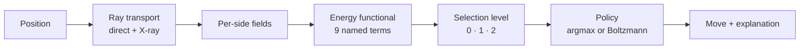

# Nabla (∇)

**A chess engine driven by energy descent on ray-transport fields**

> **Status: design phase (Milestone 0).** The specification is complete enough to
> begin implementation; no engine code exists yet. See the [roadmap](docs/roadmap.md).

---

## What Nabla is

Nabla is a research chess engine built around one question: **how well can a
small, physically structured, fully explainable evaluation play chess with little
or no search?**

Every piece emits influence along its exact attack rays. Influence is attenuated by
the pieces it passes, which separates *direct control* from *X-ray pressure*
(batteries, pins, skewers). A nine-term energy functional over these fields scores
each position, and every score decomposes exactly into named terms. Nabla chooses
moves by steepest ascent of that energy over the legal moves, which is the discrete
gradient ∇ on the game graph that gives the engine its name.

## How it works

| Stage | Summary | Specification |
| --- | --- | --- |
| Ray transport | Exact attack sets plus an X-ray channel whose transmission depends on what blocks the ray | [02 §4](docs/design/02-field-model.md#4-ray-transport-and-fields) |
| Energy | Material, safe mobility, saturating territory, side-to-move-aware exchange, breakdown king safety, tropism, pawn passage and light cone, endgame confinement, tempo | [02 §5](docs/design/02-field-model.md#5-energy-functional) |
| Selection | Level 0: no lookahead · Level 1: capture-only relaxation · Level 2: one reply | [03](docs/design/03-move-selection.md) |
| Strength control | Boltzmann temperature in pawn units, calibrated to `UCI_Elo` | [04](docs/design/04-strength-control.md) |
| Targets | One Rust core: native UCI binary and WebAssembly for the visualisation lab | [05](docs/design/05-architecture.md) |

## Strength control

Nabla speaks standard UCI, so it runs in any chess GUI and in match runners such as
fastchess. Strength is adjustable the way it is in Stockfish:

| Option | Effect |
| --- | --- |
| `Level` (0–2) | How much tactical lookahead is allowed |
| `Temperature` (centipawns) | How often weaker moves are chosen; a move Δ pawns worse is chosen $e^{-\Delta/\tau}$ times as often as the best |
| `UCI_LimitStrength`, `UCI_Elo` | Request a rating directly; mapped to level and temperature by a measured calibration table |

Ratings are stated on a CCRL-Blitz-anchored engine scale, not a human rating scale
([04 §6](docs/design/04-strength-control.md#6-rating-scale)).

## What is new, and what is not

Single-ply move selection on a field energy, rendered in the browser, is **prior
art**: Flow Field Chess ([Koch, 2026](https://doi.org/10.5281/zenodo.21028769)).
Nabla's contributions are chess-exact ray transport with an X-ray channel, a
side-to-move-aware exchange energy, a non-linear king-safety model, tuned and
interpretable coefficients, calibrated strength control, and a pre-registered,
reproducible evaluation that includes head-to-head games against Flow Field Chess.
The full argument is in the
[review of the initial proposal](docs/design/01-proposal-review.md#23-consequence-repositioned-contribution).

## Documentation

| Document | Contents |
| --- | --- |
| [Documentation index](docs/README.md) | Reading order and documentation rules |
| [Notation](docs/notation.md) | Symbols, conventions, glossary, terminology policy |
| [01 · Proposal review](docs/design/01-proposal-review.md) | Defects found, claims verified, changes made |
| [02 · Field model](docs/design/02-field-model.md) | **Core specification**: fields, energy, parameters |
| [03 · Move selection](docs/design/03-move-selection.md) | Graph gradient, boundary conditions, levels |
| [04 · Strength control](docs/design/04-strength-control.md) | Temperature, calibration, rating scale |
| [05 · Architecture](docs/design/05-architecture.md) | Crates, UCI, WebAssembly API, determinism, tests |
| [06 · Visualisation lab](docs/design/06-visualization-lab.md) | Interactive demo and figure export |
| [Hypotheses and protocol](docs/research/hypotheses-and-protocol.md) | What will be measured, and how |
| [Related work](docs/research/related-work.md) | Prior work with verification tags |
| [Paper outline](docs/research/paper-outline.md) | Section, figure, and table map |
| [Decision log](docs/decisions.md) | Why each design choice was made |

## Citing

If you use Nabla in research, please cite it. GitHub's **"Cite this repository"**
button (generated from [`CITATION.cff`](CITATION.cff)) provides APA and BibTeX
entries.

## Licence

Nabla is free software, licensed under the
[GNU General Public License v3.0 or later](LICENSE).
