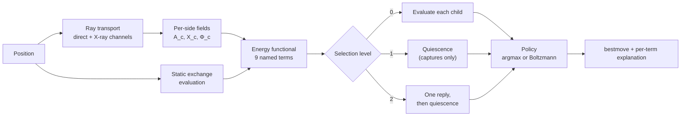
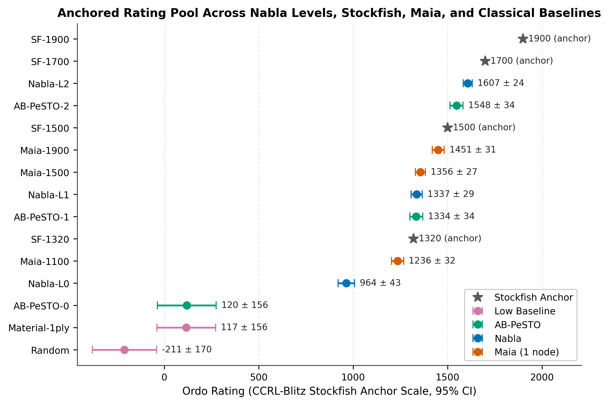
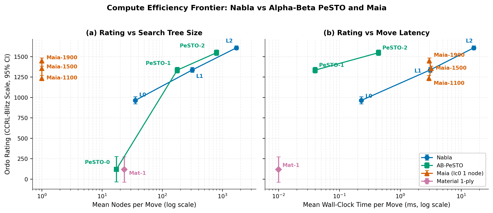
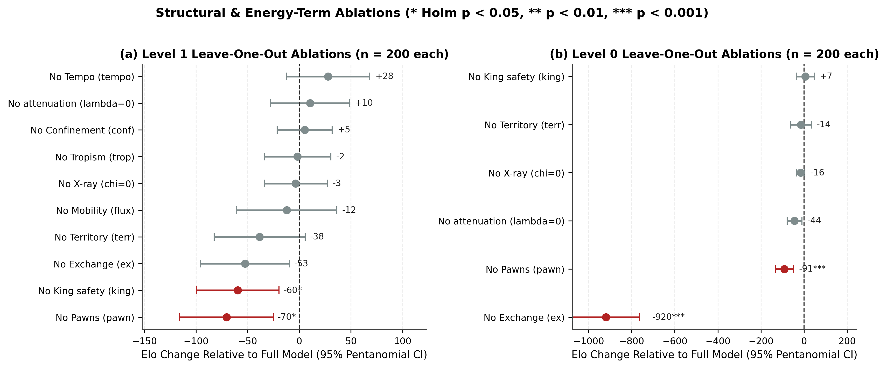
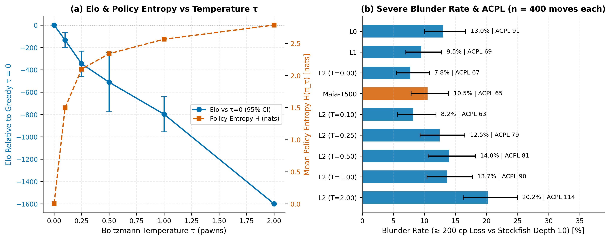
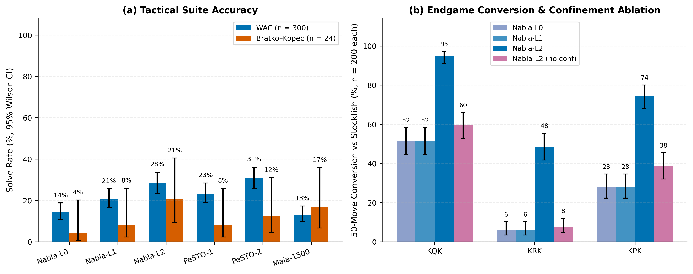
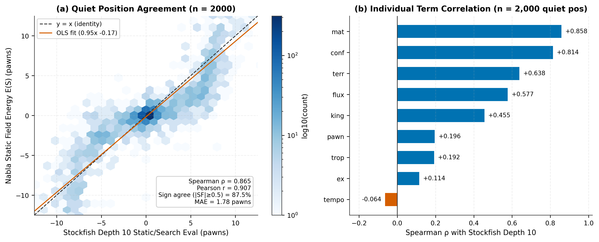

<div align="center">

# Nabla (∇)

**A chess engine that chooses moves by energy descent on ray-transport fields**

[](LICENSE)
[](https://www.rust-lang.org)
[](docs/roadmap.md)

</div>

Nabla is a chess engine that chooses moves by energy descent on ray-transport
fields. Each piece sends influence along the squares it actually attacks. Pieces
in the way weaken that influence, which separates **direct control** from
**X-ray pressure** (batteries, pins, skewers). Nine named terms add up to one
energy. Nabla plays the legal move that raises its energy the most. Lookahead is
small and explicit: none past the move itself, or captures only, or one reply.

> **Status:** v0.1. The full energy functional, all three selection levels, the
> Boltzmann policy, the UCI front end, and the playable page in `web/` are
> implemented. The coefficients are hand-set initial values; a tuner prints a
> fit and does not replace them. In an **11,920-game** native benchmark suite
> anchored to Stockfish 19 on the CCRL Blitz scale (`Ordo`, zero adjudication),
> untuned Level 2 rates **1607 ± 24 Elo**, Level 1 rates **1337 ± 29 Elo**, and
> Level 0 rates **964 ± 43 Elo** (`0` time forfeits, `0` illegal moves, `40/40`
> UCI compliance). See the [benchmark report](docs/research/benchmark-report.md)
> and [roadmap](docs/roadmap.md).

## Contents

- [Features](#features)
- [How it works](#how-it-works)
- [Benchmarks](#benchmarks)
- [Building](#building)
- [Using Nabla](#using-nabla)
- [Repository layout](#repository-layout)
- [Development](#development)
- [Documentation](#documentation)
- [Citing and licence](#citing-and-licence)

## Features

- **Ray-transport evaluation.** Direct and X-ray channels, with transmission that
  depends on what blocks the ray (battery partner, own piece, enemy piece, enemy pawn).
- **Nine-term energy functional, 57 coefficients.** Material, safe mobility,
  saturating territory, side-to-move-aware exchange, breakdown king safety,
  tropism, pawn passage with a light-cone rule, endgame confinement, tempo.
- **Exact explanations.** Every candidate move comes with its per-term energy
  gradient; the terms sum exactly to the move's score minus the current position's value.
- **Three selection levels.** No lookahead beyond the move (and forced replies to a check), capture-only quiescence, or one reply.
- **Strength control by temperature.** A Boltzmann policy whose temperature is in
  pawn units; seeded and reproducible.
- **Exactly colour-symmetric.** The evaluation is antisymmetric under the colour
  flip bit for bit, enforced by tests on more than 10,000 positions.
- **Full standard chess rules.** Castling (both wings), en passant (with SEE
  removing the captured pawn before X-ray discovery), all four pawn promotions
  (queen promotions in quiescence), checkmate, stalemate, the fifty-move rule,
  insufficient material, threefold repetition in the lab, and first-recurrence
  repetition (`±0.15` pawn contempt) in search. Standard chess only (no
  Chess960); static $`E(S)`$ ignores castling rights and SEE ignores pins
  ([`02 §12`](docs/design/02-field-model.md#12-known-exclusions)).
- **Standard UCI.** Works with any UCI GUI and with match runners such as fastchess.

## How it works



### 1. Ray transport

Influence travels along each slider ray and is multiplied by a transmission
coefficient θ at every occupied square it passes, like light through absorbers
(Beer–Lambert):

```math
T_1 = 1, \qquad T_{k+1} = T_k\,\theta(i_k), \qquad a(k) = \frac{1}{1 + \lambda (k-1)}
```

Up to and including the first blocker, the ray is the piece's exact attack set
(the **direct field** $`A_c`$). Beyond it, influence continues at strength $T_k$
(the **X-ray field** $`X_c`$). A battery partner transmits strongly
($`\theta_\text{bat} = 0.9`$), other own pieces weakly (0.25), enemy pieces
moderately (0.5, the pin channel), enemy pawns barely (0.1). The influence field is
$\Phi_c = A_c + \chi X_c$.

### 2. Energy functional

```math
E(S) = E_\text{mat} + E_\text{flux} + E_\text{terr} + E_\text{ex} + E_\text{king} + E_\text{trop} + E_\text{pawn} + E_\text{conf} + E_\text{tempo}
```

| Term | Meaning |
| --- | --- |
| `mat` | Tapered material (rest mass); the pawn defines the unit. |
| `flux` | Safe mobility: attacked squares not occupied by own pieces or covered by enemy pawns. |
| `terr` | Square control, saturating: $`\sum_i w(i) \tanh\big((\Phi_W - \Phi_B)/\Phi_0\big)`$, centre-weighted. |
| `ex` | Exchange: the side to move realises its best SEE gain; the opponent's *second* threat counts (forks). |
| `king` | King danger: near zero while the shelter holds, rising past a threshold (softplus "breakdown"), and saturating so no attack outweighs everything. |
| `trop` | Weak long-range pull of pieces towards the enemy king; king centralisation in endgames. |
| `pawn` | Passed pawns via path transmittance, a bounded rank bonus, the rule of the square, and pawn structure. |
| `conf` | Endgame confinement: shrink the area the losing king can reach. |
| `tempo` | Small bonus for the side to move. |

All energies are in pawn units and White-positive. Each term is computed as a
White part minus a Black part on mirrored inputs, so $`E(ℱS) = -E(S)`$
holds exactly.

### 3. Move selection

For a move $m$ from $S$ to $`S'_m`$, the mover's energy change is the discrete
gradient of $E$ along that edge of the game graph:

```math
\nabla_m E(S) = s_{\text{stm}(S)}\big[E(S'_m) - E(S)\big] = -e(S'_m) - e(S), \qquad e(S) = s_{\text{stm}(S)} E(S)
```

| Level | What Nabla searches | Sees |
| --- | --- | --- |
| 0 | The position after each move (and the forced replies when the move gives check) | Material won, pieces left hanging, forks (including checking forks), mate in one |
| 1 | Captures and queen promotions after each move (quiescence) | Exchange sequences |
| 2 | Every reply, then captures | Mate threats, most one-move blunders |

Checkmate, stalemate, insufficient material, the fifty-move rule, and repetitions
are boundary conditions: they replace the energy with a mate or draw score.

### 4. Strength control

At temperature $\tau > 0$ (pawn units), Nabla samples its move from

```math
\pi_\tau(m) \propto \exp\!\big(\hat Q(m) / \tau\big)
```

so a move Δ pawns worse than the best is chosen $e^{-\Delta/\tau}$ times as often.
Sampling is keyed by seed, position, and ply, so games are reproducible.

The full specification, with every equation and coefficient, is in
[`docs/design/02-field-model.md`](docs/design/02-field-model.md).

## Benchmarks

Across **11,920 native games** (**9,520** `fastchess` tournament games plus
**2,400** endgame conversion games), **324** tactical test positions, and
**2,000** quiet evaluation probes on an Intel Core i7-7700HQ (4 physical cores,
2.80 GHz; Windows; `rustc 1.100.0`; `fastchess` 1.8.3; `Stockfish 19`; `lc0`
0.32.1 + Maia; custom PeSTO alpha-beta baselines; `Ordo` v1.0 `-W -M -s 1000`;
zero adjudication; base seed `20261121`; parameter hash `c3deee9880eb64dc`),
Nabla completed every included match with **0 time forfeits, 0 illegal moves,
and 0 crashes** (`40/40` UCI compliance). Full tables and methodology live in
[`docs/research/benchmark-report.md`](docs/research/benchmark-report.md) and
[`benchmarks/results/manifest.json`](benchmarks/results/manifest.json).

### Anchored Ordo Elo ladder

4,780 pool games on `8moves_v3.pgn` at `10+0.1 s`, pinned to four Stockfish 19
`UCI_LimitStrength` anchors (580 anchor games) on the CCRL Blitz scale:

| Engine | Ordo Elo | 95% CI | Pool Games | Score | Nodes / move | Time / move |
| --- | ---: | --- | ---: | ---: | ---: | ---: |
| `SF-1900` *(anchor)* | **1900.0** | pinned | 60 | 80.0% | 113,270.1 | 319.53 ms |
| `SF-1700` *(anchor)* | **1700.0** | pinned | 160 | 73.4% | 86,518.2 | 303.95 ms |
| **`Nabla-L2`** | **1607.0 ± 24.2** | `[1582.8, 1631.2]` | **1,700** | **77.0%** | **1,701.5** | **16.07 ms** |
| `AB-PeSTO-2` | 1547.6 ± 34.0 | `[1513.6, 1581.6]` | 400 | 58.2% | 798.3 | 0.44 ms |
| `SF-1500` *(anchor)* | **1500.0** | pinned | 200 | 52.5% | 89,569.5 | 325.02 ms |
| `Maia-1900` (`lc0` 1n) | 1450.7 ± 31.0 | `[1419.7, 1481.7]` | 520 | 38.6% | 1.0 | 2.99 ms |
| `Maia-1500` *(hold-out, 1n)* | 1356.0 ± 26.7 | `[1329.3, 1382.7]` | 1,100 | 39.2% | 1.0 | 3.22 ms |
| **`Nabla-L1`** | **1336.7 ± 29.4** | `[1307.3, 1366.1]` | **1,260** | **61.0%** | **315.7** | **3.10 ms** |
| `AB-PeSTO-1` | 1334.2 ± 34.2 | `[1300.0, 1368.4]` | 600 | 43.6% | 177.4 | 0.04 ms |
| `SF-1320` *(anchor)* | **1320.0** | pinned | 160 | 28.8% | 96,725.5 | 369.06 ms |
| `Maia-1100` (`lc0` 1n) | 1235.6 ± 31.7 | `[1203.9, 1267.3]` | 1,000 | 39.8% | 1.0 | 2.97 ms |
| **`Nabla-L0`** | **963.9 ± 43.4** | `[920.5, 1007.3]` | **1,100** | **50.7%** | **35.8** | **0.23 ms** |
| `AB-PeSTO-0` | 119.7 ± 155.7 | `[-36.0, 275.4]` | 400 | 25.6% | 17.4 | 0.00 ms |
| `Material-1ply` | 116.6 ± 155.6 | `[-39.0, 272.2]` | 700 | 26.8% | 23.5 | 0.01 ms |
| `Random` | -211.0 ± 169.9 | `[-380.9, -41.1]` | 200 | 6.8% | 1.0 | 0.01 ms |





<details>
<summary>Additional benchmark figures (ablations, temperature &amp; blunders, tactics &amp; endgames, static eval correlation)</summary>









</details>

### Key diagnostics, strengths & trade-offs

- **Head-to-head & level scaling:** `L0 → L1` adds `+442.8 ± 93.0` Elo (`184–13–3`) and `L1 → L2` adds `+372.2 ± 78.6` Elo (`174–16–10`; `+418.5 ± 78.6` on `noob_3moves.epd`). `Nabla-L2` beats `SF-1320` (`74–18–8`, `+219.9 ± 80.4`), `SF-1500` (`58–40–2`, `+63.2 ± 65.1`, `p = 0.049`, using `53×` fewer nodes and `20×` less time), `Maia-1100` (`+358.8 ± 67.7`), `Maia-1500` (`137–36–27`, `+193.2 ± 46.9`; `noob_3moves.epd`: `121–35–44`, `+159.8 ± 47.0`), `Maia-1900` (`116–34–50`, `+151.3 ± 41.8`), and depth-matched `AB-PeSTO-2` (`105–73–22`, `+56.1 ± 44.7`, `p = 0.012`), while losing to `SF-1700` (`32–68–0`, `-130.9 ± 77.7`). At 1 ply, `Nabla-L0` beats `AB-PeSTO-0` `198–2–0` (`+798.2 ± 197.7`).
- **Ablations (`3,200` games, `30+0.3 s`, Holm-corrected):** At **L0**, `No Exchange` drops `-919.5 ± 155.7` (`p_H < 10⁻³⁰⁰`), `No Pawns` drops `-90.6 ± 43.2` (`p_H = 0.00008`), and `No Attenuation (λ = 0)` drops `-43.7 ± 34.8` (`p = 0.013, p_H = 0.051`). At **L1**, `No Pawns` (`-70.4 ± 45.4`, `p_H = 0.0167`) and `No King` (`-59.6 ± 39.9`, `p_H = 0.0243`) degrade strength significantly, and `No Exchange` drops `-52.5 ± 43.0` (`p = 0.015, p_H = 0.117`). At hand-set defaults, `No X-ray (χ = 0)` stays within noise (`-3.5` to `-15.7` Elo at `n = 200`).
- **Temperature & blunders (`SF depth 10`):** Elo drops strictly monotonically vs `T = 0` (`0.10`: `-134.9`, `0.25`: `-346.1`, `0.50`: `-511.5`, `1.00`: `-798.2`, `2.00`: `0/100`), while entropy rises `1.495 → 2.785` nats, ACPL `63.1 → 114.5`, and blunders (`≥ 200` cp) `8.2% → 20.2%`. At `T = 0`, `Nabla-L2` records ACPL `67.1`, blunders `7.8%`, and SF Top-1 match `40.5%` (vs `Maia-1500` `65.2`, `10.5%`, `40.3%`).
- **Tactics & endgames:** `Nabla-L2` solves `85/300` (`28.3%`) on `WAC-300` and `5/24` (`20.8%`) on `BK-24` (vs `AB-PeSTO-2` `30.7%` / `12.5%`, `Maia-1500` `13.0%` / `16.7%`). Confinement drives endgame conversion (`n = 200` verified wins vs `SF depth 8`, 50-move limit): **KQK `95.0%` vs `59.5%`**, **KRK `48.5%` vs `7.5%`**, **KPK `74.5%` vs `38.5%`** (L2 with vs without confinement).
- **Static eval agreement (`n = 2,000` quiet positions vs `SF depth 10`):** Spearman `ρ = 0.8645`, Pearson `r = 0.9072`, sign agreement (`|SF| ≥ 0.5`) `87.5%`, `MAE = 1.785` pawns (Opening `0.7489`, Middlegame `0.9785`, Endgame `0.9384`).
- **Speed & WASM parity (`5` `bench` runs):** Native medians `0.36 ms` (L0), `12.54 ms` (L1), `21.02 ms` (L2, `120,368` nps, `8.31 µs/node`); WebAssembly is `48/48` bit-identical (`1.42×` factor at L2).
- **Modeling boundaries & trade-offs:** Nabla uses a hybrid evaluator (only territory and king pressure read the ray-transport field Φ_c; the other 7 terms use exact bitboards and SEE) with untuned hand-set weights (`MAE = 1.785` pawns). Evaluating the field costs `8.3 µs/node` vs `0.55 µs/node` for PeSTO PSTs, so Nabla wins at equal depth (`+844` Elo at 1 ply, `+56` Elo at 2 ply), whereas deeper classical search wins at equal wall-clock time. Shallow search also leaves a 2-ply tactical/triangulation ceiling (`28.3%` WAC-300, `48.5%` KRK) and no opposite-coloured-bishop/fortress draw scaling.

Reproducing the full suite (installs `fastchess`, `Stockfish`, `lc0`/Maia, openings, builds baselines, runs matches, and regenerates charts):

```sh
python tools/benchmark/provision.py
python tools/benchmark/run_suite.py
python tools/benchmark/plot_results.py
```

## Building

**Requirements:** Rust 1.97 or newer ([rustup](https://rustup.rs)). No other
dependencies; the build is pure Rust.

```sh
git clone <repository-url> Nabla
cd Nabla
cargo build --release
```

The engine binary is `target/release/nabla` (`nabla.exe` on Windows).

```sh
cargo test --release      # invariants: symmetry, SEE, selection, policy
cargo run --release -- bench
```

The lab is a separate page:

```sh
npm run engine --prefix web    # Rust to WebAssembly, once
npm install --prefix web
npm run dev --prefix web       # http://127.0.0.1:4321
```

The notes are the front page. Play is a second page, one viewport high on a
desktop. Each colour is a seat. Choosing it opens a roster: you, Nabla,
Stockfish 19 lite, or Maia, and that model's own settings. The judgement bar
stands to the left of the board. The right column has a Reading tab and a
Moves tab. Moves can be undone and replayed. The notes summarise the recorded
native benchmark suite against Stockfish 19, Maia, and classical alpha-beta
baselines, and include its figures.
Maia-3 can sit in a seat; its network downloads in the browser the first time
it moves. Nabla's rims, ticks, and hanging-piece numbers stay on the board
while the other side thinks, in the same shape as the legend behind the
question mark. Two Nablas use two colours. Arrows are drawn above the pieces.
The pause before an engine move is at the top of a seat, and the game waits
while that seat is open. The bar is cream on White's side of the board and
grey on Black's.

### In your own page

`npm run engine --prefix web` writes the WebAssembly into `web/src/engine`
(`nabla_wasm.js` and `nabla_wasm_bg.wasm`). Those files are committed, so a
site build does not need Rust. They are GPL-3.0-or-later, the same as the rest
of Nabla. Copy that directory into your site and load it from a browser module.
The page keeps the rules. You do not reimplement chess.

```js
import init, { Lab } from "./nabla_wasm.js";

await init();
const lab = new Lab();          // start position, level 2, temperature 0
lab.set_level(2);               // 0, 1, or 2
lab.set_temperature(0);         // pawns. 0 plays the best move. The cap is 5.
const view = JSON.parse(lab.view());
// view.turn, view.state, view.detail
// view.energy.mat … view.energy.total
// view.control, view.tension, view.threats: 64 numbers, a1 = 0
const choice = JSON.parse(lab.analyze());
lab.push(choice.best);          // also accepts a move from your board, such as "e7e8q"
```

`view` describes the current position and does not choose a move. `analyze`
chooses. `detail` is `play`, `check`, `checkmate`, `stalemate`, `material`,
`fifty`, or `repetition`. A threefold repetition ends the displayed game.
Nabla's search still treats the first recurrence as a draw when it is choosing
a move (03 §3). That rule does not, by itself, end the game on the board.

Single protocol matches against Stockfish, Maia, and the other engines named in
the protocol run with `node tools/gauntlet.mjs`; the full suite above runs with
`python tools/benchmark/run_suite.py`. The page's Stockfish lite opponent is
for play. It is not that measurement.

`bench [level]` runs a fixed 16-position suite (Level 2 by default) and prints the
node count, speed, mean decision time, and a checksum of the chosen moves. Across
five repeated runs on an Intel i7-7700HQ (one thread, `120k nps` at Level 2,
roughly 8.3 µs per position visited), median decisions take **0.36 ms** at
Level 0, **12.54 ms** at Level 1, and **21.02 ms** at Level 2 (native vs
WebAssembly bit-identical 48/48, with 1.42× WASM slowdown at Level 2). Three
bench positions, 21 November 2026, Level 2 and temperature 0 with no clock:

| Position | Visits | Time |
| --- | --- | --- |
| Starting position | 441 | 2 ms |
| Middlegame, all pieces still on | 5,939 | 49 ms |
| King and one pawn | 56 | under 1 ms |

The middlegame figure is that one sharp bench position (captures to seldepth 16),
not every middlegame. Level 0 on the same three positions stayed under 1 ms
(20, 50, and 6 visits). The cost follows the number of positions visited.
Level 0 visits each legal move, plus the forced replies to a check. Level 2
adds one reply and the captures after it.

Nabla is not a neural network. The energy has 57 named coefficients and four
fixed constants (pawn unit 1, ray cut-off 0.05, light-cone sharpness 0.1,
control scale 1). The coefficients shipped here are the hand-set initial
values. A tuner can print a fit. It does not replace them. The page plays a
committed WebAssembly build, `web/src/engine/nabla_wasm_bg.wasm`, 935,057 bytes
on 21 November 2026. A site build does not compile Rust.

## Using Nabla

### In a GUI or match runner

Register `target/release/nabla` as a UCI engine in Cute Chess, Arena,
BanksiaGUI, or similar. For engine matches with
[fastchess](https://github.com/Disservin/fastchess):

```sh
fastchess -engine cmd=./target/release/nabla name=Nabla \
          -engine cmd=stockfish name=SF1320 option.UCI_LimitStrength=true option.UCI_Elo=1320 \
          -each tc=10+0.1 -openings file=8moves_v3.pgn format=pgn order=random \
          -rounds 100 -repeat -concurrency 4
```

### UCI options

| Option | Range | Default | Effect |
| --- | --- | --- | --- |
| `Level` | 0–2 | 2 | Selection level (see above). |
| `Temperature` | 0–500 cp | 0 | Boltzmann temperature; 0 plays the best move. |
| `Contempt` | −100–100 cp | 15 | How much Nabla dislikes draws. |
| `Seed` | 0–2³¹−1 | 0 | Seed for temperature sampling. |
| `MultiPV` | 1–256 | 1 | Number of candidate lines reported. |
| `Move Overhead` | 0–5000 ms | 20 | Time reserved per move for process and UCI overhead. |

Time is handled automatically: Nabla turns the clock (or `go movetime`, or
`go nodes`) into a node budget, so moves stay deterministic and the engine
finishes within its clock. In a 600-game self-play stress gate at 4 s + 0.04 s
per move (`concurrency = 3`) and across all 9,520 `fastchess` benchmark games, it
lost zero games on time. Decisions normally take milliseconds; the budget only
matters in rare tactical explosions.

`UCI_LimitStrength` / `UCI_Elo` will be offered once a calibration table exists
(Milestone 5). For tuning, any coefficient can be overridden with
`setoption name Param_<symbol> value <1000 × value>` (for example
`Param_chi value 350`), and any term disabled with
`setoption name Ablate_<term> value true`.

### Analysis commands

| Command | Output |
| --- | --- |
| `eval` | Energy of the current position, term by term. |
| `explain [n]` | The top *n* candidates with score, probability, and per-term gradient. |
| `fields` | The influence fields Φ_W, Φ_B and the control field as 8×8 tables. |
| `bench [level]` | The deterministic bench (also `nabla bench [level]` from the shell). |
| `d` | The current position as FEN. |

```text
position fen 1k1r3q/1ppn3p/p4b2/4p3/8/P2N2P1/1PP1R1BP/2K1Q3 w - - 0 1
explain 3
move           Q   prob  mat  flux  terr  ex  king  trop  pawn  conf  tempo
g2d5      +0.742  1.000  +0.00 +0.06 +0.09 +0.00 +0.01 +0.00 +0.00 -0.00 -0.20
c1b1      +0.653  0.000  +0.00 -0.05 -0.08 +0.00 +0.00 +0.00 +0.00 -0.00 +0.00
e1b4      +0.645  0.000  +0.00 -0.15 +0.01 +0.00 -0.00 +0.00 +0.00 -0.00 +0.00
```

## Repository layout

```text
Nabla/
├── crates/
│   ├── nabla-core/          # library: fields, energy, SEE, selection, policy
│   │   ├── src/
│   │   │   ├── board.rs     # adapter over shakmaty, colour-relative helpers
│   │   │   ├── transport.rs # ray transport and per-side fields
│   │   │   ├── see.rs       # static exchange evaluation
│   │   │   ├── energy/      # one module per energy term
│   │   │   ├── select.rs    # boundary conditions and levels 0–2
│   │   │   ├── policy.rs    # Boltzmann policy and counter-based RNG
│   │   │   ├── params.rs    # the 57 coefficients
│   │   │   └── snapshot.rs  # the picture the lab paints
│   │   └── tests/           # symmetry, SEE, fields, selection, policy
│   ├── nabla-uci/           # the `nabla` binary (UCI front end)
│   ├── nabla-wasm/          # the same engine for the page
│   └── nabla-tune/          # prints a fit; does not change the defaults
├── benchmarks/              # measured results and publication figures
│   ├── results/             # manifest, Ordo ratings, and per-experiment JSONs
│   └── figures/             # SVG and 300-DPI PNG benchmark plots
├── tools/                   # gauntlet, parity check, PeSTO baselines, benchmark suite
│   ├── baselines/           # standalone classical baselines (Random, Material, AB-PeSTO)
│   ├── benchmark/           # provision, run_suite, plot_results scripts
│   ├── check_wasm_parity.mjs
│   └── gauntlet.mjs
├── web/                     # the playable page
└── docs/                    # specification, decisions, research protocol
```

## Development

Read [`AGENTS.md`](AGENTS.md) before changing anything. In short:

1. The specification in `docs/design/` comes first; change it in the same commit
   as the code.
2. `cargo fmt --all`, `cargo clippy --release --all-targets -- -D warnings`, and
   `cargo test --release` must pass.
3. A commit that changes evaluation or search behaviour states the new `bench`
   checksum in its message.

## Documentation

| Document | Contents |
| --- | --- |
| [Field model](docs/design/02-field-model.md) | Fields, energy terms, coefficients, symmetry |
| [Move selection](docs/design/03-move-selection.md) | Graph gradient, boundary conditions, levels |
| [Strength control](docs/design/04-strength-control.md) | Temperature policy, Elo calibration plan |
| [Architecture](docs/design/05-architecture.md) | Crates, UCI surface, determinism, tests |
| [Visualisation lab](docs/design/06-visualization-lab.md) | Playable board, notes, and layers |
| [Benchmark report](docs/research/benchmark-report.md) | 11,920-game anchored Elo, ablations, eval, tactics, endgames |
| [Hypotheses and protocol](docs/research/hypotheses-and-protocol.md) | Confirmatory criteria, statistics, experimental design |
| [Documentation index](docs/README.md) | Everything else: reviews, decisions, research protocol |

## Citing and licence

Nabla builds on the idea of field-based move selection explored by
[Flow Field Chess](https://doi.org/10.5281/zenodo.21028769) (Koch, 2026). To cite
Nabla, use GitHub's **Cite this repository** button, generated from
[`CITATION.cff`](CITATION.cff).

Nabla is free software under the [GNU General Public License v3.0 or later](LICENSE).
