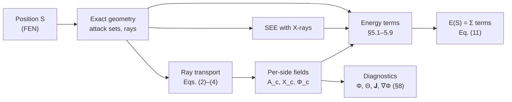

# 02 — Field Model and Energy Functional

> **Status:** Draft v0.2 (revised after the audits recorded in
> [`01b-second-proposal-review.md`](01b-second-proposal-review.md)) ·
> **Implemented in:** `crates/nabla-core` · **Depends on:** [`../notation.md`](../notation.md)
> · **Resolves:** C-1, C-2, C-3, M-1, M-2, M-3, M-4, m-2 of
> [`01-proposal-review.md`](01-proposal-review.md)

This document specifies Nabla's static evaluation: the map $`S \mapsto E(S)`$ from a
position to a scalar energy in pawn units, and the per-side fields from which it
is computed. $E$ is **stateless**: it depends only on the information in a FEN.
Terminal states and game-history effects (repetition) are boundary conditions,
specified in [`03-move-selection.md`](03-move-selection.md).

---

## Contents

1. [Design principles](#1-design-principles)
2. [Preliminaries](#2-preliminaries)
3. [Pipeline overview](#3-pipeline-overview)
4. [Ray transport and fields](#4-ray-transport-and-fields)
5. [Energy functional](#5-energy-functional)
6. [Symmetry](#6-symmetry)
7. [Computation](#7-computation)
8. [Diagnostic fields](#8-diagnostic-fields)
9. [Parameter table](#9-parameter-table)
10. [Classical limits](#10-classical-limits)
11. [Analogy register](#11-analogy-register)
12. [Known limitations](#12-known-limitations)

---

## 1. Design principles

| ID | Principle | Consequence |
| --- | --- | --- |
| P1 | **Exact geometry.** Every set predicate (attacked, safe, reachable) uses exact attack bitboards, never field values. | SEE, safe checks, and king regions are chess-exact; approximation lives only in weights. |
| P2 | **Per-side fields.** White and Black fields are stored separately. | Contested squares are resolved by exchange evaluation (§5.4). A signed per-square term cannot tell a 3-against-3 contest from an empty square, so none is asked to. |
| P3 | **Additive, interpretable energy.** $E$ is a sum of named terms. | Every evaluation and every move can be explained term by term (03 §6); every term can be ablated. |
| P4 | **Pawn units, named coefficients.** | All coefficients appear in §9 with an initial value, a range, and a tuning method. |
| P5 | **Classical limits.** Each term reduces to a recognised heuristic in a stated limit (§10). | The model generalises chess knowledge rather than discarding it, and each term is testable against its limit. |
| P6 | **Colour antisymmetry by construction.** | $`E(ℱS) = -E(S)`$ holds exactly, including in floating point (§6). |
| P7 | **Bounded positional terms.** | No positional term can grow without limit; magnitudes are controlled by named coefficients. |

---

## 2. Preliminaries

### 2.1 Rays and the first blocker

For a sliding piece $p$ (bishop, rook, queen) and a direction $d$ in its direction
set ($D_R$: 4 orthogonal; $D_B$: 4 diagonal; $`D_Q = D_R \cup D_B`$), the **ray** is
the sequence of squares $i_1, i_2, \dots, i_L$ from $`\sigma(p)`$ to the board edge.
The **first-blocker index** is

```math
k^\star = \min \lbrace k : i_k \text{ is occupied} \rbrace, \qquad k^\star = L \text{ if the ray is empty.} \qquad \text{(1)}
```

Knights, kings, and pawns have no rays: each attacked square is a single step
($`k = 1`$) in the direct channel.

### 2.2 Line compatibility

A blocker $b$ on ray square $i_k$ is **line-compatible** with direction $d$ if $b$
is friendly to the emitter and can itself attack along $d$:

- $b \in \lbrace R, Q \rbrace$ and $d$ is orthogonal; or
- $b \in \lbrace B, Q \rbrace$ and $d$ is diagonal; or
- $b$ is a pawn and $d$ is one of that pawn's forward capture diagonals.

Line compatibility is what makes a battery: the rear piece supports the front
piece along the shared line.

---

## 3. Pipeline overview



---

## 4. Ray transport and fields

### 4.1 Transmittance

Influence travels along a ray and is attenuated by each piece it passes, in the
manner of light through a sequence of absorbers (Beer–Lambert law). The
**cumulative transmittance** at step $k$ is

```math
T_1 = 1, \qquad T_{k+1} = T_k \, \theta(i_k), \qquad \text{(2)}
```

where the **single-blocker transmission coefficient** depends on what occupies
$i_k$, relative to the emitter:

```math
\theta(i_k) =
\begin{cases}
1 & i_k \text{ empty, or occupied by the enemy king} \\
\theta_\text{bat} & \text{friendly piece, line-compatible (battery)} \\
\theta_\text{fr} & \text{friendly piece, not line-compatible} \\
\theta_\text{en} & \text{enemy piece other than pawn or king (pin, skewer)} \\
\theta_\text{ep} & \text{enemy pawn}
\end{cases} \qquad \text{(3)}
```

The enemy king is transparent because squares behind a king on an attacking line
remain unavailable to it. Propagation along a ray stops when $T_k < T_\text{min}$.
Influence also decays gently with distance,

```math
a(k) = \frac{1}{1 + \lambda (k - 1)}, \qquad \text{(4)}
```

so that adjacent squares ($`k = 1`$) are unattenuated and leapers and sliders are
on a common scale.

### 4.2 Per-side fields

The **direct field** of colour $c$ sums each piece's influence over its exact
attack set:

```math
A_c(i) = \sum_{p \in \Pi_c} \alpha_{t(p)} \sum_{\text{rays of } p} \ \sum_{k \le k^\star} a(k)\, 𝟙[i_k = i]
\;+\; \sum_{p \in \Pi_c^{N,K,P}} \alpha_{t(p)}\, 𝟙[i \in \mathrm{Att}(p)]. \qquad \text{(5)}
```

The king's weight is tapered, $\alpha_K(\varphi) = (1 - \varphi)\,\alpha_K$, so the
king controls squares only as material comes off; in the middlegame its weight is
zero. For $k \le k^\star$ every intermediate square is empty, so $T_k = 1$: the
direct channel is unattenuated except by distance. Its support is contained in the
union of attack sets, with equality whenever every weight is positive. This is
why set predicates use attack bitboards rather than field values (P1).

The **X-ray field** carries influence beyond the first blocker:

```math
X_c(i) = \sum_{p \in \Pi_c^{B,R,Q}} \alpha_{t(p)} \sum_{\text{rays of } p} \ \sum_{k > k^\star} a(k)\, T_k\, 𝟙[T_k \ge T_\text{min}]\, 𝟙[i_k = i]. \qquad \text{(6)}
```

The **influence field** combines both channels with an X-ray weight $\chi < 1$:

```math
\Phi_c = A_c + \chi X_c. \qquad \text{(7)}
```

Two attack bitboards are kept alongside the fields: $`\mathrm{Att}_c`$, the squares
colour $c$ attacks, and $`\mathrm{Att}^{\not K}_c`$, the same with the enemy king
removed from the board, so that squares behind a checked king count as attacked
(used in §5.8).

### 4.3 Derived fields

```math
\Phi = \Phi_W - \Phi_B \qquad \text{(net potential; diagnostic)} \qquad \text{(8)}
```

```math
\Theta = \min(\Phi_W, \Phi_B) \qquad \text{(tension; diagnostic)} \qquad \text{(9)}
```

```math
\Omega = \tanh\!\left( \frac{\Phi_W - \Phi_B}{\Phi_0} \right) \in (-1, 1), \quad \Phi_0 \equiv 1 \qquad \text{(control)} \qquad \text{(10)}
```

$\Phi$ and $\Theta$ exist for visualisation and analysis. Tension does **not** enter
the energy: whether a contested square favours either side is decided by exchange
resolution (§5.4). $\Phi_0$ is fixed rather than tuned, because together with the
control weights and king coefficients it forms an exact scaling degeneracy (§9.2).

---

## 5. Energy functional

```math
E(S) = E_\text{mat} + E_\text{flux} + E_\text{terr} + E_\text{ex} + E_\text{king} + E_\text{trop} + E_\text{pawn} + E_\text{conf} + E_\text{tempo}. \qquad \text{(11)}
```

Several coefficients are **tapered** by the game phase

```math
\varphi = \min\!\left(1,\ \frac{N_N + N_B + 2N_R + 4N_Q}{24}\right),
\qquad x(\varphi) = \varphi\, x^\text{MG} + (1 - \varphi)\, x^\text{EG}, \qquad \text{(12)}
```

where $N_t$ counts pieces of type $t$ of both colours.

### 5.1 Rest mass (material)

```math
E_\text{mat} = \sum_{p \in \Pi(S),\ t(p) \ne K} s_{c(p)}\, m_{t(p)}(\varphi), \qquad m_P \equiv 1. \qquad \text{(13)}
```

Fixing $m_P = 1$ defines the energy unit. Material is an explicit term, not a
by-product of field emission (resolves C-2).

### 5.2 Flux (safe mobility)

```math
E_\text{flux} = \sum_{p,\ t(p) \in \lbrace N,B,R,Q \rbrace} s_{c(p)}\, \mu_{t(p)}\, F_p,
\qquad
F_p = \left\lvert \mathrm{Att}(p) \setminus \left( \mathrm{Occ}_{c(p)} \cup \mathrm{PA}_{\bar{c}(p)} \right) \right\rvert . \qquad \text{(14)}
```

$F_p$ counts the field lines leaving $p$ that end on squares it could use without
being captured by a pawn: an outward flux, by analogy with Gauss's law.

### 5.3 Territory (saturating control)

```math
E_\text{terr} = \sum_{i \in ℬ} w(i)\, \Omega(i),
\qquad
w(i) = w_0 + w_c\, \frac{3 - d_c(i)}{3}. \qquad \text{(15)}
```

The weight is $w_0 + w_c$ on the four central squares and $w_0$ on the outer ring,
and $\lvert E_\text{terr} \rvert \le 64 w_0 + \tfrac{56}{3} w_c$. Saturation means a
fifth attacker on an already controlled square adds little, which a linear sum
cannot express (resolves the linearity part of C-2).

### 5.4 Exchange energy

**Static exchange evaluation.** $\mathrm{SEE}$ is the standard swap algorithm, with
two entry points: per square (the capturing side uses its least valuable attacker
first) and per move (the first attacker is given). Attackers are taken
least-valuable-first, X-ray attackers are revealed after every removal, either
side may stop capturing (backward minimax), and the king captures only onto a
square the opponent no longer attacks. Ties between equal-valued attackers are
broken in the capturing side's relative square order, because the choice decides
which X-ray is revealed and an absolute order would break colour symmetry. Values
are fixed at $`(1, 3, 3, 5, 9)`$ for P, N, B, R, Q so that tactical accounting does
not drift during tuning. Documented simplifications: pins of capturing pieces are
ignored, promotions during the exchange are not credited, and en passant captures
score 0.

**Exchange term.** Let $`g_c(i) = \max(0, \mathrm{SEE}_c(i))`$ be the gain for colour
$c$ from capturing on a square $i$ holding an enemy piece other than the king, and
let $G_c^{(1)} \ge G_c^{(2)}$ be its two largest values over distinct squares
($0$ if fewer exist). One move can either cash the best capture or parry a
threat, never both:

```math
E_\text{ex} = s_\text{stm} \max\!\Big( \beta_1 G^{(1)}_{\text{stm}} - \beta_2 G^{(1)}_{\overline{\text{stm}}},\; -\beta_2 G^{(2)}_{\overline{\text{stm}}} \Big). \qquad \text{(16)}
```

- The **capture branch** realises the side to move's best capture; every
  opponent threat then remains.
- The **parry branch** spends the move on defence; the opponent can then realise
  only its second threat, so forks are rewarded and punished.
- A side **in check** can do neither freely. Its only capture is of a single
  checker, worth $g_\text{chk}$, and every threat stays realisable:
  $`E_\text{ex} = s_\text{stm}\,(\beta_1 g_\text{chk} - \beta_2 G^{(1)}_{\overline{\text{stm}}})`$.
- At selection levels $L \ge 1$, $\beta_1 = 0$, because quiescence search
  realises captures explicitly. Eq. (16) then reduces to
  $`-s_\text{stm}\beta_2 G^{(2)}_{\overline{\text{stm}}}`$, the fork term.
- $\beta_1$ starts at 1: a discount below 1 makes every defended trade look
  profitable at Level 0 (a queen trade would score $`+0.2 \times 9`$).

This term resolves C-3.

### 5.5 King safety (breakdown model)

The **king zone** $Z_c$ is the king's square, its king-move neighbours, and the
three squares two ranks in front of the king (files $f_K - 1$ to $`f_K + 1`$), clipped
to the board. The **pressure** on king $c$ is

```math
P_c = \sum_{i \in Z_c} \Phi_{\bar c}(i) + \omega_\text{chk}\, C_c, \qquad \text{(17)}
```

where $C_c$ counts **safe checking squares**: squares $i$, not occupied by
$\bar c$, that some piece $p \in \Pi_{\bar c}^{N,B,R,Q}$ attacks, from which a piece
of type $`t(p)`$ would attack $K_c$, and that $c$ does not attack. Using
$\Phi_{\bar c}$ (which includes the X-ray channel) makes batteries aimed at the king
count.

The **shelter** is an exponentially weighted count of the king's own pawns in front
of it, with $\delta_c = +1$ for White and $-1$ for Black:

```math
H_c = \sum_{f = f_K - 1}^{f_K + 1} \ \sum_{k=1}^{3} \nu_\text{sh}^{\,k-1}\ 𝟙\!\left[ \text{own pawn on } (f,\ r_K + k\,\delta_c) \right]. \qquad \text{(18)}
```

King danger stays near zero while the shelter holds, rises once pressure exceeds a
threshold (by analogy with dielectric breakdown), and saturates:

```math
D_c = \sigma_b\left[ \mathrm{softplus}\!\left( \frac{P_c - \xi H_c - x_0}{\sigma_b} \right) - \mathrm{softplus}\!\left( \frac{-x_0}{\sigma_b} \right) \right],
\qquad
E_\text{king} = -\sum_c s_c\, \Gamma_{\bar c}\, D_\text{max} \tanh\!\left( \frac{D_c}{D_\text{max}} \right), \qquad \text{(19)}
```

```math
\Gamma_{\bar c} = G_0\, \frac{\mathrm{NPM}_{\bar c}}{\mathrm{NPM}_0} \left( 1 + \gamma_Q\, 𝟙[\bar c \text{ has a queen}] \right).
```

- The subtracted constant makes $D_c = 0$ at zero pressure and zero shelter, so
  the limits of §10 are well defined.
- The $\tanh$ bounds the term by $\Gamma_{\bar c} D_\text{max}$ (P7). Without it,
  softplus grows linearly and a single piece parked in the zone could outweigh
  its own value at levels that never search quiet defences.
- $`\mathrm{NPM}_0`$ is the initial non-pawn material of one side under $m^\text{MG}$
  (32.0 at the initial values of §9).
- Danger scales with the **attacker's** material and queen presence (resolves
  M-4). Pieces are drawn towards the enemy king because moves that raise
  $P_{\bar c}$ lower the opponent's energy (resolves C-1).

### 5.6 Tropism and king activity

Zone-based pressure has zero gradient for pieces far from the enemy king. A weak,
long-range interaction supplies that gradient in the middlegame, and a
centralisation term activates the king in the endgame:

```math
E_\text{trop} = \varphi \sum_{p,\ t(p) \in \lbrace N,B,R,Q \rbrace} s_{c(p)}\, g_{t(p)}\, k_\text{s}\!\left( d_2(\sigma(p), K_{\bar c(p)}) \right)
+ (1 - \varphi) \sum_c s_c\, g_K\, \frac{3 - d_c(K_c)}{3},
\qquad
k_\text{s}(d) = \frac{1}{1 + (d / a_\text{s})^2}. \qquad \text{(20)}
```

$k_\text{s}$ is a softened inverse-square kernel with softening length $a_\text{s}$:
finite at $d = 0$, with non-zero slope for every $d \ge 1$ (all on-board distances).

### 5.7 Pawns

**Passage transmittance.** Let the **front span** of pawn $p$ be the squares ahead
of it on its own and the adjacent files. Each enemy pawn in the span is an
absorber:

```math
T^\text{pass}_p = (1 - \theta_\text{pp})^{\,n_p}, \qquad n_p = \left\lvert \text{front span}(p) \cap \mathrm{Occ}^P_{\bar c} \right\rvert. \qquad \text{(21)}
```

With $\theta_\text{pp} = 1$, $`T^\text{pass}_p \in \lbrace 0, 1 \rbrace`$ is exactly the
classical passed-pawn predicate. With $\theta_\text{pp} < 1$, a candidate passer
facing one pawn gets partial credit, and redundant blockers compound.

**Rank potential** (bounded, unlike the proposal's unbounded exponential, M-3):

```math
h(\rho) = h_\text{max}(\varphi)\, \frac{e^{b_\rho \rho} - 1}{e^{6 b_\rho} - 1}, \qquad \rho \in \lbrace 1, \dots, 6 \rbrace. \qquad \text{(22)}
```

**Light cone (rule of the square).** Let $d_P(p) = 7 - \rho(p) - 𝟙[\rho(p) = 1]$ be the
moves the pawn needs to promote (the first move may be a double step) and
$`d_K = d_\infty(K_{\bar c}, z_p)`$ the defending king's distance to the promotion
square $z_p$. When the defender has no pieces, the pawn is unstoppable if the
defending king lies outside its light cone, unless that king stands next to the
pawn with the move and can simply take it:

```math
u_p = 𝟙[\mathrm{NPM}_{\bar c} = 0]\ \big(1 - 𝟙[\text{stm} = \bar c \,\wedge\, d_\infty(K_{\bar c}, \sigma(p)) \le 1]\big)\ \sigma_\text{L}\!\left( \frac{d_K - d_P(p) - 𝟙[\text{stm} = \bar c] - \tfrac12}{\sigma_u} \right). \qquad \text{(23)}
```

**Pawn energy.** With $`c = c(p)`$, $s_p$ the stop square (directly in front of $`p`$),
and $b_p = 𝟙[s_p \text{ occupied}]$ (blockade),

```math
E_\text{pawn} = \sum_{p,\ t(p) = P} s_{c(p)} \Big[
T^\text{pass}_p \left( 1 - \epsilon_\text{blk}\, b_p \right)
\Big( h(\rho_p) + U u_p + (1 - \varphi)\, \epsilon_K \big( d_\infty(K_{\bar c}, s_p) - d_\infty(K_c, s_p) \big) \Big)
+ \psi_b\, 𝟙[\sigma(p) \in \mathrm{PA}_c] - \psi_i\, 𝟙[p \text{ isolated}] - \psi_d\, 𝟙[p \text{ doubled}]
\Big]. \qquad \text{(24)}
```

A pawn is *isolated* if no friendly pawn stands on an adjacent file, and *doubled*
if a friendly pawn stands in front of it on the same file (only the rear pawn is
penalised, so each doubled pair counts once). The escort term rewards the
attacker's king for being nearer the stop square than the defender's king.

### 5.8 Confinement (endgame)

When one side leads in **non-pawn** material in a reduced position, it should
shrink the region available to the defending king. Let $R_{\bar c}$ be the set of
squares reachable by king steps from $K_{\bar c}$ through squares outside
$`\mathrm{Att}^{\not K}_c`$ (attacks seen through that king) and not occupied by
$\bar c$'s own pieces, computed as a fixed-point bitboard flood fill. Let
$\Delta_c$ be $c$'s lead in non-pawn rest mass. Then

```math
E_\text{conf} = \sum_c s_c\, (1 - \varphi)\, \sigma_\text{L}\!\left( \frac{\Delta_c - \Delta_0}{\Delta_s} \right)
\left[ \zeta_1 \left( 1 - \frac{\lvert R_{\bar c} \rvert}{64} \right) + \zeta_2 \left( 1 - \frac{d_1(K_c, K_{\bar c})}{14} \right) \right]. \qquad \text{(25)}
```

Gating on the non-pawn lead leaves pawn-up rook endings to the pawn terms, where
pulling the king towards the enemy king would be wrong. The flood fill is skipped
when the gate is below $10^{-3}$, which is the common case.

### 5.9 Tempo

```math
E_\text{tempo} = s_\text{stm}\, \delta_\text{tempo}. \qquad \text{(26)}
```

### 5.10 Experimental terms (off by default)

These exist only for ablations (protocol §7). None is part of the default energy,
and none is implemented in v0.1.

| Term | Source | Purpose |
| --- | --- | --- |
| Knight halo | Proposal, Step B | Tests whether second-order knight influence adds information. |
| Momentum $w_\text{mom} \vec v_m \cdot \vec M_p$ | Proposal, §3 | Tests H7; would live in the selection layer because it needs history. |
| Charge-proportional control, $\alpha_t \propto q_t$ | Proposal, Step B | Tests whether control should grow (proposal) or shrink (chess intuition) with piece value. |
| Nabla-P | Proposal, §3, verbatim with the m-1 fix | The as-proposed baseline for H1. |

---

## 6. Symmetry

**Proposition (colour antisymmetry).** For the colour flip $ℱ$,

```math
E(ℱ S) = -E(S). \qquad \text{(27)}
```

*Argument.* Most terms have the form $`\sum_c s_c f(Q_c)`$, where $Q_c$ is computed in
$c$-relative coordinates (relative rank $\rho$, forward direction $`\delta_c`$) from the
pieces of both colours. All geometric constructions (rays, attack sets, zones,
spans, flood fills) commute with $ℱ$, which maps $`Q_W(S)`$ to $`Q_B(ℱS)`$ and
flips $s_c$. Territory is antisymmetric because $w$ is invariant under $ℱ$ and
$\tanh$ is odd. $E_\text{ex}$ and $E_\text{tempo}$ depend on the side to move, which
$ℱ$ also swaps. $\square$

**Exactness in floating point.** Eq. (27) holds bit for bit, which the test suite
checks on more than 10,000 positions per term, under five implementation
conditions:

1. Each side's contribution is computed with identical operations on
   colour-relative inputs: pieces and squares are visited in that side's relative
   order (Black via rank-mirrored bitboards), and ray directions are stored in
   relative form.
2. Each term is formed as a White part minus a Black part. Territory, which is
   per-square and antisymmetric, is computed as half the difference of the two
   colour-relative sums.
3. Ties that change results (equal-valued SEE attackers) are broken in relative order.
4. Odd functions are exactly odd ($\tanh$ from the `libm` crate).
5. No fast-math, fused multiply-add contraction, or reassociation.

$E$ never reads castling rights, so the file mirror $ℋ$ leaves $E$ invariant
for every position (equal up to summation order, tested to $`10^{-4}`$).

---

## 7. Computation

| Step | Operation | Cost driver |
| --- | --- | --- |
| 1 | Attack bitboards per piece (magic lookups); $`\mathrm{Occ}_c`$, $`\mathrm{PA}_c`$, $`\mathrm{Att}^{\not K}_c`$. | ≤ 64 lookups |
| 2 | Direct field $A_c$ from attack sets. | ≤ ~300 square updates |
| 3 | Ray walks beyond first blockers for $X_c$ until $T_k < T_\text{min}$. | ≤ 8 rays × 7 squares per slider |
| 4 | Flux counts (popcount). | ≤ 20 popcounts |
| 5 | SEE on every enemy-occupied square, for both sides, with X-ray discovery. | ≤ 30 swap sequences |
| 6 | King zones, safe checks, shelter. | constant |
| 7 | Pawn front spans, rank potential, light cone. | ≤ 16 pawns |
| 8 | Confinement flood fill (only when gated on). | ≤ 64 dilations, usually skipped |

**Measured** (v0.1, `nabla bench`, Intel i7-7700HQ, one thread): about 7 µs per
visited position at Level 2, including move generation and hashing. Fields use
`f32`; transcendental functions come from the `libm` crate so that native and
WebAssembly builds agree bit for bit (05 §6).

---

## 8. Diagnostic fields

These quantities are computed for visualisation and analysis. **None enters $E$.**

**Flux vectors (lines of force).** Each piece contributes its influence along the
unit direction $\hat{𝐝}$ of travel (for leapers and pawns, the unit vector from
$`\sigma(p)`$ to the target):

```math
𝐉_c(i) = \sum_{p \in \Pi_c} \alpha_{t(p)} \sum_{\text{rays}} \sum_{k} a(k)\, T^\text{eff}_k\, \hat{𝐝}\, 𝟙[i_k = i],
\qquad
T^\text{eff}_k = \begin{cases} 1 & k \le k^\star \\ \chi\, T_k & k > k^\star \end{cases} \qquad \text{(28)}
```

Because transport is anisotropic (along rays only), the model's vector field is
**not** the gradient of a scalar potential. $𝐉_c$ is therefore the faithful
picture of where pressure points.

**Spatial gradient (terrain slope).** For completeness, the gradient of the net
potential uses central differences in the interior and one-sided differences at
the edges (resolves m-2):

```math
\partial_f \Phi(f, r) =
\begin{cases}
\tfrac{1}{2}\left[ \Phi(f+1, r) - \Phi(f-1, r) \right] & 0 < f < 7 \\
\Phi(1, r) - \Phi(0, r) & f = 0 \\
\Phi(7, r) - \Phi(6, r) & f = 7
\end{cases} \qquad \text{(29)}
```

and analogously for $\partial_r \Phi$. The **decision-relevant** vectors are the
move gradients $\nabla_m E$ of 03 §2, not $\nabla_{xy}\Phi$. Neither diagnostic is
implemented in v0.1; both arrive with the WebAssembly API (Milestone 6).

---

## 9. Parameter table

Tuning methods: **T** = Texel tuning on quiet labelled positions; **S** = SPSA on
match results; **F** = fixed. Initial values are physically and chessically
motivated starting points, not tuned results. Code names (in `params.rs`) are
given in parentheses where they differ from the symbol.

### 9.1 Material (8 tunable, 1 fixed)

| Symbol | Meaning | Initial (MG / EG) | Range | Tuning |
| --- | --- | --- | --- | --- |
| $m_P$ | Pawn rest mass (unit) | 1.0 / 1.0 | — | F |
| $m_N$ | Knight rest mass | 3.2 / 3.2 | [2.5, 4.0] | T |
| $m_B$ | Bishop rest mass | 3.3 / 3.4 | [2.5, 4.0] | T |
| $m_R$ | Rook rest mass | 5.0 / 5.2 | [4.0, 6.5] | T |
| $m_Q$ | Queen rest mass | 9.0 / 9.4 | [8.0, 11.0] | T |

### 9.2 Ray transport and control (12 tunable, 2 fixed)

| Symbol | Meaning | Initial | Range | Tuning |
| --- | --- | --- | --- | --- |
| $\alpha_P, \alpha_N, \alpha_B, \alpha_R, \alpha_Q, \alpha_K$ | Control weight per attacker type (the king's is tapered by $`1 - \varphi`$) | 1.0, 0.8, 0.8, 0.6, 0.4, 0.5 | [0, 2] | T |
| $\lambda$ | Distance decay | 0.12 | [0, 0.5] | T |
| $\theta_\text{bat}$ | Transmission through a battery partner | 0.9 | [0, 1] | T |
| $\theta_\text{fr}$ | Transmission through other friendly pieces | 0.25 | [0, 1] | T |
| $\theta_\text{en}$ | Transmission through enemy pieces (pin channel) | 0.5 | [0, 1] | T |
| $\theta_\text{ep}$ | Transmission through enemy pawns | 0.1 | [0, 1] | T |
| $\chi$ | X-ray channel weight | 0.35 | [0, 1] | T |
| $\Phi_0$ | Control saturation scale | 1.0 | — | F |
| $T_\text{min}$ | Ray cut-off | 0.05 | — | F |

$\Phi_0$ is fixed because the energy is exactly invariant under scaling
$`(\alpha_t, \Phi_0, x_0, \sigma_b, \xi, \omega_\text{chk})`$ by $k$ and $G_0$ by $1/k$
(with $D_\text{max}$ scaled accordingly). Without fixing one of them, Texel tuning
would face a singular Hessian and the coefficients would not be identifiable.

### 9.3 Mobility and territory (6 tunable)

| Symbol | Meaning | Initial | Range | Tuning |
| --- | --- | --- | --- | --- |
| $\mu_N, \mu_B, \mu_R, \mu_Q$ | Value per safe square | 0.040, 0.035, 0.025, 0.012 | [0, 0.1] | T |
| $w_0$ | Base square weight | 0.02 | [0, 0.1] | T |
| $w_c$ | Centre bonus weight | 0.06 | [0, 0.2] | T |

### 9.4 Exchange (2 tunable)

| Symbol | Meaning | Initial | Range | Tuning |
| --- | --- | --- | --- | --- |
| $\beta_1$ | Realisable capture weight (Level 0 only) | 1.0 | [0, 1] | S |
| $\beta_2$ | Threat weight | 0.6 | [0, 1] | S |

### 9.5 King safety (8 tunable)

| Symbol | Meaning | Initial | Range | Tuning |
| --- | --- | --- | --- | --- |
| $G_0$ | King danger scale | 0.6 | [0, 4] | T |
| $\gamma_Q$ | Queen-presence amplification | 0.5 | [0, 2] | T |
| $x_0$ | Breakdown threshold | 3.0 | [0, 10] | T |
| $\sigma_b$ | Breakdown softness | 1.0 | [0.1, 4] | T |
| $D_\text{max}$ (`d_max`) | Danger saturation | 3.0 | [0.5, 10] | T |
| $\xi$ | Shelter weight | 0.8 | [0, 3] | T |
| $\nu_\text{sh}$ | Shelter decay per rank | 0.5 | [0, 1] | T |
| $\omega_\text{chk}$ | Weight per safe checking square | 0.5 | [0, 2] | T |

### 9.6 Tropism and king activity (6 tunable)

| Symbol | Meaning | Initial | Range | Tuning |
| --- | --- | --- | --- | --- |
| $g_N, g_B, g_R, g_Q$ | Tropism weight | 0.03, 0.02, 0.02, 0.05 | [0, 0.2] | T |
| $a_\text{s}$ | Softening length (squares) | 2.0 | [0.5, 6] | T |
| $g_K$ | Endgame king centralisation | 0.3 | [0, 1] | T |

### 9.7 Pawns (10 tunable, 1 fixed)

| Symbol | Meaning | Initial | Range | Tuning |
| --- | --- | --- | --- | --- |
| $`h^\text{MG}_\text{max}, h^\text{EG}_\text{max}`$ | Maximum passer bonus | 0.5, 1.5 | [0, 3] | T |
| $b_\rho$ | Rank growth rate | 0.6 | [0, 1.5] | T |
| $\theta_\text{pp}$ | Opacity of an enemy pawn in the front span | 1.0 | [0.5, 1] | T |
| $\epsilon_\text{blk}$ | Blockade reduction | 0.3 | [0, 1] | T |
| $U$ (`u_bonus`) | Unstoppable-passer bonus | 5.0 | [0, 8] | T |
| $\epsilon_K$ | Escort weight per square | 0.05 | [0, 0.3] | T |
| $\psi_b$ | Pawn-defended bonus | 0.05 | [0, 0.3] | T |
| $\psi_i$ | Isolated-pawn penalty | 0.15 | [0, 0.5] | T |
| $\psi_d$ | Doubled-pawn penalty | 0.15 | [0, 0.5] | T |
| $\sigma_u$ | Light-cone sharpness | 0.1 | — | F |

### 9.8 Confinement and tempo (5 tunable)

| Symbol | Meaning | Initial | Range | Tuning |
| --- | --- | --- | --- | --- |
| $\zeta_1$ | Region-area weight | 1.0 | [0, 3] | T |
| $\zeta_2$ | King-proximity weight | 0.3 | [0, 1] | T |
| $\Delta_0$ | Non-pawn lead at gate midpoint | 2.5 | [1, 5] | T |
| $\Delta_s$ | Gate width | 0.5 | [0.1, 2] | T |
| $\delta_\text{tempo}$ | Side-to-move bonus | 0.1 | [0, 0.3] | T |

**Total:** 57 tunable coefficients, 4 fixed coefficients ($m_P$, $\Phi_0$,
$T_\text{min}$, $`\sigma_u`$), and the fixed SEE value vector. Selection-level
constants (contempt, mate value, score cap, temperature) are specified in 03 and 04.

---

## 10. Classical limits

| Term | Limit | Recovered heuristic |
| --- | --- | --- |
| $A_c$ | $\chi = 0$, $\lambda = 0$, $\alpha_t \equiv 1$ | Attack-count map |
| $E_\text{flux}$ | (as defined) | Safe mobility |
| $E_\text{terr}$ | $\Phi_0 \to 0$ (analysis only; fixed in play) | Weighted square ownership |
| $E_\text{ex}$ | $\beta_1 = 0$ | Fork (second-threat) evaluation |
| $E_\text{king}$ | $D_\text{max} \to \infty$, $\sigma_b \to 0$, $x_0 \ge 0$ | Thresholded linear king danger, $`\max(0, P - \xi H - x_0)`$ |
| $E_\text{king}$ | $D_\text{max} \to \infty$, $x_0 \to -\infty$ | Linear king-zone pressure $P - \xi H$ (as in FFCE) |
| $E_\text{trop}$ | (as defined) | King tropism |
| $`T^\text{pass}_p`$ | $\theta_\text{pp} = 1$ | Passed-pawn predicate (exact) |
| $u_p$ | $\sigma_u \to 0$ | Rule of the square |
| $E_\text{conf}$ | $\zeta_1 = 0$ | Mop-up evaluation |

The contribution is therefore not that these terms are new (most have classical
counterparts) but that the positional terms are functionals of **one** transport
model with shared, interpretable coefficients, which makes them explainable,
visualisable, and jointly tunable.

---

## 11. Analogy register

| Term | Analogy | What carries over | What does not |
| --- | --- | --- | --- |
| Transmittance | Beer–Lambert attenuation | Multiplicative attenuation through successive absorbers | Continuous media, wavelength dependence |
| $E_\text{mat}$ | Rest mass | A configuration-independent energy per particle | Mass–energy equivalence |
| $F_p$ | Gauss flux | Counting field lines leaving a source | Divergence theorem on a lattice |
| $E_\text{king}$ | Dielectric breakdown | An insulator holds until a threshold, then fails rapidly | Avalanche physics, hysteresis |
| $k_\text{s}$ | Softened inverse-square kernel | Long-range, finite-at-origin attraction | Newtonian gravity: its potential falls as $1/d$, this kernel as $1/d^2$ |
| $u_p$ | Light cone | A causal reachability bound in time steps | Relativity |
| $E_\text{conf}$ | Particle in a box | Energy rises as the accessible region shrinks | Quantisation |
| Level 1 (03) | Born–Oppenheimer separation | Fast variables (exchanges) settled for fixed slow variables (structure) | Settling is adversarial minimax, not minimisation of one energy; no adiabatic guarantees |

---

## 12. Known limitations

These are expected weaknesses of a static evaluator; they are listed so that the
paper reports them and the protocol measures them.

1. SEE ignores pins of the capturing piece, overloaded defenders, discovered
   attacks other than X-ray ordering, promotions during the exchange, and
   en passant (scored 0).
2. $E_\text{ex}$ treats a capture as never removing a threat (a capture that
   takes the attacker still leaves its threat counted), treats every threat as
   parryable (a trapped or pinned piece is not), and counts two threats from
   one attacker as a fork even when that attacker can be captured.
3. King safety: no castling incentive (a king on e1 behind d2-e2-f2 has full
   shelter), pawns contribute full weight to zone pressure (pawn storms may be
   overrated), and pressure does not require two attackers.
4. No specialised endgame knowledge: KBNK corner colour, fortresses, wrong-bishop
   draws, opposite-coloured bishops, and drawish material imbalances (KN v KP,
   KNN v K) are not scaled.
5. The light-cone term ignores obstruction by the attacker's own king, protected
   promotion squares, blocked double steps, and races between two unstoppable
   passers (they cancel instead of being decided by who queens first).
6. The pawn-battery rule credits X-ray influence beyond the pawn's single
   capture square.
7. Safe checks are computed with the checking piece on its origin square, and
   pawn and discovered checks are omitted.

Levels 1 and 2 (03 §4) mitigate items 1 and 2; the rest remain and are measured by
the endgame and motif suites of protocol §8.
