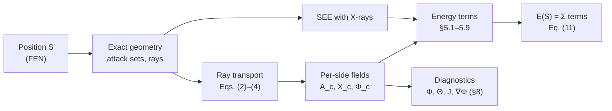

# 02 — Field Model and Energy Functional

> **Status:** Draft v0.1 · **Depends on:** [`../notation.md`](../notation.md)
> · **Resolves:** C-1, C-2, C-3, M-1, M-2, M-3, M-4, m-2 of
> [`01-proposal-review.md`](01-proposal-review.md)

This document specifies Nabla's static evaluation: the map $S \mapsto E(S)$ from a
position to a scalar energy in pawn units, and the per-side fields from which it
is computed. $E$ is **stateless**: it depends only on the information in a FEN.
Terminal states and game-history effects (repetition) are boundary conditions,
specified in [`03-move-selection.md`](03-move-selection.md).

---

## Contents

1. [Design principles](#1-design-principles)
2. [Preliminaries](#2-preliminaries)
3. [Pipeline overview](#3-pipeline-overview)
4. [Ray transport and fields](#4-ray-transport-and-fields)
5. [Energy functional](#5-energy-functional)
6. [Symmetry](#6-symmetry)
7. [Computation](#7-computation)
8. [Diagnostic fields](#8-diagnostic-fields)
9. [Parameter table](#9-parameter-table)
10. [Classical limits](#10-classical-limits)
11. [Analogy register](#11-analogy-register)
12. [Known limitations](#12-known-limitations)

---

## 1. Design principles

| ID | Principle | Consequence |
| --- | --- | --- |
| P1 | **Exact geometry.** The direct channel equals the pseudo-legal attack set. | SEE, checks, and king-zone pressure are computed from exact geometry; approximation lives only in weights. |
| P2 | **Per-side fields.** White and Black fields are stored separately. | Signs are combined only inside explicitly non-linear terms, so contested squares are never silently cancelled. |
| P3 | **Additive, interpretable energy.** $E$ is a sum of named terms. | Every evaluation and every move can be explained term by term (03 §6); every term can be ablated. |
| P4 | **Pawn units, named coefficients.** | All coefficients appear in §9 with an initial value, a range, and a tuning method. |
| P5 | **Classical limits.** Each term reduces to a recognised heuristic in a stated limit (§10). | The model generalises chess knowledge rather than discarding it, and each term is testable against its limit. |
| P6 | **Colour antisymmetry by construction.** | $E(\mathcal{F}S) = -E(S)$ holds exactly, including in floating point (§6). |
| P7 | **Bounded positional terms.** | No positional term can grow without limit; magnitudes are controlled by named coefficients. |

---

## 2. Preliminaries

### 2.1 Rays and the first blocker

For a sliding piece $p$ (bishop, rook, queen) and a direction $d$ in its direction
set ($D_R$: 4 orthogonal; $D_B$: 4 diagonal; $D_Q = D_R \cup D_B$), the **ray** is
the sequence of squares $i_1, i_2, \dots, i_L$ from $\sigma(p)$ to the board edge.
The **first-blocker index** is

```math
k^\star = \min \lbrace k : i_k \text{ is occupied} \rbrace, \qquad k^\star = L \text{ if the ray is empty.}
\tag{1}
```

Knights, kings, and pawns have no rays: each attacked square is a single step
($k = 1$) in the direct channel.

### 2.2 Line compatibility

A blocker $b$ on ray square $i_k$ is **line-compatible** with direction $d$ if $b$
is friendly to the emitter and can itself attack along $d$:

- $b \in \lbrace R, Q \rbrace$ and $d$ is orthogonal; or
- $b \in \lbrace B, Q \rbrace$ and $d$ is diagonal; or
- $b$ is a pawn and $d$ is one of that pawn's forward capture diagonals.

Line compatibility is what makes a battery: the rear piece supports the front
piece along the shared line.

---

## 3. Pipeline overview



---

## 4. Ray transport and fields

### 4.1 Transmittance

Influence travels along a ray and is attenuated by each piece it passes, in the
manner of light through a sequence of absorbers (Beer–Lambert law). The
**cumulative transmittance** at step $k$ is

```math
T_1 = 1, \qquad T_{k+1} = T_k \, \theta(i_k),
\tag{2}
```

where the **single-blocker transmission coefficient** depends on what occupies
$i_k$, relative to the emitter:

```math
\theta(i_k) =
\begin{cases}
1 & i_k \text{ empty, or occupied by the enemy king} \\
\theta_\text{bat} & \text{friendly piece, line-compatible (battery)} \\
\theta_\text{fr} & \text{friendly piece, not line-compatible} \\
\theta_\text{en} & \text{enemy piece other than pawn or king (pin, skewer)} \\
\theta_\text{ep} & \text{enemy pawn}
\end{cases}
\tag{3}
```

The enemy king is transparent because squares behind a king on an attacking line
remain unavailable to it. Propagation along a ray stops when $T_k < T_\text{min}$.
Influence also decays gently with distance,

```math
a(k) = \frac{1}{1 + \lambda (k - 1)},
\tag{4}
```

so that adjacent squares ($k = 1$) are unattenuated and leapers and sliders are
on a common scale.

### 4.2 Per-side fields

The **direct field** of colour $c$ sums each piece's influence over its exact
attack set:

```math
A_c(i) = \sum_{p \in \Pi_c} \alpha_{t(p)} \sum_{\text{rays of } p} \ \sum_{k \le k^\star} a(k)\, \mathbf{1}[i_k = i]
\;+\; \sum_{p \in \Pi_c^{N,K,P}} \alpha_{t(p)}\, \mathbf{1}[i \in \mathrm{Att}(p)].
\tag{5}
```

For $k \le k^\star$ every intermediate square is empty, so $T_k = 1$: the direct
channel is unattenuated except by distance, and its support
$\lbrace i : A_c(i) > 0 \rbrace$ equals the union of attack sets exactly
(principle P1).

The **X-ray field** carries influence beyond the first blocker:

```math
X_c(i) = \sum_{p \in \Pi_c^{B,R,Q}} \alpha_{t(p)} \sum_{\text{rays of } p} \ \sum_{k > k^\star} a(k)\, T_k\, \mathbf{1}[T_k \ge T_\text{min}]\, \mathbf{1}[i_k = i].
\tag{6}
```

The **influence field** combines both channels with an X-ray weight $\chi < 1$:

```math
\Phi_c = A_c + \chi X_c.
\tag{7}
```

### 4.3 Derived fields

```math
\Phi = \Phi_W - \Phi_B \qquad \text{(net potential; diagnostic)}
\tag{8}
```

```math
\Theta = \min(\Phi_W, \Phi_B) \qquad \text{(tension; diagnostic)}
\tag{9}
```

```math
\Omega = \tanh\!\left( \frac{\Phi_W - \Phi_B}{\Phi_0} \right) \in (-1, 1) \qquad \text{(control)}
\tag{10}
```

$\Phi$ and $\Theta$ exist for visualisation and analysis. Tension does **not** enter
the energy directly: whether a contested square favours either side is decided by
exchange resolution (§5.4), not by the amount of contest.

---

## 5. Energy functional

```math
E(S) = E_\text{mat} + E_\text{flux} + E_\text{terr} + E_\text{ex} + E_\text{king} + E_\text{trop} + E_\text{pawn} + E_\text{conf} + E_\text{tempo}.
\tag{11}
```

Several coefficients are **tapered** by the game phase

```math
\varphi = \min\!\left(1,\ \frac{N_N + N_B + 2N_R + 4N_Q}{24}\right),
\qquad x(\varphi) = \varphi\, x^\text{MG} + (1 - \varphi)\, x^\text{EG},
\tag{12}
```

where $N_t$ counts pieces of type $t$ of both colours.

### 5.1 Rest mass (material)

```math
E_\text{mat} = \sum_{p \in \Pi(S),\ t(p) \ne K} s_{c(p)}\, m_{t(p)}(\varphi), \qquad m_P \equiv 1.
\tag{13}
```

Fixing $m_P = 1$ defines the energy unit. Material is an explicit term, not a
by-product of field emission (resolves C-2).

### 5.2 Flux (safe mobility)

```math
E_\text{flux} = \sum_{p,\ t(p) \in \lbrace N,B,R,Q \rbrace} s_{c(p)}\, \mu_{t(p)}\, F_p,
\qquad
F_p = \left\lvert \mathrm{Att}(p) \setminus \left( \mathrm{Occ}_{c(p)} \cup \mathrm{PA}_{\bar{c}(p)} \right) \right\rvert .
\tag{14}
```

$F_p$ counts the field lines leaving $p$ that end on squares it could use without
being captured by a pawn: an outward flux, by analogy with Gauss's law.

### 5.3 Territory (saturating control)

```math
E_\text{terr} = \sum_{i \in \mathcal{B}} w(i)\, \Omega(i),
\qquad
w(i) = w_0 + w_c\, \frac{3 - d_c(i)}{3}.
\tag{15}
```

The weight is $w_0 + w_c$ on the four central squares and $w_0$ on the outer ring.
The term is bounded: $\lvert E_\text{terr} \rvert < 64 w_0 + 18.67 w_c$. Saturation
means a fifth attacker on an already controlled square adds little, which a linear
sum cannot express (resolves the linearity part of C-2).

### 5.4 Exchange energy

Let $g_c(i) = \max(0, \mathrm{SEE}_c(i))$ for $i \in \mathrm{Occ}_{\bar c}$ be the
gain for colour $c$ from capturing on square $i$, and let
$G_c^{(1)} \ge G_c^{(2)}$ be its two largest values over distinct squares ($0$ if
fewer exist). Then

```math
E_\text{ex} = s_\text{stm} \left[ \beta_1\, G^{(1)}_{\text{stm}} - \beta_2\, G^{(2)}_{\overline{\text{stm}}} \right].
\tag{16}
```

- The **side to move** can realise its best capture now. $\beta_1 < 1$ discounts
  the static estimate, which ignores replies away from the exchange square.
- The **side not to move** threatens captures, but the side to move can parry one
  threat. Only the second-largest threat (a fork) is realisable.
- At selection levels $L \ge 1$, $\beta_1 = 0$, because quiescence search resolves
  the side to move's captures explicitly (03 §4).

$\mathrm{SEE}$ is the standard swap algorithm: attackers in least-valuable-first
order, X-ray attackers revealed as pieces are removed, fixed values
$(1, 3, 3, 5, 9)$ for P, N, B, R, Q, and the king allowed to capture only as the
final, undefended capture. SEE values are fixed so that tactical accounting does
not drift during tuning. This term resolves C-3.

### 5.5 King safety (breakdown model)

The **king zone** $Z_c$ is the king's square, its king-move neighbours, and the
three squares two ranks in front of the king (files $f_K - 1$ to $f_K + 1$), clipped
to the board. The **pressure** on king $c$ is

```math
P_c = \sum_{i \in Z_c} \Phi_{\bar c}(i) + \omega_\text{chk}\, C_c,
\tag{17}
```

where $C_c$ counts **safe checking squares**: squares $i$, not occupied by
$\bar c$, that some piece $p \in \Pi_{\bar c}^{N,B,R,Q}$ attacks, from which a piece
of type $t(p)$ would attack $K_c$, and with $A_c(i) = 0$. Using $\Phi_{\bar c}$ (which
includes the X-ray channel) makes batteries aimed at the king count.

The **shelter** is an exponentially weighted count of the king's own pawns in front
of it, with $\delta_c = +1$ for White and $-1$ for Black:

```math
H_c = \sum_{f = f_K - 1}^{f_K + 1} \ \sum_{k=1}^{3} \nu_\text{sh}^{\,k-1}\ \mathbf{1}\!\left[ \text{own pawn on } (f,\ r_K + k\,\delta_c) \right].
\tag{18}
```

King danger is near zero while the shelter holds and grows rapidly once pressure
exceeds a threshold, by analogy with dielectric breakdown:

```math
E_\text{king} = -\sum_c s_c\, \Gamma_{\bar c}\ \sigma_b \mathrm{softplus}\!\left( \frac{P_c - \xi H_c - x_0}{\sigma_b} \right),
\qquad
\Gamma_{\bar c} = G_0\, \frac{\mathrm{NPM}_{\bar c}}{\mathrm{NPM}_0} \left( 1 + \gamma_Q\, \mathbf{1}[\bar c \text{ has a queen}] \right).
\tag{19}
```

$\mathrm{NPM}_0$ is the initial non-pawn material of one side under $m^\text{MG}$
(32.0 at the initial values of §9). Danger scales with the **attacker's** material
and queen presence (resolves M-4), and attraction of pieces toward the enemy king
arises because moves that raise $P_{\bar c}$ lower the opponent's energy
(resolves C-1).

### 5.6 Tropism and king activity

Zone-based pressure has zero gradient for pieces far from the enemy king. A weak,
long-range interaction supplies that gradient in the middlegame, and a
centralisation term activates the king in the endgame:

```math
E_\text{trop} = \varphi \sum_{p,\ t(p) \in \lbrace N,B,R,Q \rbrace} s_{c(p)}\, g_{t(p)}\, k_\text{s}\!\left( d_2(\sigma(p), K_{\bar c(p)}) \right)
+ (1 - \varphi) \sum_c s_c\, g_K\, \frac{3 - d_c(K_c)}{3},
\qquad
k_\text{s}(d) = \frac{1}{1 + (d / a_\text{s})^2}.
\tag{20}
```

$k_\text{s}$ is a softened inverse-square kernel with softening length $a_\text{s}$:
finite at $d = 0$ and with non-zero slope everywhere.

### 5.7 Pawns

**Passage transmittance.** Let $\Gamma(p)$ be the squares strictly in front of pawn
$p$ on its file, up to its promotion square $z_p$. The pawn's path is opaque where
enemy pawns stand on it, or attack it or the pawn itself:

```math
T^\text{pass}_p = \prod_{j \in \Gamma(p)} \left( 1 - \theta_\text{pp}\, \mathbf{1}[j \in \mathrm{Occ}^P_{\bar c}] \right)
\prod_{j \in \lbrace \sigma(p) \rbrace \cup \Gamma(p)} \left( 1 - \theta_\text{pp}\, \mathbf{1}[j \in \mathrm{PA}_{\bar c}] \right).
\tag{21}
```

With $\theta_\text{pp} = 1$, $T^\text{pass}_p \in \lbrace 0, 1 \rbrace$ equals the
classical passed-pawn predicate exactly: an enemy pawn in the pawn's front span
either occupies its file or attacks a square of $\lbrace \sigma(p) \rbrace \cup \Gamma(p)$.
With $\theta_\text{pp} < 1$, candidate passers receive partial credit.

**Rank potential** (bounded, unlike the proposal's unbounded exponential, M-3):

```math
h(\rho) = h_\text{max}(\varphi)\, \frac{e^{b_\rho \rho} - 1}{e^{6 b_\rho} - 1}, \qquad \rho \in \lbrace 1, \dots, 6 \rbrace.
\tag{22}
```

**Light cone (rule of the square).** Let $d_P(p) = 7 - \rho(p) - \mathbf{1}[\rho(p) = 1]$
be the moves the pawn needs to promote and $d_K = d_\infty(K_{\bar c}, z_p)$. When
the defender has no pieces, the pawn is unstoppable if the defending king lies
outside its light cone:

```math
u_p = \mathbf{1}[\mathrm{NPM}_{\bar c} = 0]\ \sigma_\text{L}\!\left( \frac{d_K - d_P(p) - \mathbf{1}[\text{stm} = \bar c] - \tfrac12}{\sigma_u} \right).
\tag{23}
```

**Pawn energy.** With $c = c(p)$, $s_p$ the stop square (directly in front of $p$),
and $b_p = \mathbf{1}[s_p \text{ occupied}]$ (blockade),

```math
E_\text{pawn} = \sum_{p,\ t(p) = P} s_{c(p)} \Big[
T^\text{pass}_p \left( 1 - \epsilon_\text{blk}\, b_p \right)
\Big( h(\rho_p) + U u_p + (1 - \varphi)\, \epsilon_K \big( d_\infty(K_{\bar c}, s_p) - d_\infty(K_c, s_p) \big) \Big)
+ \psi_b\, \mathbf{1}[\sigma(p) \in \mathrm{PA}_c] - \psi_i\, \mathbf{1}[p \text{ isolated}] - \psi_d\, \mathbf{1}[p \text{ doubled}]
\Big].
\tag{24}
```

A pawn is *isolated* if no friendly pawn stands on an adjacent file, and *doubled*
if a friendly pawn stands in front of it on the same file (only the rear pawn is
penalised, so each doubled pair counts once). The escort term rewards the
attacker's king for being nearer the stop square than the defender's king.

### 5.8 Confinement (endgame)

When one side is materially ahead in a reduced position, it should shrink the
region available to the defending king. Let $R_{\bar c}$ be the set of squares
reachable by king steps from $K_{\bar c}$ through squares that are not attacked by
$c$ ($A_c(i) = 0$) and not occupied by $\bar c$'s own pieces (computed as a
fixed-point bitboard flood fill). Let $\Delta_c$ be $c$'s material lead in rest-mass
units. Then

```math
E_\text{conf} = \sum_c s_c\, (1 - \varphi)\, \sigma_\text{L}\!\left( \frac{\Delta_c - \Delta_0}{\Delta_s} \right)
\left[ \zeta_1 \left( 1 - \frac{\lvert R_{\bar c} \rvert}{64} \right) + \zeta_2 \left( 1 - \frac{d_1(K_c, K_{\bar c})}{14} \right) \right].
\tag{25}
```

The flood fill is skipped when the gate is below $10^{-3}$, which is the common case.

### 5.9 Tempo

```math
E_\text{tempo} = s_\text{stm}\, \delta_\text{tempo}.
\tag{26}
```

### 5.10 Experimental terms (off by default)

These exist only for ablations (protocol §7). None is part of the default energy.

| Term | Source | Purpose |
| --- | --- | --- |
| Knight halo | Proposal, Step B | Tests whether second-order knight influence adds information. |
| Momentum $w_\text{mom} \vec v_m \cdot \vec M_p$ | Proposal, §3 | Tests H7; implemented in the selection layer because it needs history. |
| Charge-proportional control, $\alpha_t \propto q_t$ | Proposal, Step B | Tests whether control should grow (proposal) or shrink (chess intuition) with piece value. |
| Nabla-P | Proposal, §3, verbatim with the m-1 fix | The as-proposed baseline for H1. |

---

## 6. Symmetry

**Proposition (colour antisymmetry).** For the colour flip $\mathcal{F}$,

```math
E(\mathcal{F} S) = -E(S).
\tag{27}
```

*Argument.* Every term has the form $\sum_c s_c f(Q_c)$, where $Q_c$ is computed in
$c$-relative coordinates (relative rank $\rho$, forward direction $\delta_c$) from the
pieces of both colours. All geometric constructions (rays, attack sets, zones,
paths, flood fills) commute with $\mathcal{F}$, which maps $Q_W(S)$ to $Q_B(\mathcal{F}S)$
and flips $s_c$. $E_\text{ex}$ and $E_\text{tempo}$ depend on the side to move,
which $\mathcal{F}$ also swaps. $\square$

**Exactness in floating point.** Each term is computed as a White part minus a
Black part, using identical code paths on colour-relative inputs. Under $\mathcal{F}$
the two parts exchange bit-for-bit, so Eq. (27) holds **exactly**, not merely to a
tolerance. The file mirror $\mathcal{H}$ leaves $E$ invariant when no castling
rights remain.

**Test obligations:** per-term and total antisymmetry on at least 10,000 positions;
file-mirror invariance on castling-free positions (05 §7).

---

## 7. Computation

| Step | Operation | Cost driver |
| --- | --- | --- |
| 1 | Attack bitboards per piece (magic lookups); $\mathrm{Occ}_c$, $\mathrm{PA}_c$. | ≤ 32 lookups |
| 2 | Direct field $A_c$ from attack sets. | ≤ ~300 square updates |
| 3 | Ray walks beyond first blockers for $X_c$ until $T_k < T_\text{min}$. | ≤ 8 rays × 7 squares per slider |
| 4 | Flux counts (popcount). | ≤ 20 popcounts |
| 5 | SEE on every occupied square, with X-ray discovery. | ≤ 32 swap sequences |
| 6 | King zones, safe checks, shelter. | constant |
| 7 | Pawn front spans, passage, light cone. | ≤ 16 pawns |
| 8 | Confinement flood fill (only when gated on). | ≤ 64 dilations, usually skipped |

The estimated cost is 2–10 µs per position in optimised native Rust; this is
hypothesis P-1, measured under protocol §9. Fields use `f32`; terms are
accumulated per side in a fixed order, which makes results bit-identical between
native and WebAssembly builds (05 §6).

---

## 8. Diagnostic fields

These quantities are computed for visualisation and analysis. **None enters $E$.**

**Flux vectors (lines of force).** Each piece contributes its influence along the
unit direction $\hat{\mathbf d}$ of travel (for leapers and pawns, the unit vector
from $\sigma(p)$ to the target):

```math
\mathbf{J}_c(i) = \sum_{p \in \Pi_c} \alpha_{t(p)} \sum_{\text{rays}} \sum_{k} a(k)\, T^\text{eff}_k\, \hat{\mathbf d}\, \mathbf{1}[i_k = i],
\qquad
T^\text{eff}_k = \begin{cases} 1 & k \le k^\star \\ \chi\, T_k & k > k^\star \end{cases}
\tag{28}
```

Because transport is anisotropic (along rays only), the model's vector field is
**not** the gradient of a scalar potential. $\mathbf{J}_c$ is therefore the faithful
picture of where pressure points.

**Spatial gradient (terrain slope).** For completeness, the gradient of the net
potential uses central differences in the interior and one-sided differences at
the edges (resolves m-2):

```math
\partial_f \Phi(f, r) =
\begin{cases}
\tfrac{1}{2}\left[ \Phi(f+1, r) - \Phi(f-1, r) \right] & 0 < f < 7 \\
\Phi(1, r) - \Phi(0, r) & f = 0 \\
\Phi(7, r) - \Phi(6, r) & f = 7
\end{cases}
\tag{29}
```

and analogously for $\partial_r \Phi$. The **decision-relevant** vectors are the
move gradients $\nabla_m E$ of 03 §2, not $\nabla_{xy}\Phi$.

---

## 9. Parameter table

Tuning methods: **T** = Texel tuning on quiet labelled positions; **S** = SPSA on
match results; **F** = fixed. Initial values are physically and chessically
motivated starting points, not tuned results.

### 9.1 Material (8 tunable, 1 fixed)

| Symbol | Meaning | Initial (MG / EG) | Range | Tuning |
| --- | --- | --- | --- | --- |
| $m_P$ | Pawn rest mass (unit) | 1.0 / 1.0 | — | F |
| $m_N$ | Knight rest mass | 3.2 / 3.2 | [2.5, 4.0] | T |
| $m_B$ | Bishop rest mass | 3.3 / 3.4 | [2.5, 4.0] | T |
| $m_R$ | Rook rest mass | 5.0 / 5.2 | [4.0, 6.5] | T |
| $m_Q$ | Queen rest mass | 9.0 / 9.4 | [8.0, 11.0] | T |

### 9.2 Ray transport and control (13 tunable, 1 fixed)

| Symbol | Meaning | Initial | Range | Tuning |
| --- | --- | --- | --- | --- |
| $\alpha_P, \alpha_N, \alpha_B, \alpha_R, \alpha_Q, \alpha_K$ | Control weight per attacker type | 1.0, 0.8, 0.8, 0.6, 0.4, 0.5 | [0, 2] | T |
| $\lambda$ | Distance decay | 0.12 | [0, 0.5] | T |
| $\theta_\text{bat}$ | Transmission through a battery partner | 0.9 | [0, 1] | T |
| $\theta_\text{fr}$ | Transmission through other friendly pieces | 0.25 | [0, 1] | T |
| $\theta_\text{en}$ | Transmission through enemy pieces (pin channel) | 0.5 | [0, 1] | T |
| $\theta_\text{ep}$ | Transmission through enemy pawns | 0.1 | [0, 1] | T |
| $\chi$ | X-ray channel weight | 0.35 | [0, 1] | T |
| $\Phi_0$ | Control saturation scale | 1.0 | [0.2, 5] | T |
| $T_\text{min}$ | Ray cut-off | 0.05 | — | F |

### 9.3 Mobility and territory (6 tunable)

| Symbol | Meaning | Initial | Range | Tuning |
| --- | --- | --- | --- | --- |
| $\mu_N, \mu_B, \mu_R, \mu_Q$ | Value per safe square | 0.040, 0.035, 0.025, 0.012 | [0, 0.1] | T |
| $w_0$ | Base square weight | 0.02 | [0, 0.1] | T |
| $w_c$ | Centre bonus weight | 0.06 | [0, 0.2] | T |

### 9.4 Exchange (2 tunable)

| Symbol | Meaning | Initial | Range | Tuning |
| --- | --- | --- | --- | --- |
| $\beta_1$ | Realisable capture discount (Level 0 only) | 0.8 | [0, 1] | S |
| $\beta_2$ | Fork (second-threat) weight | 0.6 | [0, 1] | S |

### 9.5 King safety (7 tunable)

| Symbol | Meaning | Initial | Range | Tuning |
| --- | --- | --- | --- | --- |
| $G_0$ | King danger scale | 1.0 | [0, 4] | T |
| $\gamma_Q$ | Queen-presence amplification | 0.5 | [0, 2] | T |
| $x_0$ | Breakdown threshold | 3.0 | [0, 10] | T |
| $\sigma_b$ | Breakdown softness | 1.0 | [0.1, 4] | T |
| $\xi$ | Shelter weight | 0.8 | [0, 3] | T |
| $\nu_\text{sh}$ | Shelter decay per rank | 0.5 | [0, 1] | T |
| $\omega_\text{chk}$ | Weight per safe checking square | 0.5 | [0, 2] | T |

### 9.6 Tropism and king activity (6 tunable)

| Symbol | Meaning | Initial | Range | Tuning |
| --- | --- | --- | --- | --- |
| $g_N, g_B, g_R, g_Q$ | Tropism weight | 0.03, 0.02, 0.02, 0.05 | [0, 0.2] | T |
| $a_\text{s}$ | Softening length (squares) | 2.0 | [0.5, 6] | T |
| $g_K$ | Endgame king centralisation | 0.3 | [0, 1] | T |

### 9.7 Pawns (10 tunable, 1 fixed)

| Symbol | Meaning | Initial | Range | Tuning |
| --- | --- | --- | --- | --- |
| $h^\text{MG}_\text{max}, h^\text{EG}_\text{max}$ | Maximum passer bonus | 0.5, 1.5 | [0, 3] | T |
| $b_\rho$ | Rank growth rate | 0.6 | [0, 1.5] | T |
| $\theta_\text{pp}$ | Opacity of enemy pawn control on a path | 1.0 | [0.5, 1] | T |
| $\epsilon_\text{blk}$ | Blockade reduction | 0.3 | [0, 1] | T |
| $U$ | Unstoppable-passer bonus | 5.0 | [0, 8] | T |
| $\epsilon_K$ | Escort weight per square | 0.05 | [0, 0.3] | T |
| $\psi_b$ | Pawn-defended bonus | 0.05 | [0, 0.3] | T |
| $\psi_i$ | Isolated-pawn penalty | 0.15 | [0, 0.5] | T |
| $\psi_d$ | Doubled-pawn penalty | 0.15 | [0, 0.5] | T |
| $\sigma_u$ | Light-cone sharpness | 0.25 | — | F |

### 9.8 Confinement and tempo (5 tunable)

| Symbol | Meaning | Initial | Range | Tuning |
| --- | --- | --- | --- | --- |
| $\zeta_1$ | Region-area weight | 1.0 | [0, 3] | T |
| $\zeta_2$ | King-proximity weight | 0.3 | [0, 1] | T |
| $\Delta_0$ | Material lead at gate midpoint | 2.5 | [1, 5] | T |
| $\Delta_s$ | Gate width | 0.5 | [0.1, 2] | T |
| $\delta_\text{tempo}$ | Side-to-move bonus | 0.1 | [0, 0.3] | T |

**Total:** 57 tunable coefficients, 3 fixed coefficients ($m_P$, $T_\text{min}$,
$\sigma_u$), and the fixed SEE value vector. Selection-level constants (contempt,
mate value, score cap, temperature) are specified in 03 and 04.

---

## 10. Classical limits

| Term | Limit | Recovered heuristic |
| --- | --- | --- |
| $A_c$ | $\chi = 0$, $\lambda = 0$, $\alpha_t \equiv 1$ | Attack-count map |
| $E_\text{flux}$ | (as defined) | Safe mobility |
| $E_\text{terr}$ | $\Phi_0 \to 0$ | Weighted square ownership |
| $E_\text{ex}$ | $\beta_1 = 1$, $\beta_2 = 0$ | Stand-pat plus best SEE capture |
| $E_\text{king}$ | $\sigma_b \to 0$ | Thresholded linear king danger |
| $E_\text{king}$ | $x_0 \to -\infty$ | Linear king-zone pressure (as in FFCE) |
| $E_\text{trop}$ | (as defined) | King tropism |
| $T^\text{pass}_p$ | $\theta_\text{pp} = 1$ | Passed-pawn predicate (exact) |
| $u_p$ | $\sigma_u \to 0$ | Rule of the square |
| $E_\text{conf}$ | $\zeta_1 = 0$ | Mop-up evaluation |

The contribution is therefore not that these terms are new (most have classical
counterparts) but that the positional terms are functionals of **one** transport
model with shared, interpretable coefficients, which makes them explainable,
visualisable, and jointly tunable.

---

## 11. Analogy register

| Term | Analogy | What carries over | What does not |
| --- | --- | --- | --- |
| Transmittance | Beer–Lambert attenuation | Multiplicative attenuation through successive absorbers | Continuous media, wavelength dependence |
| $E_\text{mat}$ | Rest mass | A configuration-independent energy per particle | Mass–energy equivalence |
| $F_p$ | Gauss flux | Counting field lines leaving a source | Divergence theorem on a lattice |
| $E_\text{king}$ | Dielectric breakdown | An insulator holds until a threshold, then fails rapidly | Avalanche physics, hysteresis |
| $k_\text{s}$ | Softened gravity | Long-range, finite-at-origin attraction | Newtonian dynamics |
| $u_p$ | Light cone | A causal reachability bound in time steps | Relativity |
| $E_\text{conf}$ | Particle in a box | Energy rises as the accessible region shrinks | Quantisation |
| Level 1 (03) | Born–Oppenheimer separation | Fast variables (exchanges) relaxed for fixed slow variables (structure) | Adiabatic theorem guarantees |

---

## 12. Known limitations

These are expected weaknesses of a static evaluator; they are listed so that the
paper reports them and the protocol measures them.

1. SEE ignores pins of the capturing piece, overloaded defenders, and discovered
   attacks other than X-ray ordering.
2. $E_\text{ex}$ assumes one threat can always be parried; a trapped or pinned
   piece of the side to move is not penalised.
3. No specialised endgame knowledge (KBNK corner colour, fortresses, wrong-bishop
   draws, opposite-coloured bishops).
4. The light-cone term ignores obstruction by the attacker's own king and
   protected promotion squares.
5. Confinement ignores the defender's pawns.
6. The pawn-battery rule credits X-ray influence beyond the pawn's single
   capture square.

Levels 1 and 2 (03 §4) mitigate items 1 and 2; items 3–6 remain and are measured
by the endgame suites of protocol §8.
