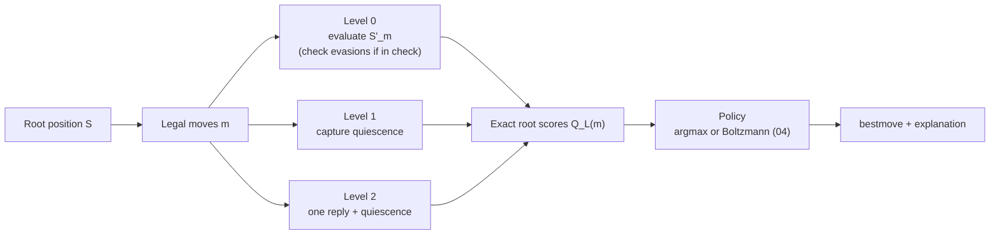

# 03 — Move Selection and Search Levels

> **Status:** Draft v0.2 (revised after the audits recorded in
> [`01b-second-proposal-review.md`](01b-second-proposal-review.md)) ·
> **Implemented in:** `crates/nabla-core/src/select.rs` · **Depends on:**
> [`02-field-model.md`](02-field-model.md) · **Resolves:** C-4, C-5, M-5, m-4 of
> [`01-proposal-review.md`](01-proposal-review.md)

The energy $E$ of document 02 scores positions. This document specifies how Nabla
turns those scores into a move: the discrete gradient that defines "descent", the
boundary conditions for terminal and repeated positions, and three precisely
defined **selection levels**. Strength control on top of the levels is in
[`04-strength-control.md`](04-strength-control.md).

---

## 1. Overview



---

## 2. The discrete gradient on the game graph

Positions are the vertices of the **game graph**; legal moves are its edges. The
side-to-move value is

```math
e(S) = s_{\text{stm}(S)}\, E(S). \qquad \text{(1)}
```

Because $`s_{\text{stm}(S'_m)} = -s_{\text{stm}(S)}`$, the mover's change in energy
along edge $m$ (from $S$ to $`S'_m`$) is

```math
\nabla_m E(S) = s_{\text{stm}(S)} \left[ E(S'_m) - E(S) \right] = -\,e(S'_m) - e(S). \qquad \text{(2)}
```

This is the graph gradient (the oriented incidence operator applied to $`E`$),
taken from the mover's side. Since $`e(S)`$ is the same for every move, maximising
$\nabla_m E$ is equivalent to maximising $`-e(S'_m)`$. Level 0 is therefore
**steepest ascent of the mover's energy over the neighbours of $S$ in the game
graph**, the precise sense in which Nabla "follows the gradient" (resolves C-4).
Scoring every child from the mover's side, rather than maximising a White-positive
score for both colours, is what keeps Black from playing for White (resolves C-5).
Because $E$ is a sum of terms, so is $\nabla_m E$; the per-term gradients are the
move's explanation (§6).

---

## 3. Boundary conditions

The value function $`v(S)`$ equals $`e(S)`$ except in the following states, which are
checked before evaluation. Checkmate takes precedence over the fifty-move rule.

| Condition | $`v(S)`$ for the side to move |
| --- | --- |
| Checkmate (side to move in check, no legal moves) | $`-(M_\text{mate} - \text{ply})`$ |
| Stalemate | $`d(S)`$ |
| Insufficient material (K v K, K+minor v K, bishops all on one colour; as implemented by `shakmaty`) | $`d(S)`$ |
| Fifty-move rule (half-move clock $`\ge 100`$) | $`d(S)`$ |
| Repetition: position already occurred in the game history or the current search path | $`d(S)`$ |

Here ply is the distance from the root, so faster mates score higher. The draw
value includes a **contempt** $\delta_\text{draw}$, where "the engine" is the side to
move at the root: $d(S) = -\delta_\text{draw}$ if the side to move in $S$ is the
engine, $+\delta_\text{draw}$ otherwise. The root itself is never scored as a draw.

**Why repetition counts at the first recurrence.** Returning to an earlier position
cannot achieve anything that was not available before. Scoring the first
recurrence as a draw (for game-history positions as well as the search path)
removes oscillation such as Nf3–g1–f3 without a history-dependent energy term,
which is why the proposal's momentum term is retained only as an ablation (resolves
M-5 and m-4). It is stricter than engines that require two prior occurrences for
game-history positions: a losing Nabla may steer towards a repetition that its
opponent can simply avoid. The rule affects move choice only; it does not claim
draws under the FIDE threefold rule.

---

## 4. Selection levels

Every level scores **every** root move with a full window, so all root scores are
exact (unless a node budget runs out, §7). This matters because the policy (04),
MultiPV, and explanations all use the scores of non-best moves; alpha-beta bounds
at the root would corrupt them.

### 4.1 Level 0 — field descent

$`Q_0(m) = -\,v(S'_m)`$, with the exchange term active ($\beta_1$, 02 §5.4).

**Check extension.** If $`S'_m`$ is in check (the move gives check), its value is the
best of the opponent's forced evasions:
$`v(S'_m) = \max_{r} \big[-v(S'_{m r})\big]`$ over the legal replies $r$, each
evaluated statically. A check usually leaves 1–6 replies, and without the extension
the commonest low-level tactic, a checking fork, is invisible: the opponent's
"parry" would be credited although the check forces the reply.

| Level 0 sees | Level 0 does not see |
| --- | --- |
| Material won immediately; mate in one; stalemates; repetitions | Mate threats against itself |
| Pieces it leaves en prise (opponent's $G^{(1)}$ in $`S'_m`$) | Tactics beyond one exchange square (deflection, discovered attack) |
| Forks it creates (its own $`G^{(2)}`$), including checking forks | Multi-move plans |

### 4.2 Level 1 — quiescent descent

$`Q_1(m) = -\,q(S'_m, 1, -\infty, +\infty)`$, where $q$ is a capture-only negamax
(quiescence search). It is **fail-soft** throughout, and its stand-pat value is
$`e(S)`$ evaluated with $\beta_1 = 0$:

```text
q(S, ply, α, β):
    if S is terminal (§3):                       return v(S)          # mate uses ply
    in_check ← side to move is in check
    if ply ≥ q_hard or (ply ≥ q_max and not in_check):   return e(S)
    best ← −∞
    if not in_check:
        best ← e(S)                                                  # stand pat, β₁ = 0
        if best ≥ β:                             return best
        α ← max(α, best)
        moves ← captures with SEE ≥ 0, and queen promotions          # MVV-LVA order
    else:
        moves ← all legal moves                                      # evasions, no stand-pat
    for m in moves:
        if not in_check and prunable(m) and e(S) + gain(m) + δ_margin < α:  continue
        s ← −q(S'_m, ply + 1, −β, −α)
        if s > best:
            best ← s
            if s ≥ β:                            break
            α ← max(α, s)
    return best
```

- `gain(m)` is the captured piece's SEE value plus 8 for a queen promotion.
- `prunable(m)` is false for promotions and for captures of the opponent's last
  non-pawn piece. Those captures switch on large endgame terms (the unstoppable
  passer bonus $`U`$), which the 2-pawn margin cannot cover.
- Underpromotions are excluded.
- Repetition is checked through the shared path of Zobrist keys, which spans the
  game history and the search path.

**Interpretation (analogy).** Exchanges are *fast* variables: large energy changes
completed within a few plies. Pawn structure, piece placement, and king shelter are
*slow* variables. Level 1 settles the fast variables for each candidate slow move,
in the spirit of the Born–Oppenheimer separation. The settling is an adversarial
minimax, not the minimisation of one energy. No quiet move beyond the root is ever
searched, so the choice among quiet moves remains a field decision.

### 4.3 Level 2 — reply-aware descent

```math
Q_2(m) = -\max_{r \in ℳ(S'_m)} \Big[ -\,q\big( S'_{m r}, 2, -\infty, -\beta_r \big) \Big], \qquad \text{(3)}
```

where $\beta_r$ is the best value found so far at $`S'_m`$: alpha-beta prunes only
**below** the root, inside each reply's quiescence search, so the maximum over
replies, and hence $`Q_2(m)`$, is exact. Replies are ordered captures first (MVV-LVA),
then quiet moves in generation order. Level 2 detects mate-in-one threats against
itself, most one-move blunders, and simple two-move tactics.

### 4.4 Summary

| Level | Tree | Quiet moves searched | Measured decision time (v0.1) |
| --- | --- | --- | --- |
| 0 | None, plus forced evasions after a check | Root only | 0.3 ms |
| 1 | Capture-only | Root only | 7.8 ms |
| 2 | Full width, depth 2, plus captures | Root and one reply | 14.6 ms |

Times are the mean per decision of `nabla bench <level>` (16 positions) on an Intel
i7-7700HQ, one thread. They satisfy hypothesis P-2 (protocol §2.3).

### 4.5 Research control (not a playing level)

**AB-*d*:** standard alpha-beta to depth $d$ with quiescence, using $E$ as the
evaluation. It is used only to measure evaluation quality independently of the
selection regime (hypothesis H8). It is not implemented in v0.1.

---

## 5. Policy

The root policy maps scores $`Q_L(m)`$ to a move:

- **Deterministic** ($`\tau = 0`$): argmax, ties broken by the lexicographic order of
  the move's UCI string, which is stable across library versions.
- **Stochastic** ($`\tau > 0`$): Boltzmann sampling, specified in 04.

---

## 6. Output and explanations

**UCI `info` lines.** `info depth <d> seldepth <s> multipv <k> score <score> nodes <n> nps <r> time <ms> pv <moves>`:

- `depth` is the nominal search depth in plies: 1 at Levels 0 and 1, 2 at Level 2.
- `nodes` counts every position visited below the root, each once.
- `score` is `cp <n>` (integer centipawns, unclipped) or `mate <n>`. Mate scores are
  those within 256 pawn units of $M_\text{mate}$; with $p$ plies to mate,
  $n = \lceil p/2 \rceil$ when winning and $-p/2$ when losing.
- With `MultiPV k`, the top $k$ candidates are reported, ranked by exact score.
- With $\tau > 0$, `info string` lines give the chosen move, its score and
  probability, and the policy entropy.

**Explanations.** For every level, a move's score equals the signed static value of
the leaf at the end of its principal variation: $`Q(m) = s_\text{mover} E(\text{leaf})`$.
The explanation is the per-term decomposition of
$s_\text{mover}\,[E(\text{leaf}) - E(S)]$, and its terms sum exactly to
$`Q(m) - e(S)`$. This is tested for all three levels. When the line ends in a
terminal state (mate, draw), the score is a boundary value rather than an energy,
and no explanation is given. The tempo term contributes $-2\delta_\text{tempo}$ when
the leaf has the opponent to move (always at Level 0) and 0 otherwise, and the
exchange term changes perspective in the same way; comparisons between moves are
therefore best read relative to the best move. Explanations are exposed by the
custom UCI command `explain` and by the planned WebAssembly API (05 §5).

---

## 7. Time management

Average decisions take milliseconds, but quiescence has no natural size limit, and
a rare tactical position can take far longer. The correctness gate (protocol §3)
showed this: without a budget, 6 of 1,000 Level 1 games and about 25 of 1,000
Level 2 games were lost on time at 2 s + 0.02 s per move. Decisions are therefore
budgeted in **nodes**, not time, which keeps them deterministic and keeps the core
free of clocks (WebAssembly has none).

- **Budget.** The UCI layer converts the clock into a node budget:
  $`\min(t/30 + \tfrac34\,\mathrm{inc},\ t/4)`$ minus 10 ms of overhead (or
  `movetime`), times a conservative 40 nodes per millisecond (measured speed is
  about 140). `go nodes N` sets the budget directly; `go infinite`, `go ponder`,
  analysis commands, `bench`, and tests have none.
- **Exhaustion.** Under a budget, root moves are searched in Level 0 order. If the
  budget runs out, the remaining root moves keep their Level 0 scores, and an
  `info string` says so. Scores are then a mixture of levels, which is acceptable
  only as a time emergency.
- **Safeguards.** If the remaining clock time is below 100 ms, Level 2 falls back to
  Level 1. Under `go infinite` and `go ponder`, `bestmove` is held until `stop` or
  `ponderhit`.

---

## 8. Selection constants

| Symbol | Meaning | Value | Tuning |
| --- | --- | --- | --- |
| $M_\text{mate}$ | Mate value (pawn units) | 1000 | F |
| $\delta_\text{draw}$ | Contempt (pawn units) | 0.15 | S |
| $q_\text{max}$ | Quiescence ply cap for captures | 16 | F |
| $q_\text{hard}$ | Hard ply cap, also for check evasions | 32 | F |
| $\delta_\text{margin}$ | Delta-pruning margin (pawn units) | 2.0 | F |

---

## 9. Positioning statement

For use in the paper, verbatim:

> Level 0 performs no lookahead beyond evaluating the position after each legal
> move, except that a checking move is followed by the opponent's forced evasions.
> Level 1 adds capture-only quiescence and never searches a quiet move beyond the
> root. Level 2 adds a single full-width reply. No level uses iterative deepening
> or a transposition table, and no level searches quiet moves deeper than one
> reply. Every root move receives an exact score unless a node budget runs out.
> All results are reported separately for each level.
