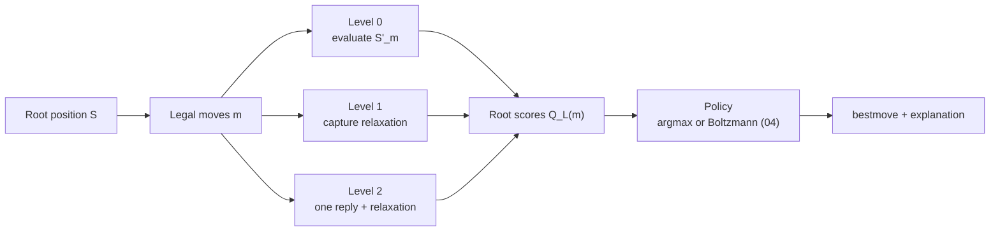

# 03 — Move Selection and Search Levels

> **Status:** Draft v0.1 · **Depends on:** [`02-field-model.md`](02-field-model.md)
> · **Resolves:** C-4, M-5, m-4 of [`01-proposal-review.md`](01-proposal-review.md)

The energy $E$ of document 02 scores positions. This document specifies how Nabla
turns those scores into a move: the discrete gradient that defines "descent", the
boundary conditions for terminal and repeated positions, and three precisely
defined **selection levels**. Strength control on top of the levels is in
[`04-strength-control.md`](04-strength-control.md).

---

## 1. Overview



---

## 2. The discrete gradient on the game graph

Positions are the vertices of the **game graph**; legal moves are its edges. The
side-to-move value is

```math
e(S) = s_{\text{stm}(S)}\, E(S).
\tag{1}
```

For a move $m$ from $S$ to $S'_m$, the mover's change in energy is the **discrete
gradient of $E$ along edge $m$**:

```math
\nabla_m E(S) = s_{\text{stm}(S)} \left[ E(S'_m) - E(S) \right] = -\,e(S'_m) - e(S).
\tag{2}
```

Since $e(S)$ is the same for every move, maximising $\nabla_m E$ is equivalent to
maximising $-e(S'_m)$. Level 0 is therefore **steepest ascent of the mover's
energy over the neighbours of $S$ in the game graph**, which is the precise sense
in which Nabla "follows the gradient" (resolves C-4). Because $E$ is a sum of
terms, so is $\nabla_m E$; the per-term gradients are the move's explanation (§6).

---

## 3. Boundary conditions

The value function $v(S)$ equals $e(S)$ except in the following states, which are
checked before evaluation:

| Condition | $v(S)$ for the side to move |
| --- | --- |
| Checkmate (side to move in check, no legal moves) | $-(M_\text{mate} - \text{ply})$ |
| Stalemate | $d(S)$ |
| Insufficient material (K v K, K+minor v K, K+B v K+B with same-coloured bishops) | $d(S)$ |
| Fifty-move rule (half-move clock $\ge 100$, not checkmate) | $d(S)$ |
| Repetition: position already occurred in the game history or the current search path | $d(S)$ |

Here ply is the distance from the root, so faster mates score higher, and the draw
value includes a **contempt** $\delta_\text{draw}$ from the engine's perspective:
$d(S) = -\delta_\text{draw}$ if the side to move is the engine, $+\delta_\text{draw}$
otherwise.

**Why repetition counts at the first recurrence.** Returning to an earlier position
cannot achieve anything that was not available before. Scoring the first recurrence
as a draw (standard engine practice) removes oscillation such as Nf3–g1–f3 without a
history-dependent energy term, which is why the proposal's momentum term is
retained only as an ablation (resolves M-5 and m-4). This rule affects move choice
only; it does not claim draws under the FIDE threefold rule.

---

## 4. Selection levels

### 4.1 Level 0 — field descent

```math
Q_0(m) = -\,v(S'_m).
```

The exchange term is active with its tuned $\beta_1$ (02 §5.4).

| Level 0 sees | Level 0 does not see |
| --- | --- |
| Material won immediately; mate in one; stalemates; repetitions | Mate threats against itself |
| Pieces it leaves en prise (opponent's $G^{(1)}$ in $S'_m$) | Tactics beyond one exchange square (deflection, discovered attack) |
| Forks it creates (its own $G^{(2)}$ in $S'_m$) | Multi-move plans |

### 4.2 Level 1 — quiescent descent

```math
Q_1(m) = -\,q(S'_m, -\infty, +\infty),
```

where $q$ is a capture-only negamax (quiescence search) with stand-pat value
$e(S)$ evaluated with $\beta_1 = 0$:

```text
q(S, α, β):
    if S is terminal (§3):        return v(S)
    if side to move is in check:  moves ← all legal moves          # evasions, no stand-pat
    else:
        stand ← e(S)                                                # β₁ = 0
        if stand ≥ β:             return stand
        α ← max(α, stand)
        moves ← captures and queen promotions with SEE ≥ 0, MVV-LVA order
    for m in moves:
        if not in check and stand + gain(m) + δ_margin < α:  continue    # delta pruning
        score ← −q(S'_m, −β, −α)
        if score ≥ β:             return score
        α ← max(α, score)
    return α
```

Recursion stops at $q_\text{max}$ plies, where the stand-pat value is returned.

**Interpretation (analogy).** Exchanges are *fast* variables: large energy changes
completed within a few plies. Pawn structure, piece placement, and king shelter are
*slow* variables. Level 1 relaxes the fast variables to equilibrium for each
candidate slow move, in the spirit of the Born–Oppenheimer separation. No quiet
move beyond the root is ever searched, so the choice among quiet moves remains a
field decision.

### 4.3 Level 2 — reply-aware descent

```math
Q_2(m) = -\max_{m' \in \mathcal{M}(S'_m)} \left[ -\,q\!\left( S'_{m m'}, -\infty, +\infty \right) \right],
```

computed by alpha-beta negamax of depth 2 with quiescence at the leaves. Moves at
both plies are ordered captures first (MVV-LVA), then quiet moves by their Level 0
score: the energy gradient doubles as the move-ordering heuristic. Level 2 detects
mate-in-one threats against itself, most one-move blunders, and simple two-move
tactics.

### 4.4 Summary

| Level | Tree | Quiet moves searched | Evaluations per decision (estimate) | Latency at 5 µs per evaluation (estimate) |
| --- | --- | --- | --- | --- |
| 0 | None | Root only | ≈ 35 | ≈ 0.2 ms |
| 1 | Capture-only | Root only | ≈ 35 × 10 | ≈ 2 ms |
| 2 | Full width, depth 2, plus captures | Root and one reply | ≈ 35 × 35 × 5 before pruning | ≈ 10–30 ms |

The estimates are hypothesis P-2 (protocol §9).

### 4.5 Research control (not a playing level)

**AB-*d*:** standard alpha-beta to depth $d$ with quiescence, using $E$ as the
evaluation. It is used only to measure evaluation quality independently of the
selection regime (hypothesis H8) and is exposed solely through a hidden UCI option
(05 §4).

---

## 5. Policy

The root policy maps scores $Q_L(m)$ to a move:

- **Deterministic** ($\tau = 0$): argmax, ties broken by the lexicographic order of
  the move's UCI string, which is stable across library versions.
- **Stochastic** ($\tau > 0$): Boltzmann sampling, specified in 04.

---

## 6. Output and explanations

**UCI.** `info depth <L> seldepth <max quiescence ply> nodes <evaluations> score cp <100·Q> pv <move>`.
With `MultiPV k`, the top $k$ candidates are reported. Scores within 256 pawn units
of $M_\text{mate}$ are reported as `score mate <n>`.

**Explanations.** For Level 0, a move's explanation is the per-term decomposition of
$\nabla_m E$. For Levels 1 and 2, the score equals the (signed) value of a leaf
position on the principal variation, so the explanation is the per-term
decomposition of $E(\text{leaf}) - E(S)$, signed for the mover. Explanations are
therefore exact, not post-hoc approximations. They are exposed by the custom UCI
command `explain` and by the WebAssembly API (05 §5).

---

## 7. Time management

Levels 0 and 1 finish far below the minimum move time of any practical time
control, so clock information is used only as a safeguard: if the remaining clock
time is below 100 ms, Level 2 falls back to Level 1. Selection runs on a worker
thread so that `stop` is honoured immediately; root moves are evaluated in Level 0
order, so a partial result is meaningful.

---

## 8. Selection constants

| Symbol | Meaning | Value | Tuning |
| --- | --- | --- | --- |
| $M_\text{mate}$ | Mate value (pawn units) | 1000 | F |
| $\delta_\text{draw}$ | Contempt (pawn units) | 0.15 | S |
| $q_\text{max}$ | Quiescence ply cap | 16 | F |
| $\delta_\text{margin}$ | Delta-pruning margin (pawn units) | 2.0 | F |

---

## 9. Positioning statement

For use in the paper, verbatim:

> Level 0 performs no lookahead beyond evaluating the position after each legal
> move, the minimum for any evaluation-driven move chooser. Level 1 adds
> capture-only relaxation and never searches a quiet move beyond the root. Level 2
> adds a single full-width reply. No level uses iterative deepening or a
> transposition table, and no level searches quiet moves deeper than one reply.
> All results are reported separately for each level.
