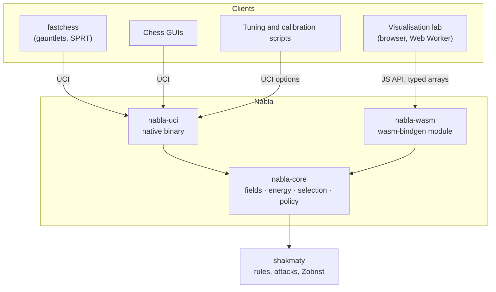

# 05 — System Architecture

> **Status:** Draft v0.1 · **Depends on:** 02, 03, 04 · **Decisions:** D-005,
> D-008, D-010 in [`../decisions.md`](../decisions.md)

Nabla is one Rust engine core compiled to two targets: a native command-line
binary that speaks UCI (for match runners and GUIs) and a WebAssembly module (for
the visualisation lab). Both targets run the **same code** and must produce
**bit-identical** analyses.

---

## 1. Goals and constraints

| ID | Goal or constraint |
| --- | --- |
| A1 | One core, two targets: native UCI and `wasm32-unknown-unknown`. |
| A2 | Bit-identical evaluation, selection, and sampling across targets (§6). |
| A3 | The core performs no I/O, has no global state, and contains no `unsafe` code of its own. |
| A4 | Every coefficient comes from one parameter set with a stable hash (02 §9, 04 §4.2). |
| A5 | Every evaluation is explainable term by term (03 §6). |
| A6 | Correctness is enforced by automated tests in CI before any strength claim (§7). |

---

## 2. System context



---

## 3. Repository layout (planned)

```text
Nabla/
├── Cargo.toml                 # workspace
├── crates/
│   ├── nabla-core/            # library: no I/O, forbid(unsafe_code)
│   │   └── src/
│   │       ├── board.rs       # adapter over shakmaty: attacks, occupancy, SEE
│   │       ├── transport.rs   # rays, transmittance, per-side fields (02 §4)
│   │       ├── energy/        # one module per term (02 §5) + decomposition
│   │       ├── select/        # boundary conditions, levels 0–2 (03)
│   │       ├── policy.rs      # Boltzmann policy, counter-based RNG (04 §2)
│   │       ├── diag.rs        # diagnostic fields J and ∇Φ (02 §8)
│   │       └── params.rs      # parameter set, defaults, canonical hash
│   ├── nabla-uci/             # binary: UCI loop, options, custom commands
│   └── nabla-wasm/            # cdylib: wasm-bindgen API for the lab
├── params/default.toml        # the parameter set of 02 §9
├── calibration/elo-map.toml   # strength calibration (04 §4)
├── tools/                     # tuning, calibration, and analysis scripts
├── web/                       # visualisation lab (06)
└── docs/
```

The board library sits behind `board.rs`, so replacing it touches one module
(decision D-005).

---

## 4. Native UCI binary

**Standard commands:** `uci`, `isready`, `ucinewgame`, `setoption`,
`position [startpos | fen <FEN>] [moves …]`, `go` (time controls and `infinite`;
`depth` is ignored because levels replace depth), `stop`, `quit`.

**Public options:** as listed in 04 §5.

**Hidden options** (not shown by `uci`, accepted by `setoption`):

| Option | Purpose |
| --- | --- |
| `Param_<symbol>` | Integer-scaled ($\times 1000$) override of any coefficient in 02 §9, for SPSA. |
| `ParamsFile` | Load a complete parameter set from TOML. |
| `ResearchDepth` | Enables the AB-*d* research control (03 §4.5); `0` disables. |
| `Ablate_<term>` | Disables one energy term, or enables one experimental term (02 §5.10). |

**Custom commands** (not part of UCI; for analysis and tests):

| Command | Output |
| --- | --- |
| `eval` | Energy decomposition of the current position, per term and per side. |
| `explain [n]` | The top $n$ candidates with per-term gradients (03 §6). |
| `fields` | The per-side fields as 8×8 tables. |
| `bench` | Fixed 50-position suite: total evaluations and an energy checksum. |

The `bench` checksum changes whenever evaluation behaviour changes. Commits that
change it state the new value in the commit message, so unintended behavioural
changes are caught in review (a practice adopted from Stockfish development).

---

## 5. WebAssembly API

The lab runs the module inside a **Web Worker** so analysis never blocks rendering.
The interface, shown from the JavaScript side:

```ts
class FieldEngine {
  constructor(paramsToml?: string);
  analyze(fen: string, history: string[], options: AnalyzeOptions): Analysis;
  explainSquare(fen: string, square: number): Source[];   // who contributes to one square
  setParam(symbol: string, value: number): void;
  params(): ParamInfo[];            // symbol, value, range, group: drives the sliders
}

interface AnalyzeOptions {
  level: 0 | 1 | 2;
  temperature: number;              // pawn units
  seed: number;
  multiPv: number;
}

interface Analysis {
  bestMove: string;                 // UCI notation
  candidates: Candidate[];          // sorted by score
  energy: Terms & { total: number };
  fields: {                         // Float32Array(64) each, LERF order (a1 = 0)
    directW: Float32Array;  directB: Float32Array;
    xrayW: Float32Array;    xrayB: Float32Array;
    net: Float32Array;      tension: Float32Array;  control: Float32Array;
    fluxWx: Float32Array;   fluxWy: Float32Array;
    fluxBx: Float32Array;   fluxBy: Float32Array;
    gradX: Float32Array;    gradY: Float32Array;
  };
  diagnostics: {
    kingPressure: [number, number]; // P_W, P_B (02 Eq. 17)
    shelter: [number, number];      // H_W, H_B (02 Eq. 18)
    passage: Float32Array;          // T^pass on squares holding a pawn, else 0 (02 Eq. 21)
    unstoppable: Float32Array;      // u_p on squares holding a pawn, else 0 (02 Eq. 23)
    confinement: Uint8Array;        // 1 on the defending king's region R (02 §5.8)
  };
  meta: { level: number; nodes: number; paramsHash: string; engineVersion: string };
}

interface Source {
  from: number;                     // square of the contributing piece
  piece: string;                    // e.g. "wQ"
  channel: "direct" | "xray";
  value: number;                    // contribution to Φ_c on the queried square
}

interface Candidate {
  uci: string;  san: string;
  q: number;                        // root score, pawn units, mover's perspective
  prob: number;                     // Boltzmann probability (04 §2)
  terms: Terms;                     // per-term gradient (03 §6)
  pv: string[];                     // principal variation (levels 1–2)
}

interface Terms {
  mat: number; flux: number; terr: number; ex: number; king: number;
  trop: number; pawn: number; conf: number; tempo: number;
}
```

Typed arrays are transferred, not copied, between the worker and the page.

---

## 6. Determinism and numerics

Bit-identical results across targets (A2) rest on five rules:

1. **`f32` everywhere in evaluation**, with no fused multiply-add. Rust does not
   contract floating-point operations by default, and baseline WebAssembly has no
   fused operations.
2. **Fixed iteration order.** Pieces, rays, and squares are iterated in LERF order;
   no hash-map iteration occurs on evaluation paths.
3. **Per-side accumulation.** Each term is computed as White part minus Black part
   with identical code paths, which also makes colour antisymmetry exact (02 §6).
4. **Counter-based randomness** keyed by seed, position hash, and ply (04 §2).
5. **Canonical parameter hash:** SHA-256 of the canonical TOML serialisation of the
   parameter set, reported as its first 12 hexadecimal digits.

---

## 7. Testing strategy

| Layer | Test | Mechanism |
| --- | --- | --- |
| Rules | Perft on standard positions | Library perft through the adapter |
| Transport | Hand-computed fields for curated positions (battery, pin, X-ray through the king, pawn battery) | Golden unit tests |
| Energy | Exact per-term colour antisymmetry; file-mirror invariance; classical limits of 02 §10 | Property tests over random legal positions |
| SEE | Standard SEE positions, including X-ray recaptures | Unit tests |
| Selection | Mate in one found at every level; no stalemate when winning; repetition avoided when ahead; mate-in-one threat detected at Level 2 | Unit tests |
| Policy | $\tau = 0$ determinism; same seed gives the same move; sample frequencies match $\pi_\tau$ | Statistical unit tests |
| Protocol | UCI compliance | `fastchess --compliance` |
| Cross-target | Native and WebAssembly analyses bit-identical on a 1,000-position golden set | Test harness running both builds |
| Regression | `bench` checksum matches the committed value | CI |
| Calibration | `elo-map.toml` hash equals the current parameter hash | CI |

All rows run in continuous integration (GitHub Actions) alongside `cargo fmt` and
`cargo clippy -D warnings`; the workflow is created in Milestone 1.

---

## 8. Performance budget

| Quantity | Budget (native, one thread) | Hypothesis |
| --- | --- | --- |
| One evaluation (fields + energy) | ≤ 10 µs | P-1 |
| Level 0 decision | ≤ 1 ms | P-2 |
| Level 1 decision | ≤ 10 ms | P-2 |
| Level 2 decision | ≤ 100 ms | P-2 |
| WebAssembly slowdown vs native | ≤ 3× | P-3 |
| Lab re-analysis at Level 0 after a slider change | ≤ 16 ms (one frame at 60 Hz) | P-3 |

Budgets are acceptance limits, not predictions; measured values are reported under
protocol §9. Incremental field updates are **not** planned: full recomputation fits
the budget, and incremental schemes would complicate exactness (A2).

---

## 9. Error handling

- **UCI:** malformed input (invalid FEN, illegal move, unknown option) produces
  `info string error: <reason>` and leaves the previous state unchanged. The loop
  never panics on external input; all parsing returns `Result`.
- **WebAssembly:** errors surface as JavaScript exceptions with the same messages.
- **Core:** functions take validated positions (the adapter enforces legality), so
  the core has no error paths for impossible states.

---

## 10. Dependencies

| Crate | Role | Licence | Status (2026-11-16) |
| --- | --- | --- | --- |
| `shakmaty` | Rules, attacks, FEN/SAN/UCI parsing, Zobrist hashing | GPL-3.0-or-later | 0.30.2, maintained |
| `serde`, `toml` | Parameter files | MIT / Apache-2.0 | Planned |
| `wasm-bindgen`, `js-sys` | WebAssembly bindings | MIT / Apache-2.0 | Maintained under the `wasm-bindgen` organisation |
| `proptest` | Property tests (development only) | MIT / Apache-2.0 | Planned |

All licences are compatible with GPL-3.0-or-later (decision D-008). New
dependencies require a decision-log entry.
