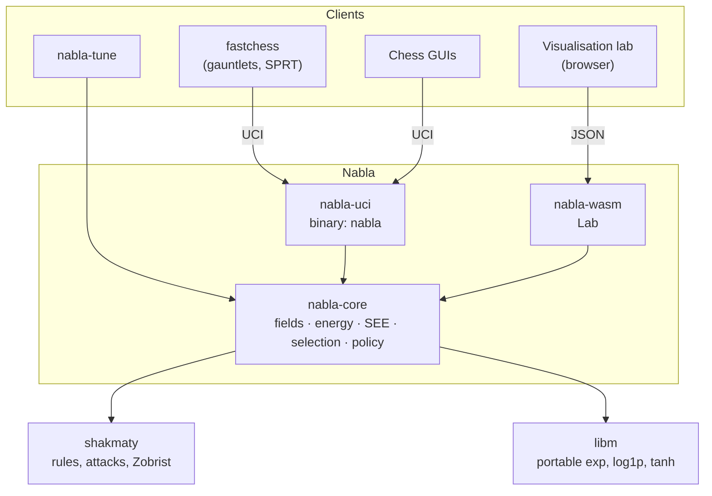

# 05 — System Architecture

> **Status:** Draft v0.3 · **Implemented:** native UCI engine, the `nabla-wasm` lab
> package, and the Astro page in `web/` · **Depends on:** 02, 03, 04 · **Decisions:**
> D-005, D-008, D-010 in [`../decisions.md`](../decisions.md)

Nabla is one Rust engine core compiled to two targets: a native command-line
binary that speaks UCI (for match runners and GUIs) and a WebAssembly module (for
the visualisation lab). Both targets run the **same code** and must produce
**bit-identical** analyses.

---

## 1. Goals and constraints

| ID | Goal or constraint |
| --- | --- |
| A1 | One core, two targets: native UCI and `wasm32-unknown-unknown`. |
| A2 | Bit-identical evaluation, selection, and sampling across targets (§6). |
| A3 | The core performs no I/O, has no global state, and contains no `unsafe` code of its own (`#![forbid(unsafe_code)]`). |
| A4 | Every coefficient comes from one parameter set with a stable hash (02 §9, 04 §4.2). |
| A5 | Every evaluation is explainable term by term (03 §6). |
| A6 | Correctness is enforced by automated tests before any strength claim (§7). |

---

## 2. System context



---

## 3. Repository layout

```text
Nabla/
├── Cargo.toml                   # workspace (edition 2024, MSRV 1.97)
├── crates/
│   ├── nabla-core/              # library: no I/O, forbid(unsafe_code)
│   │   ├── src/
│   │   │   ├── board.rs         # adapter over shakmaty: relative iteration, phase, flip
│   │   │   ├── transport.rs     # rays, transmittance, per-side fields (02 §4)
│   │   │   ├── see.rs           # static exchange evaluation (02 §5.4)
│   │   │   ├── energy/          # one module per term (02 §5) + decomposition
│   │   │   ├── select.rs        # boundary conditions, levels 0–2 (03)
│   │   │   ├── policy.rs        # Boltzmann policy, counter-based RNG (04 §2)
│   │   │   ├── params.rs        # the 57 coefficients, fixed constants, hash
│   │   │   └── snapshot.rs      # the picture the lab paints
│   │   └── tests/               # invariant tests (§7)
│   ├── nabla-uci/               # binary `nabla`: UCI loop, options, analysis commands
│   ├── nabla-wasm/              # `Lab` for the page (05 §5)
│   └── nabla-tune/              # coordinate descent; prints a fit, does not install it
├── web/                         # Astro lab (decision D-012)
└── docs/
```

Still planned: `params/*.toml` (Milestone 4), `calibration/elo-map.toml`
(Milestone 5). The board library sits behind `board.rs`, so replacing it touches
one module (decision D-005).

---

## 4. Native UCI binary

**Standard commands:** `uci`, `isready`, `ucinewgame`, `setoption`,
`position [startpos | fen <FEN>] [moves …]`, `go`, `stop`, `ponderhit`, `quit`.
`go` accepts every standard limit. The clock (`wtime`, `btime`, `winc`, `binc`),
`movetime`, or `nodes` becomes a node budget for the core (03 §7); `depth` and
`mate` are accepted and ignored. Under `go infinite` or `go ponder` there is no
budget and `bestmove` is held until `stop` or `ponderhit`. With no legal moves the
reply is `bestmove 0000`.

**Public options:** as listed in 04 §5.

**Hidden options** (not shown by `uci`, accepted by `setoption`):

| Option | Purpose | Status |
| --- | --- | --- |
| `Param_<symbol>` | Integer-scaled ($`\times 1000`$) override of any coefficient in 02 §9, for SPSA. | Implemented |
| `Ablate_<term>` | `true` disables one energy term (`mat`, `flux`, `terr`, `ex`, `king`, `trop`, `pawn`, `conf`, `tempo`). | Implemented |
| `ParamsFile` | Load a complete parameter set from TOML. | Milestone 4 |
| `ResearchDepth` | Enables the AB-*d* research control (03 §4.5). | Milestone 7 |

**Analysis commands** (not part of UCI):

| Command | Output |
| --- | --- |
| `eval` | Energy decomposition of the current position, per term. |
| `explain [n]` | The top $n$ candidates with score, probability, and per-term gradient (03 §6). |
| `fields` | The influence fields and the control field as 8×8 tables. |
| `bench [level]` | Fixed 16-position suite at the given level (default 2): nodes, evaluations, speed, mean decision time, move checksum, parameter hash. Also runs as `nabla bench [level]`. |
| `d` | The current position as FEN. |

The Level 2 `bench` checksum changes whenever evaluation or search behaviour
changes. Commits that change it state the new value as `Bench: <checksum>`, so
unintended behavioural changes are caught in review (a practice adopted from
Stockfish development).

---

## 5. WebAssembly API

`crates/nabla-wasm` exposes one `Lab` object to the page. It keeps the game, so
the page does not implement chess rules. Analysis runs on the page thread. A
Level 2 opening decision is a few milliseconds, so a worker is not used yet.

| Method | Effect |
| --- | --- |
| `new Lab()` | Start position, Level 2, temperature 0. |
| `set_level(0\|1\|2)`, `set_temperature(pawns)` | The next analysis uses these. |
| `fen()`, `turn()`, `moves()` | Position, side to move, and legal moves as JSON `{uci, san, from, to}`. |
| `push(uci)` | Play a legal move, including a promotion such as `e7e8q`. |
| `replay(start_fen, uci_moves)` | Rebuild position and repetition history from `start_fen` and space-separated UCI moves without advancing the policy's game counter (used for undo and move scrubbing). |
| `reset()`, `load(fen)` | New game, or a FEN. Each one advances the policy's game counter. |
| `view()` | JSON for the HUD (using `realisable_capture = true` only at Level 0, matching selection): turn, `state`, `detail` (play, check, checkmate, stalemate, material, fifty, or repetition), the nine energy terms, and 64-length `control`, `tension`, and `threats` arrays (a1 = 0). |
| `explain_square(sq)` | JSON `{square, direct: {white, black}, xray: {white, black}}` listing ray-transport and attack contributors (`role`, `square`, `weight`) bearing on LERF square `sq`. |
| `analyze()` | JSON `{best, level, nodes, candidates}`. Each candidate has `uci`, `san`, `q`, `prob`, and `terms` (null when the line is mate or a draw). |

`view` is the current position. `analyze` is the move choice. The page draws
control, tension, hanging pieces, and the candidate arrows from those two calls.
Flux lines, the king-pressure gauge, pawn cones, and confinement are not in this
build.

Build it with `npm run engine --prefix web`. The generated files are committed
in `web/src/engine`, so the page can be built where Rust is not installed.
Regenerate them after a change to the engine.

---

## 6. Determinism and numerics

Bit-identical results across targets (A2) and exact colour antisymmetry (02 §6)
rest on six rules, all followed by the v0.1 code:

1. **`f32` in evaluation, no fused multiply-add.** Rust does not contract
   floating-point operations by default, and baseline WebAssembly has no fused
   operations.
2. **Colour-relative iteration.** Each side visits its pieces and squares in its
   own relative order (`board::rel_squares`), ray directions are stored in relative
   form, and ties that change results are broken in relative order. No hash-map
   iteration occurs on evaluation paths.
3. **Per-side accumulation.** Each term is computed as a White part minus a Black
   part with identical code paths.
4. **Portable transcendental functions.** `exp`, `expm1`, `log1p`, and `tanh` come from the
   `libm` crate, never from `std`, whose implementations differ between native
   targets and WebAssembly. `powi` is not used; `sqrt` and the basic operations are
   correctly rounded everywhere.
5. **Counter-based randomness** keyed by seed, game counter, position hash, and
   ply (04 §2).
6. **Parameter hash:** FNV-1a (64-bit) over the canonical `name=value`
   serialisation of the parameter set, printed as 16 hexadecimal digits. It
   identifies a parameter set; it is not a security hash.

---

## 7. Testing strategy

All tests run with `cargo test --release` (the random-position tests are heavy in
debug builds).

| Layer | Test (v0.1) | File |
| --- | --- | --- |
| Parameters | 57 tunable coefficients; valid `Params::range` bounds from 02 §9; hash changes with any coefficient; $`\mathrm{NPM}_0 = 32`$ | `tests/params.rs` |
| Classical limits | Six analytical limit checks of 02 §10 (no-ray material limit, weak-attenuation limit, `b_rho = 0` continuity, etc.) | `tests/classical_limits.rs` |
| SEE | Reference positions (undefended capture; defended capture losing 2 through X-ray recaptures; multi-ply swap; en passant; promotion capture); the king cannot capture a defended piece | `tests/exchange_and_fields.rs` |
| Transport | Field support within the attack sets; battery and blocker transmission values; `square_sources` ray attributions | `tests/exchange_and_fields.rs` |
| Pawns | Front-span predicate equals the attack-based characterisation of Eq. (21) on random positions; an adjacent defending king with the move stops an unstoppable passer; `n_p = 0` gate on unstoppable-passer bonus | `tests/exchange_and_fields.rs`, `tests/selection.rs` |
| Exchange | Capture and parry are exclusive; a side in check cannot parry; Level ≥ 1 reduces to the fork term | `src/energy/exchange.rs` (unit) |
| Symmetry | Exact per-term colour antisymmetry on more than 10,000 random positions, with and without the realisable-capture term; file-mirror invariance to $10^{-4}$ | `tests/symmetry.rs` |
| Selection | Mate in one found at every level; no stalemate when winning; Level 2 never allows an avoidable mate in one; Level 0 finds a checking fork; repetition scored as a draw with contempt; node-budget fallback uses Level 0 with `realisable_capture = true`; qsearch exempts checking captures and pawn-endgame passer captures | `tests/selection.rs` |
| Explanations | Per-term gradients sum to $`Q(m) - e(S)`$ at every level (and `None` on node-budget fallback) | `tests/selection.rs` |
| Policy | Deterministic at $\tau = 0$; reproducible with a seed; sample frequencies match $\pi_\tau$; the gap cap keeps mate distances ordered | `tests/selection.rs` |
| Protocol | UCI compliance: `fastchess --compliance` passes all 40 checks (fastchess 1.8.3) | Run manually; CI from Milestone 1 close |
| Regression | Level 2 `bench` checksum stated in behaviour-changing commits | Commit messages |
| Cross-target | Native (`nabla-core` / `nabla`) and WebAssembly (`nabla-wasm`) `view` and `analyze` outputs bit-identical across all bench positions × Levels 0–2 | `tools/check_wasm_parity.mjs` |
| Calibration | `elo-map.toml` hash equals the current parameter hash | Milestone 5 |

`cargo fmt --all` and `cargo clippy --all-targets -- -D warnings` must pass. The
continuous-integration workflow (`.github/workflows/ci.yml`) runs formatting,
linting, the tests, the bench, and the fastchess compliance check.

---

## 8. Performance budget

| Quantity | Budget (native, one thread) | Measured, v0.1 | Hypothesis |
| --- | --- | --- | --- |
| One visited position (fields + energy + move generation) | ≤ 10 µs | ≈ 7 µs | P-1 |
| Level 0 decision | ≤ 1 ms | 0.3 ms | P-2 |
| Level 1 decision | ≤ 10 ms | 7.8 ms | P-2 |
| Level 2 decision | ≤ 100 ms | 14.6 ms | P-2 |
| WebAssembly slowdown vs native | ≤ 3× | — | P-3 |
| Lab re-analysis at Level 0 after a slider change | ≤ 16 ms (one frame at 60 Hz) | — | P-3 |

Measured with `nabla bench <level>` on an Intel i7-7700HQ (2017 laptop CPU) under
WSL2. Incremental field updates are **not** planned: full recomputation fits the
budget, and incremental schemes would complicate exactness (A2).

---

## 9. Error handling

- **UCI:** malformed input (invalid FEN, illegal move, unknown or out-of-range
  option) produces `info string error: <reason>` and leaves the previous state
  unchanged. The loop never panics on external input; all parsing returns `Result`.
- **WebAssembly:** an invalid FEN or an illegal move throws a JavaScript exception
  and leaves the position unchanged.
- **Core:** functions take validated positions (the adapter enforces legality), so
  the core has no error paths for impossible states.

---

## 10. Dependencies

| Crate | Role | Licence | Status (2026-11-17) |
| --- | --- | --- | --- |
| `shakmaty` 0.30.2 | Rules, attacks, FEN/SAN/UCI parsing, Zobrist hashing | GPL-3.0-or-later | In use; maintained; `no_std`-capable |
| `libm` 0.2 | Portable `exp`, `log1p`, `tanh` (rule 4 of §6) | MIT / Apache-2.0 | In use |
| `wasm-bindgen` 0.2.100 | WebAssembly bindings for `Lab` | MIT / Apache-2.0 | In use |
| `serde`, `toml` | Parameter files | MIT / Apache-2.0 | Milestone 4 |

All licences are compatible with GPL-3.0-or-later (decision D-008). New
dependencies require a decision-log entry.
