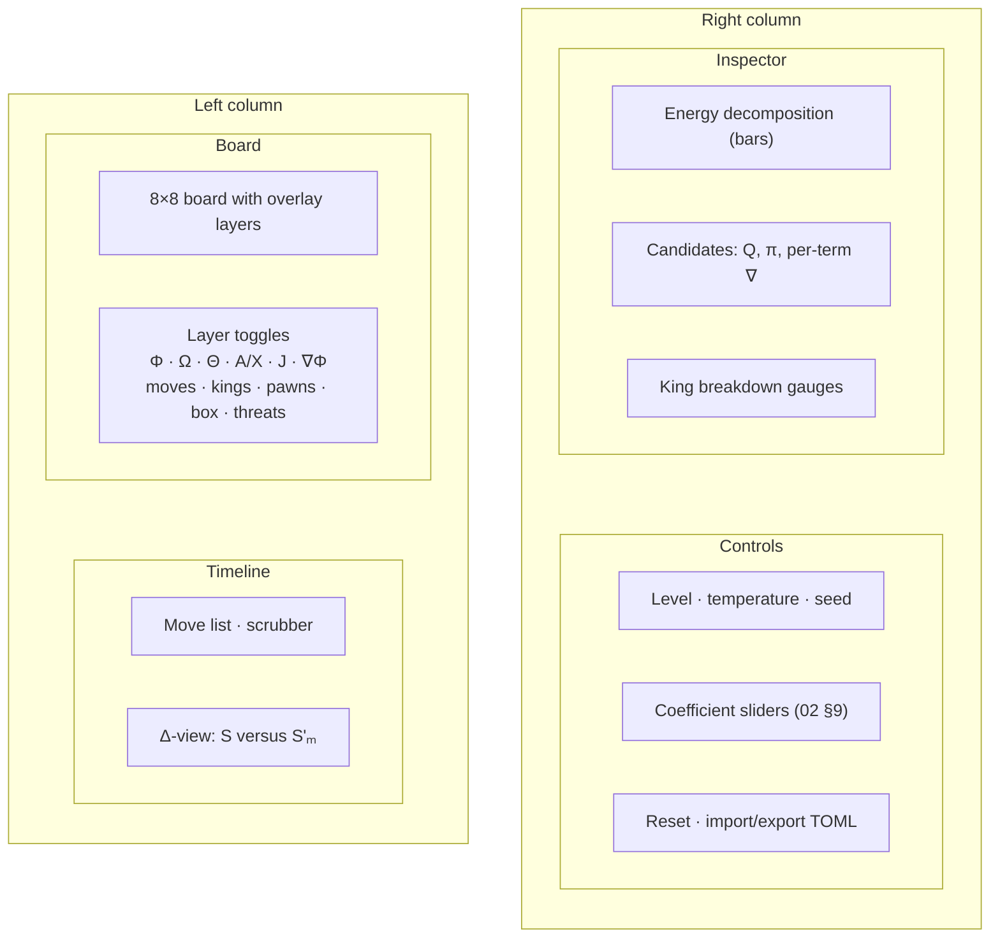

# 06 — Visualisation Lab

> **Status:** Draft v0.3 · The playable page is `web/` · **Built in:** Milestone 6 ([`../roadmap.md`](../roadmap.md))
> · **Depends on:** the WebAssembly API of [`05-architecture.md`](05-architecture.md#5-webassembly-api)
> · **Resolves:** M-9 of [`01-proposal-review.md`](01-proposal-review.md)

The lab is the public face of the project and the source of the paper's figures.
It shows what Nabla computes, why it chooses a move, and how its behaviour changes
when its coefficients change.

The notes are `/` and the board is `/play`. The play page is one viewport high
on a desktop. A framed square board has a seat on each side. Choosing a seat
opens a roster: you, Nabla, Stockfish 19 lite, or Maia. Maia-3 downloads in the
browser the first time it moves. That seat also holds the model's own settings.
The mast is the width of the page column on both Notes and Play. The judgement
bar stands to the left of the board, square-ended: cream where White's pieces
sit, grey where Black's sit, including after a flip, with a mark at the
midpoint. The side to move is the lit seat. The other seat is dulled. There is
no "to move" line. The score is white-positive. A Stockfish mate is M2 when
White mates in two, and −M4 when Black mates in four. Captured pieces and the
material lead sit on the seat that took them. The move controls sit under the
board, with a gap above them. On a narrow screen the history controls keep
their own line, and Pause, Undo, Flip, Swap, and PGN sit on the line beneath.
The judgement bar lies flat under the lower seat, with space around it. Why that move sits beside Considered, the two
columns the same width: the nine terms of the chosen move, and up to eight
moves it weighed. The move itself is not named again above those terms. The
right column does not scroll. Reading holds the layer switches, the nine
energy terms, and the reason for the last Nabla move. Those marks stay on
the board while the other side thinks. Two Nablas use two colours. Moves holds
the game. The question mark opens the legend. Pause, then hover a mark, to read
which pieces and squares make it. The pause before an engine move is at the top
of a seat, and a move does not start while that seat is open. The notes
summarise the recorded native benchmark suite (anchored matches against
Stockfish 19, Maia, and classical alpha-beta baselines, plus ablations,
temperature curves, tactical suites, endgame conversions, and static evaluation
correlation) and display its figures. Control is one inset rim under the
pieces, and only while Nabla is
to move, in the same geometry the legend draws. Tension ticks,
hanging-piece numbers, and candidate arrows use that same geometry. Check,
checkmate, stalemate, and the draw reasons are written on the board. The king that is
in check is outlined; the piece that gave the check is not. Flux
lines, the king gauge, pawn cones, confinement, and figure export are still to
build. The notes state the official description and do not offer coefficient
sliders.

Stockfish's Elo cap is Stockfish's own UCI option. A game against it is not a
rating for Nabla. Maia-3 is fetched by the browser and is not in the repository.
Single protocol matches go through `node tools/gauntlet.mjs`, and the full
benchmark suite reported in [`../research/benchmark-report.md`](../research/benchmark-report.md)
runs through `python tools/benchmark/run_suite.py`, under the conditions in the
research protocol.

---

## 1. Purpose

| Job | What the user does | What the lab must provide |
| --- | --- | --- |
| **Explain** | Asks "why this move?" | Per-term energy gradients for every candidate, and the fields behind them. |
| **Explore** | Changes the coefficients ("the laws of the board") | Live re-analysis with every layer updated within one animation frame at Level 0. |
| **Publish** | Produces figures for the paper | Deterministic, metadata-stamped exports regenerated by one command. |

---

## 2. Layout

---

## 3. Layers

| # | Layer | Data (05 §5) | Encoding | Question it answers |
| --- | --- | --- | --- | --- |
| 1 | Net potential $\Phi$ | `fields.net` | Diverging colour map, fixed symmetric limits | Who dominates where? |
| 2 | Control $\Omega$ | `fields.control` | Diverging, fixed limits $[-1, 1]$ | Who owns each square? |
| 3 | Tension $\Theta$ | `fields.tension` | Sequential, single hue | Where are the flashpoints? |
| 4 | Direct and X-ray channels | `fields.direct*`, `fields.xray*` | Per side; X-ray drawn as dashed beams through the blocking piece | What is attacked, and what is only X-rayed (pins, batteries)? |
| 5 | Lines of force $𝐉$ | `fields.flux*` | Streamlines; width proportional to $\lVert 𝐉 \rVert$ | Where does pressure point? |
| 6 | Terrain slope $\nabla_{xy}\Phi$ | `fields.grad*` | Small arrows | How does dominance change across the board? |
| 7 | Move gradients | `candidates` | Arrow from origin to target; colour = $Q$, width = $\pi_\tau$ | Which moves does the energy favour, and why? |
| 8 | King breakdown | `diagnostics.kingPressure`, `diagnostics.shelter` | Zone outline plus a gauge marking the current point on the breakdown curve of 02 Eq. (19) | How close is each king to collapse? |
| 9 | Pawn cones | `diagnostics.passage`, `diagnostics.unstoppable` | Shaded forward path; light-cone square for unstoppable pawns | Which pawns are passed, and which cannot be caught? |
| 10 | Confinement | `diagnostics.confinement` | Outline of the defending king's region | How boxed-in is the defending king? |
| 11 | Exchange threats | `diagnostics.threatsW`, `diagnostics.threatsB` | Ring around each piece that can be won by SEE; thickness = gain | What can be captured profitably right now? |

Layers 1–3 and 5–6 are diagnostics (02 §8); layer 7 is the decision itself. The lab
labels the two kinds differently so viewers do not mistake a diagnostic for the
reason a move was chosen. Layers 4 and 11 were suggested by the second proposal
(00b, Part 4); its other suggestions are handled as follows:

- **Tracer particles** may animate the lines of force $𝐉$, never the Cartesian
  gradient $\nabla_{xy}\Phi$, which the engine does not use and which would show a
  Euclidean flow that does not exist in the model.
- **Bilinear smoothing** of the 8×8 fields is available only as a labelled
  "smooth" view in the interactive lab. It invents values between squares (for
  example across a pawn wall), so it is never used in exported figures.
- A **king potential** layer is not offered: the energy has no such term (02 §5.5),
  so drawing one would depict a cause that is absent from the decision.

---

## 4. Interactions

1. **Play** against Nabla at a chosen level and temperature, or at a calibrated
   `UCI_Elo`.
2. **Hover a square** to see every field value there and its top five sources
   (`explainSquare`), split into direct and X-ray contributions.
3. **Select a candidate** to open the Δ-view: the change in each field from $S$ to
   $`S'_m`$, with the per-term gradient bars of 03 §6.
4. **Move a slider** to re-analyse immediately at Level 0, and after a 150 ms pause
   at Levels 1–2.
5. **Step through** the principal variation at Levels 1–2 to the leaf whose energy
   produced the score.
6. **Import or export** a parameter set as TOML; reset to defaults.

---

## 5. Visual encoding standards

1. **Colour.** Perceptually uniform maps. The diverging map runs from blue (White)
   to orange (Black), which remains distinguishable under common colour-vision
   deficiencies; red–green pairs are not used.
2. **Fixed scales.** Each layer uses fixed limits stated in pawn units, so that
   two positions can be compared by eye. Per-frame auto-scaling is not used,
   because it makes small differences look large.
3. **Legibility.** Pieces are drawn above overlays; overlay opacity is at most 0.6.
4. **Legends.** Every visible layer shows a legend with units.
5. **Accessibility.** Full keyboard navigation; text equivalents for gauges;
   animated streamlines are disabled when the user prefers reduced motion.

---

## 6. Reproducible figure export

1. Export the board with selected layers as SVG or PNG. Fields are drawn as flat
   per-square cells with a diverging colour map symmetric about 0 and the same
   limits in every panel. Each file embeds its provenance: FEN, move history,
   parameter hash, engine version, level, temperature, seed, layers, and
   colour-map limits.
2. Export the raw arrays as JSON alongside each figure.
3. A figure manifest in `tools/figures/` lists every figure in the paper; one
   command regenerates all of them from the manifest.

---

## 7. Third-party overlay policy

1. Nabla never overlays analysis on **live** games on any third-party platform.
   Chess platforms' fair-play rules prohibit engine assistance during play.
2. A browser extension, if built, activates only on analysis boards and finished
   games, and stays off whenever the page context cannot be determined.
3. The primary demonstration is the self-hosted lab.

This policy is recorded as decision D-011.

---

## 8. Performance

Nabla's analysis runs on the page thread. A Level 2 opening decision is a few
milliseconds, so Nabla itself is not put in a worker. Stockfish 19 lite, when
that opponent is selected, runs in its own worker. The HUD is one canvas over
the board, redrawn after each move. Streamlines are not computed in this build.

---

## 9. Technology

Astro serves two pages: `/` (the explanatory notes) and `/play` (the
interactive board). A client script uses Chessground 9.2.1 (lichess-org,
GPL-3.0-or-later) for the pieces and drag-and-drop, and a canvas for the HUD.
The engine is `nabla-wasm` (using `Lab::replay` to preserve repetition history on
undo/scrub and `Lab::explain_square` for square hover tooltips). The right-panel
term bars use fixed ±5.0 pawn (static energy) and ±2.0 pawn (candidate delta)
scales per §5. Stockfish 19 lite (`stockfish` 19.0.1, GPL-3.0) is loaded only when
that match is selected. Type is Geist (SIL Open Font License). There is no React
and no server. Decision D-012.
