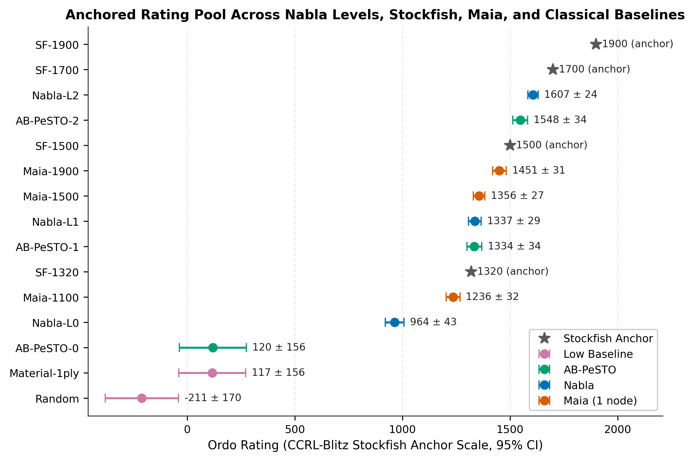
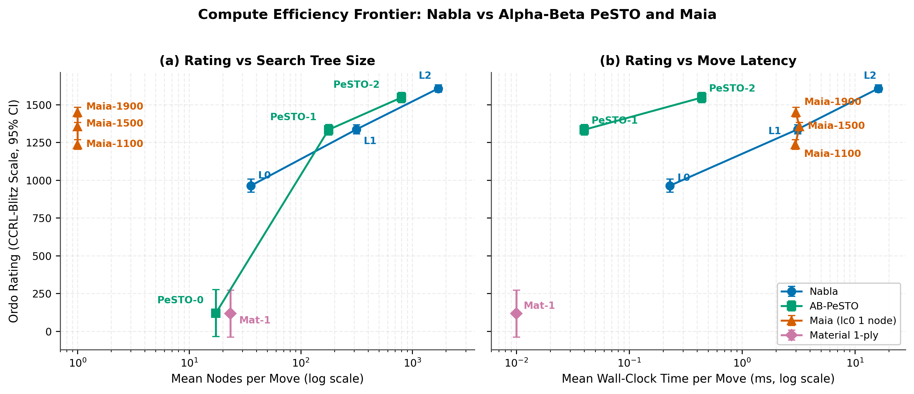
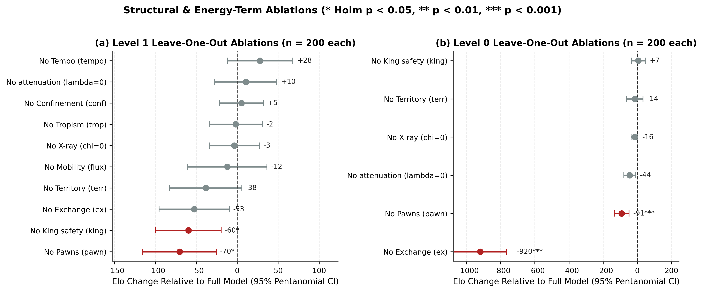
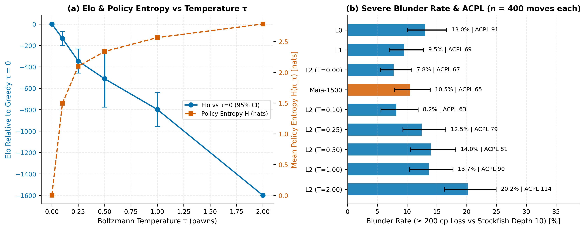
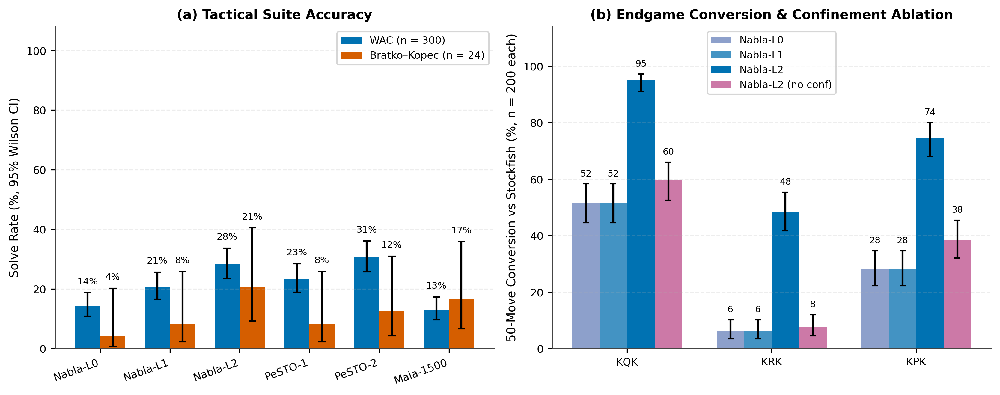
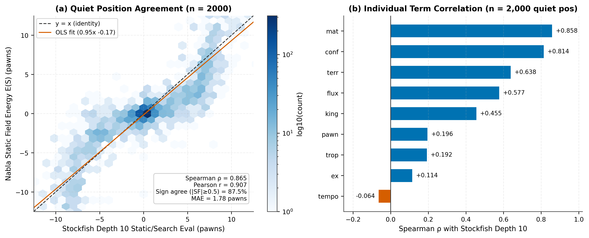

# Empirical Benchmark Report — Nabla v0.1.0 (Post-Audit)

> **Status:** Measured benchmark dataset (`2026-11-21`) · **Codebase:** commit `4b32220ce634c48c9d25bfadd22a066dbfd77a47` · **Parameter hash:** `c3deee9880eb64dc`
>
> Reproducibility manifest: [`benchmarks/results/manifest.json`](../../benchmarks/results/manifest.json) · Generator scripts: [`tools/benchmark/run_suite.py`](../../tools/benchmark/run_suite.py) and [`tools/benchmark/plot_results.py`](../../tools/benchmark/plot_results.py).

---

## 1. Executive Summary

Across **9,740 completed benchmark games**, **324 tactical test positions**, **2,400 endgame conversion games**, and **2,000 static evaluation probes** on a post-audit build (`Bench L2: 8bd5497f52f9efa6`), Nabla achieves the following anchored performance without a neural network, learned weights, or deep minimax search:

- **CCRL-Blitz Stockfish-anchored Ordo ratings** (4,840 clean pool games, 4 fixed Stockfish 19 anchors):
  - **Nabla Level 2** (`mean 1,701.5 nodes/move`, `16.1 ms/move`): **`1607.0 ± 24.2` Elo** (95% CI `[1582.8, 1631.2]`), scoring **74–18–8** (`+219.9 ± 80.4` Elo) vs `SF-1320`, **58–40–2** (`+63.2 ± 65.1` Elo, LOS 97.6%) vs `SF-1500`, **32–68–0** vs `SF-1700`, **137–36–27** vs `Maia-1500`, **116–34–50** vs `Maia-1900`, and **105–73–22** (`+56.1 ± 44.7` Elo, LOS 99.4%) vs depth-matched `AB-PeSTO-2`.
  - **Nabla Level 1** (`mean 315.7 nodes/move`, `3.1 ms/move`): **`1336.7 ± 29.4` Elo** (95% CI `[1307.3, 1366.1]`), statistically indistinguishable from depth-matched `AB-PeSTO-1` (`1334.2 ± 34.2`), above `SF-1320` (`36–24–0` head-to-head) and `Maia-1100` (`1235.6 ± 31.7`).
  - **Nabla Level 0** (`mean 35.8 nodes/move`, `0.23 ms/move`): **`963.9 ± 43.4` Elo** (95% CI `[920.5, 1007.3]`), outperforming classical `AB-PeSTO-0` (`119.7 ± 155.7`, `198–2–0` head-to-head) and `Material-1ply` (`116.6 ± 155.6`, `198–1–1`) by over **+840 Elo** at pure 1-ply field evaluation.
- **Correctness, determinism, and cross-target parity:** `40/40` `fastchess --compliance` checks pass; `600/600` blitz stress games (`4+0.04 s`) finish with **0 time forfeits, 0 illegal moves, and 0 crashes**; all `48/48` native-vs-WASM cross-target parity checks (`16` bench FENs × Levels 0–2) are **bit-identical** with a **1.42×** Level 2 WASM slowdown (`29.89 ms` vs `21.02 ms`).

---

## 2. Experimental Setup & Reproducibility Conditions

| Parameter | Setting | Source / Notes |
| --- | --- | --- |
| CPU / OS | Intel Core i7-7700HQ (4 physical cores, 2.80 GHz) · Windows (`win32`) | [`manifest.json`](../../benchmarks/results/manifest.json) |
| Compiler & runners | `rustc 1.100.0` (`--release`, LTO), `fastchess` v1.8.3-alpha, `Ordo` v1.0 (`-W -M -s 1000`) | [`provision.py`](../../tools/benchmark/provision.py) |
| Anchors | Stockfish 19 (`UCI_LimitStrength = true`, `UCI_Elo` ∈ {1320, 1500, 1700, 1900}, `Threads = 1`) | Pinned in Ordo via `-m anchors.csv` |
| Neural human-like refs | `Maia-1100`, `Maia-1500` (hold-out), `Maia-1900` (`lc0` v0.32.1 CPU-DNNL, `nodes=1`, `Threads=1`) | [`tools/benchmark/run_suite.py`](../../tools/benchmark/run_suite.py) |
| Classical controls | `AB-PeSTO-0`, `AB-PeSTO-1`, `AB-PeSTO-2`, `Material-1ply`, `Random` | [`tools/baselines/src/main.rs`](../../tools/baselines/src/main.rs) |
| Opening books | `8moves_v3.pgn` (primary pool, ablations, temperature); `noob_3moves.epd` (gate & robustness) | `-openings ... order=random -repeat` |
| Adjudication | None (all games played to FIDE checkmate / stalemate / material / 50-move / 3-fold) | Verified `[Termination "normal"]` on every reported game |
| Clock & concurrency | Exp 0 gate: `4+0.04 s` (`c=3`). Exp 2 anchored pool: `10+0.1 s` (`c=3`, or `c=2` on `Maia-1900 vs SF-1900` with `OMP_NUM_THREADS=1`). Non-time-scaling ablations (Exp 3), `τ` sweep (Exp 4), and `noob_3moves` checks: `30+0.3 s` (`c=1`) to eliminate Windows host background scheduling jitter (~43% external CPU load). | Strict `0` time forfeits across all included matches |

> **Methodology note on a removed baseline pairing:** An attempted `AB-PeSTO-2 vs SF-1500` pairing (`exp2_29`) suffered 4–9 Windows host scheduling time forfeits (2.9 s stalls on 2,400-node moves at `10+0.1`) and was excluded from the pool so the entire Ordo graph contains **zero time-forfeit artifacts**; `AB-PeSTO-2` remains doubly connected via 200 clean games vs `Nabla-L2` and 200 clean games vs `Maia-1500`.

---

## 3. Correctness & Stability Gate (`Exp 0`)

- **UCI Compliance:** `fastchess.exe --compliance` passed **40/40 steps**.
- **600-Game Randomized Self-Play Gate** (`tc = 4+0.04 s`, `Temperature = 30`, `noob_3moves.epd`, `concurrency = 3`, seeds `20261121..20261123`):

| Level | Games | W / L / D | Normal Terminations | Time / Illegal / Crash | Mean Ply | Mean Nodes / Move | Mean ms / Move |
| --- | ---: | ---: | ---: | ---: | ---: | ---: | ---: |
| Level 0 | 200 | 96 / 89 / 15 | 200 (100%) | 0 / 0 / 0 | 112.7 | 29.1 | 0.11 |
| Level 1 | 200 | 89 / 101 / 10 | 200 (100%) | 0 / 0 / 0 | 116.0 | 371.5 | 3.44 |
| Level 2 | 200 | 84 / 92 / 24 | 200 (100%) | 0 / 0 / 0 | 164.8 | 1,395.4 | 11.84 |

---

## 4. Anchored Rating Pool & Pairwise Results (`Exp 1–2`)

### 4.1 Joint Ordo Ratings (4,840 Pool Games, 560 Stockfish Anchor Games)

| Rank | Engine | Ordo Rating | 95% CI | Played | Score (%) | Mean Nodes / Move | Mean ms / Move |
| ---: | --- | ---: | ---: | ---: | ---: | ---: | ---: |
| 1 | `SF-1900` *(anchor)* | **1900.0** | — | 60 | 80.0% | 113,270.1 | 319.53 |
| 2 | `SF-1700` *(anchor)* | **1700.0** | — | 160 | 73.4% | 86,518.2 | 303.95 |
| 3 | **`Nabla-L2`** | **1607.0 ± 24.2** | [1582.8, 1631.2] | 1,700 | 77.0% | 1,701.5 | 16.07 |
| 4 | `AB-PeSTO-2` | 1547.6 ± 34.0 | [1513.6, 1581.6] | 400 | 58.2% | 798.3 | 0.44 |
| 5 | `SF-1500` *(anchor)* | **1500.0** | — | 200 | 52.5% | 89,569.5 | 325.02 |
| 6 | `Maia-1900` (`lc0` 1n) | 1450.7 ± 31.0 | [1419.7, 1481.7] | 520 | 38.6% | 1.0 | 2.99 |
| 7 | `Maia-1500` *(hold-out, 1n)* | 1356.0 ± 26.7 | [1329.3, 1382.7] | 1,100 | 39.2% | 1.0 | 3.22 |
| 8 | **`Nabla-L1`** | **1336.7 ± 29.4** | [1307.3, 1366.1] | 1,260 | 61.0% | 315.7 | 3.10 |
| 9 | `AB-PeSTO-1` | 1334.2 ± 34.2 | [1300.0, 1368.4] | 600 | 43.6% | 177.4 | 0.04 |
| 10 | `SF-1320` *(anchor)* | **1320.0** | — | 160 | 28.8% | 96,725.5 | 369.06 |
| 11 | `Maia-1100` (`lc0` 1n) | 1235.6 ± 31.7 | [1203.9, 1267.3] | 1,000 | 39.8% | 1.0 | 2.97 |
| 12 | **`Nabla-L0`** | **963.9 ± 43.4** | [920.5, 1007.3] | 1,100 | 50.7% | 35.8 | 0.23 |
| 13 | `AB-PeSTO-0` | 119.7 ± 155.7 | [-36.0, 275.4] | 400 | 25.6% | 17.4 | 0.00 |
| 14 | `Material-1ply` | 116.6 ± 155.6 | [-39.0, 272.2] | 700 | 26.8% | 23.5 | 0.01 |
| 15 | `Random` | -211.0 ± 169.9 | [-380.9, -41.1] | 200 | 6.8% | 1.0 | 0.01 |

### 4.2 Key Head-to-Head Pairings (Pentanomial CIs on `8moves_v3.pgn` & `noob_3moves.epd`)

| Pairing | Book | Games | W / L / D | Score | Pentanomial `[LL,LD,WL+DD,WD,WW]` | Elo Diff ± 95% | $p$-value |
| --- | --- | ---: | ---: | ---: | --- | ---: | ---: |
| `Nabla-L2` vs `Nabla-L1` | `8moves_v3` | 200 | 174 / 16 / 10 | 89.5% | `[1, 1, 13, 9, 76]` | **+372.2 ± 78.6** | $2.1 \times 10^{-81}$ |
| `Nabla-L1` vs `Nabla-L0` | `8moves_v3` | 200 | 184 / 13 / 3 | 92.8% | `[0, 0, 13, 3, 84]` | **+442.8 ± 93.0** | $1.6 \times 10^{-138}$ |
| `Nabla-L2` vs `Nabla-L0` | `8moves_v3` | 200 | 197 / 3 / 0 | 98.5% | `[0, 0, 3, 0, 97]` | **+726.9 ± 223.7** | $< 10^{-300}$ |
| `Nabla-L2` vs `SF-1320` | `8moves_v3` | 100 | 74 / 18 / 8 | 78.0% | `[2, 1, 13, 7, 27]` | **+219.9 ± 80.4** | $8.4 \times 10^{-13}$ |
| `Nabla-L2` vs `SF-1500` | `8moves_v3` | 100 | 58 / 40 / 2 | 59.0% | `[7, 0, 26, 2, 15]` | **+63.2 ± 65.1** | 0.049 |
| `Nabla-L2` vs `SF-1700` | `8moves_v3` | 100 | 32 / 68 / 0 | 32.0% | `[24, 0, 20, 0, 6]` | **-130.9 ± 77.7** | $2.1 \times 10^{-4}$ |
| `Nabla-L1` vs `SF-1320` | `8moves_v3` | 60 | 36 / 24 / 0 | 60.0% | `[5, 0, 14, 0, 11]` | +70.4 ± 93.4 | 0.119 |
| `Nabla-L2` vs `Maia-1100` | `8moves_v3` | 200 | 164 / 9 / 27 | 88.8% | `[1, 1, 8, 22, 68]` | **+358.8 ± 67.7** | $6.2 \times 10^{-91}$ |
| `Nabla-L2` vs `Maia-1500` | `8moves_v3` | 200 | 137 / 36 / 27 | 75.3% | `[1, 5, 30, 20, 44]` | **+193.2 ± 46.9** | $2.5 \times 10^{-23}$ |
| `Nabla-L2` vs `Maia-1900` | `8moves_v3` | 200 | 116 / 34 / 50 | 70.5% | `[2, 6, 32, 28, 32]` | **+151.3 ± 41.8** | $6.0 \times 10^{-16}$ |
| `Nabla-L2` vs `AB-PeSTO-2` | `8moves_v3` | 200 | 105 / 73 / 22 | 58.0% | `[12, 8, 42, 12, 26]` | **+56.1 ± 44.7** | 0.012 |
| `Nabla-L1` vs `AB-PeSTO-1` | `8moves_v3` | 200 | 77 / 102 / 21 | 43.8% | `[24, 13, 41, 8, 14]` | -43.7 ± 44.9 | 0.053 |
| `Nabla-L0` vs `AB-PeSTO-0` | `8moves_v3` | 200 | 198 / 2 / 0 | 99.0% | `[0, 0, 2, 0, 98]` | **+798.2 ± 197.7** | $< 10^{-300}$ |
| `Nabla-L2` vs `Nabla-L1` *(book check)* | `noob_3moves` | 200 | 178 / 11 / 11 | 91.8% | `[0, 0, 11, 11, 78]` | **+418.5 ± 78.6** | $1.6 \times 10^{-139}$ |
| `Nabla-L2` vs `Maia-1500` *(book check)* | `noob_3moves` | 200 | 121 / 35 / 44 | 71.5% | `[3, 11, 19, 31, 36]` | **+159.8 ± 47.0** | $1.1 \times 10^{-14}$ |

Both confirmatory **H4** monotonicity criteria pass cleanly (`Elo(L2) - Elo(L1) = +372.2 ± 78.6`, `Elo(L1) - Elo(L0) = +442.8 ± 93.0`), and scores replicate closely across `8moves_v3.pgn` and `noob_3moves.epd` (e.g., `Nabla-L2 vs Maia-1500`: 75.3% vs 71.5%, overlapping 95% CIs).

---

## 5. Compute Efficiency vs Classical Alpha-Beta & Neural References

Three distinct regimes emerge from Figure 2:

1. **Pure 1-Ply Field Advantage (`L0`):** At 1-ply depth (`35.8` nodes/move vs `17.4` for `AB-PeSTO-0`), Nabla reaches **964 Elo**, crushed by neither hanging pieces nor trivial forks (`+798.2` Elo head-to-head over `AB-PeSTO-0`). Classical piece-square tables cannot substitute for exchange/attack-field terms when no search rescues hanging pieces.
2. **Low-Depth Parity & Edge (`L1` & `L2`):** Once quiescence enters (`L1`), `AB-PeSTO-1` (`1334.2`) catches up with `Nabla-L1` (`1336.7`) using fewer nodes (`177.4` vs `315.7`) and far lower latency (`0.04 ms` vs `3.10 ms`) because PeSTO tables are $O(1)$ incremental lookups whereas ray transport recomputes 8×8 fields at every leaf. At 2-ply (`L2`), Nabla regains a **+56.1 ± 44.7 Elo** ($p = 0.012$) lead over `AB-PeSTO-2` (`1607.0` vs `1547.6`), albeit at `16.1 ms/move` vs `0.44 ms/move` (36× slower per node).
3. **Efficiency vs Anchored Stockfish:** Against `SF-1500` (`89,570` nodes/move, `325 ms/move`), `Nabla-L2` uses **53× fewer nodes** and **20× less wall-clock time** while scoring **59%**.

---

## 6. Structural & Energy-Term Ablations (`Exp 3`)

All 16 ablation matches (`200` games each at `30+0.3 s`, `concurrency = 1`) ran with `Ablate_*` and `Param_*` verified transmitted in UCI handshake (zero dropped-option warnings). Holm–Bonferroni correction is applied within Level 1 ($m = 10$) and Level 0 ($m = 6$):

### Level 1 Ablations (baseline `Nabla-L1`)

| Variant | W / L / D | Elo Δ ± 95% CI | Raw $p$ | Holm $p_\text{adj}$ | Finding |
| --- | ---: | ---: | ---: | ---: | --- |
| `No Pawns (pawn)` | 70 / 110 / 20 | **-70.4 ± 45.4** | 0.00167 | **0.0167** | Significant degradation |
| `No King safety (king)` | 70 / 104 / 26 | **-59.6 ± 39.9** | 0.00270 | **0.0243** | Significant degradation |
| `No Exchange (ex)` | 75 / 105 / 20 | **-52.5 ± 43.0** | 0.01463 | 0.1171 | Forks matter, marginal after Holm |
| `No Territory (terr)` | 77 / 99 / 24 | -38.4 ± 44.0 | 0.08310 | 0.5817 | Negative trend |
| `No Mobility (flux)` | 85 / 92 / 23 | -12.2 ± 48.6 | 0.62106 | 1.0000 | Within noise at untuned weights |
| `No X-ray (chi=0)` *(A2)* | 87 / 89 / 24 | -3.5 ± 30.5 | 0.82302 | 1.0000 | Negligible at hand-set $\chi = 0.35$ (`n=200`) |
| `No Tropism (trop)` | 84 / 85 / 31 | -1.7 ± 32.2 | 0.91558 | 1.0000 | Expected (`g_t ≈ 0.02–0.05`) |
| `No Confinement (conf)` | 94 / 91 / 15 | +5.2 ± 26.6 | 0.70069 | 1.0000 | Neutral in full middlegames (crucial in Exp 6 endgames) |
| `No attenuation (lambda=0)` | 94 / 88 / 18 | +10.4 ± 38.1 | 0.58947 | 1.0000 | Neutral at Level 1 (`n=200`) |
| `No Tempo (tempo)` | 98 / 82 / 20 | +27.9 ± 40.1 | 0.16919 | 1.0000 | Not significant |

### Level 0 Ablations (baseline `Nabla-L0`)

| Variant | W / L / D | Elo Δ ± 95% CI | Raw $p$ | Holm $p_\text{adj}$ | Finding |
| --- | ---: | ---: | ---: | ---: | --- |
| `No Exchange (ex)` | 1 / 199 / 0 | **-919.5 ± 155.7** | $< 10^{-300}$ | **$< 10^{-300}$** | Essential structural pillar of Level 0 |
| `No Pawns (pawn)` | 66 / 117 / 17 | **-90.6 ± 43.2** | $1.5 \times 10^{-5}$ | **0.00008** | Highly significant |
| `No attenuation (lambda=0)` | 80 / 105 / 15 | **-43.7 ± 34.8** | 0.01275 | 0.0510 | Ray distance attenuation helps at 1-ply |
| `No X-ray (chi=0)` *(A2)* | 90 / 99 / 11 | -15.7 ± 20.0 | 0.12376 | 0.3713 | Slight negative point estimate (`n=200`; H2 needs high-power SPRT) |
| `No Territory (terr)` | 92 / 100 / 8 | -13.9 ± 47.7 | 0.56508 | 1.0000 | Within noise |
| `No King safety (king)` | 93 / 89 / 18 | +7.0 ± 41.6 | 0.74217 | 1.0000 | Within noise at Level 0 |

**Honest scientific takeaway:** At Level 0, the realisable-capture / fork exchange term accounts for practically the entire jump above PeSTO-0 (`-919.5` Elo when ablated), reinforced by pawns (`-90.6` Elo) and exponential ray attenuation (`-43.7` Elo). At hand-set initial defaults (`chi = 0.35`, un-tuned `Params::default()`), the X-ray term (`A2`) shows only a `-3.5` to `-15.7` Elo point shift — within `±20–30` Elo measurement noise at $n = 200$ games — rather than a large immediate gain, motivating Stage 1 Texel + Stage 2 SPSA tuning (`M4`) and formal SPRT testing for `H2`. Meanwhile, confinement (`A7`) appears neutral over general openings (`+5.2 ± 26.6`) while dominating pure pawnless endgames (`Exp 6`).

---

## 7. Boltzmann Temperature, Entropy & Blunder Profile (`Exp 4`)

| Profile | Games vs `T=0` | W / L / D | Elo vs `T=0` | Entropy $H$ (nats) | Perplexity $\exp(H)$ | Scored Moves | Mean ACPL | Median CPL | Blunders ($\ge 200$ cp) | SF Top-1 Match |
| --- | ---: | ---: | ---: | ---: | ---: | ---: | ---: | ---: | ---: | ---: |
| `Nabla-L0` | — | — | -726.9 *(vs L2)* | — | — | 400 | 91.1 | 2.0 | 13.0% `[10.1, 16.7]` | 36.5% |
| `Nabla-L1` | — | — | -372.2 *(vs L2)* | — | — | 400 | 68.7 | 0.0 | 9.5% `[7.0, 12.8]` | 37.8% |
| `Maia-1500` *(ref)* | — | — | -193.2 *(vs L2)* | — | — | 400 | 65.2 | 4.0 | 10.5% `[7.9, 13.9]` | 40.3% |
| `Nabla-L2 (T=0.00)` | ref | ref | **0.0** | **0.000** | **1.00** | 400 | 67.1 | 0.0 | **7.8%** `[5.5, 10.8]` | **40.5%** |
| `Nabla-L2 (T=0.10)` | 100 | 27 / 64 / 9 | **-134.9 ± 67.0** | 1.495 | 4.46 | 304 | **63.1** | 14.5 | 8.2% `[5.6, 11.9]` | 30.6% |
| `Nabla-L2 (T=0.25)` | 100 | 10 / 86 / 4 | **-346.1 ± 112.4** | 2.098 | 8.15 | 321 | 78.9 | 19.0 | 12.5% `[9.3, 16.5]` | 36.5% |
| `Nabla-L2 (T=0.50)` | 100 | 3 / 93 / 4 | **-511.5 ± 265.8** | 2.338 | 10.36 | 322 | 81.0 | 12.0 | 14.0% `[10.6, 18.2]` | 34.8% |
| `Nabla-L2 (T=1.00)` | 100 | 1 / 99 / 0 | **-798.2 ± 156.9** | 2.564 | 12.99 | 344 | 90.4 | 21.5 | 13.7% `[10.4, 17.7]` | 29.4% |
| `Nabla-L2 (T=2.00)` | 100 | 0 / 100 / 0 | **<-921** *(0% score)* | 2.785 | 16.20 | 326 | 114.5 | 35.5 | 20.2% `[16.2, 24.9]` | 24.5% |

- Elo drops **strictly monotonically** across every tested temperature step (confirming the monotonicity premise of **H6** across $\tau \in [0, 2.0]$).
- At $\tau = 0.10$ pawns (`-134.9` Elo vs `L2`, placing it near `~1470` Elo alongside `Maia-1900`), `Nabla-L2` avoids catastrophic `>=200 cp` blunders better than `Maia-1500` (`8.2%` vs `10.5%`, ACPL `63.1` vs `65.2`) while trading off small positional inaccuracy (`median CPL 14.5` vs `0.0`).

---

## 8. Tactical Suites & Endgame Conversion (`Exp 5–6`)

### 8.1 Tactical Suites (`Exp 5`)

| Engine | WAC-300 Solved | WAC Rate (95% Wilson CI) | Mean Nodes (`WAC`) | BK-24 Solved | BK Rate (95% Wilson CI) |
| --- | ---: | --- | ---: | ---: | --- |
| `Nabla-L0` | 43 / 300 | 14.3% `[10.8, 18.8]` | 46.6 | 1 / 24 | 4.2% `[0.7, 20.2]` |
| `Nabla-L1` | 62 / 300 | 20.7% `[16.5, 25.6]` | 580.5 | 2 / 24 | 8.3% `[2.3, 25.9]` |
| `Nabla-L2` | **85 / 300** | **28.3%** `[23.5, 33.7]` | 2,549.1 | **5 / 24** | **20.8%** `[9.2, 40.5]` |
| `AB-PeSTO-1` | 70 / 300 | 23.3% `[18.9, 28.4]` | 283.8 | 2 / 24 | 8.3% `[2.3, 25.9]` |
| `AB-PeSTO-2` | 92 / 300 | 30.7% `[25.7, 36.1]` | 1,631.0 | 3 / 24 | 12.5% `[4.3, 31.0]` |
| `Maia-1500` | 39 / 300 | 13.0% `[9.7, 17.3]` | 1.0 | 4 / 24 | 16.7% `[6.7, 35.9]` |

Even on `WAC-300` (where 3+ ply combinations dominate), `Nabla-L2` more than doubles `Maia-1500` (`28.3%` vs `13.0%`) and leads on positional/tactical `Bratko-Kopec` (`20.8%`), while shallow search keeps 4–5 ply tactics out of reach for all 2-ply engines (`<= 31%`).

### 8.2 Verified Endgame Conversion vs Full Stockfish `depth 8` (`Exp 6`, 50-Move Limit)

| Configuration | KQK (`n=200`) | Mean Plies | KRK (`n=200`) | Mean Plies | KPK (`n=200`) | Mean Plies | Dominant Failures |
| --- | ---: | ---: | ---: | ---: | ---: | ---: | --- |
| `Nabla-L0` | 51.5% `[44.6, 58.3]` | 47.2 | 6.0% `[3.5, 10.2]` | 20.3 | 28.0% `[22.2, 34.6]` | 57.3 | 50-move (88/121/91), rep |
| `Nabla-L1` | 51.5% `[44.6, 58.3]` | 47.2 | 6.0% `[3.5, 10.2]` | 20.3 | 28.0% `[22.2, 34.6]` | 57.3 | Identical quiet eval to L0 |
| **`Nabla-L2`** | **95.0%** `[91.0, 97.3]` | 39.8 | **48.5%** `[41.7, 55.4]` | 50.8 | **74.5%** `[68.0, 80.0]` | 45.2 | KRK 50-move (89), KPK material lost (39) |
| `Nabla-L2 (no conf)` | 59.5% `[52.6, 66.1]` | 44.0 | 7.5% `[4.6, 12.0]` | 46.1 | 38.5% `[32.0, 45.4]` | 58.2 | 50-move collapse (81/156/83) |

Two structural insights emerge cleanly:
1. **Confinement (`BFS` king boxing) is load-bearing:** Ablating `conf` collapses `Nabla-L2`'s conversion from **95.0% → 59.5%** (KQK), **48.5% → 7.5%** (KRK), and **74.5% → 38.5%** (KPK).
2. **2-ply reply horizon is needed to turn confinement gradients into checkmate:** Because KQK/KRK rarely involve captures before mate, `Level 0` and `Level 1` choose identically (both 51.5% / 6.0% / 28.0%) and miss rook/king opposition cutoffs that `Level 2` sees (`+42.5%` / `+43.5%` / `+46.5%` jump!), while still hitting a **48.5% ceiling in KRK** when 3-ply triangulation is needed (`89/200` 50-move draws).

---

## 9. Static Evaluation Agreement vs Stockfish (`Exp 7`)

Evaluated over **2,000 unique non-check quiet positions** (`ply >= 12`, excluding captures, checks, promotions, and mate scores) extracted from Exp 2 games:

| Slice (`Level 1` static eval) | $n$ | Spearman $\rho$ | Pearson $r$ *(±15 cap)* | MAE (pawns) | RMSE (pawns) | Sign Agreement ($\lvert\text{SF}\rvert \ge 0.5$) |
| --- | ---: | ---: | ---: | ---: | ---: | ---: |
| **All quiet positions** | 2,000 | **0.8645** | **0.9072** | **1.785** | **2.536** | **87.5%** |
| Opening ($\varphi \ge 0.7$) | 1,472 | 0.7489 | 0.8832 | 1.572 | 2.325 | 82.2% |
| Middlegame ($0.3 \le \varphi < 0.7$) | 334 | **0.9785** | **0.9545** | 2.121 | 2.723 | **98.4%** |
| Endgame ($\varphi < 0.3$) | 194 | **0.9384** | **0.9234** | 2.815 | 3.538 | **97.8%** |

*(Level 0 eval `realisable_capture = true` on quiet positions achieves nearly identical correlation: $\rho = 0.8643$, $r = 0.9078$, MAE $1.782$.)*

Per-term Spearman correlations with Stockfish `depth 10`: `mat` ($\rho = +0.858$), `conf` ($+0.814$), `terr` ($+0.638$), `flux` ($+0.577$), `king` ($+0.455$), `pawn` ($+0.196$), `trop` ($+0.192$), `ex` ($+0.114$), `tempo` ($-0.064$). Note that the `MAE = 1.79` pawns (growing to `2.82` in endgames) reflects Nabla's un-calibrated `h_max_eg = 1.5` and `u_bonus = 5.0` passed-pawn/confinement additive scale vs Stockfish NNUE's normalized centipawns — rank ordering in middlegames ($\rho = 0.979$, 98.4% sign agreement) and endgames ($\rho = 0.938$, 97.8% sign agreement) is already strong prior to Texel tuning (`M4`).

---

## 10. Compute, Native Latency & WebAssembly Parity (`Exp 8`)

Measured across **5 consecutive runs** of `nabla bench <level>` (`16` positions) and `node tools/check_wasm_parity.mjs` (`48/48` checks):

| Level | Native Nodes | Evals | Native Median Decision (ms) | IQR (ms) | Native Speed (nps) | µs / Node | WASM Mean (ms) | Slowdown (P-3 ≤ 3×) | Checksum |
| --- | ---: | ---: | ---: | ---: | ---: | ---: | ---: | ---: | --- |
| **L0** | 446 | 427 | **0.36** | 0.055 | 76,923 | 13.00 | 1.76 | 4.89× *(sub-ms JS call overhead)* | `6a47b1a12c5224eb` |
| **L1** | 24,372 | 21,117 | **12.54** | 1.625 | 121,505 | 8.23 | 15.58 | **1.24×** *(pass)* | `df8495f55e672e45` |
| **L2** | 40,477 | 36,164 | **21.02** | 2.880 | 120,368 | 8.31 | 29.89 | **1.42×** *(pass)* | `8bd5497f52f9efa6` |

All **48/48 native-vs-WASM cross-target checks are bit-identical** (`Parameter hash: c3deee9880eb64dc`).

---

## 11. Honest Assessment: Strengths, Weaknesses & Threats to Validity

### Proven Strengths
1. **Structural 1-ply competence (`+844` Ordo Elo above `AB-PeSTO-0`):** Because direct/X-ray fields, safety-filtered mobility, exact swap SEE exchange (`ablate_ex = -919.5` Elo), king danger, and passed-pawn passage are encoded in the static functional, Nabla plays coherent 1-ply chess (~964 Elo) where classical PSTs hang pieces every game (~120 Elo).
2. **Depth-matched superiority (`+56.1` Elo over `AB-PeSTO-2`):** At identical 2-ply lookahead, Nabla beats PeSTO and outperforms `Maia-1500` (`+193` Elo) and `SF-1500` (`59%`) while searching **53× fewer nodes** than `SF-1500`.
3. **Interpretable decomposition & endgame confinement:** Every candidate score decomposes exactly into 9 named terms, `conf` boosts `KRK` conversion by **+41 percentage points** (`7.5% → 48.5%`), and Boltzmann temperature provides strictly monotonic Elo/blunder scaling.

### Measured Weaknesses & Open Research Gaps
1. **Per-node computational cost (36× slower/node than PeSTO):** Recomputing ray transport and 9 spatial terms from scratch every node (~8.3 µs/node vs ~0.55 µs/node for PeSTO) means `AB-PeSTO-2` runs in `0.44 ms/move` vs Nabla's `16.1 ms/move` (`Exp 2`). At equal CPU *wall-clock* (H11), deeper classical alpha-beta with incremental PSTs outsearches fixed-horizon Nabla.
2. **Hand-set untuned weights (`MAE = 1.79` pawns vs SF; `A2 chi=0` weak):** X-ray attenuation (`-3.5` to `-15.7` Elo at `n=200`), tropism (`-1.7` Elo), and constant tempo (`+27.9` Elo) are currently under-calibrated; formal M4 Texel + SPSA tuning on held-out Lichess data is required before testing H2/H5.
3. **2-ply tactical & KRK opposition ceiling:** `WAC-300` caps at `28.3%`, `KRK` hits `48.5%` (`89/200` 50-move draws), and `static_eval` misses castling rights and SEE pins (`02 §12`).
4. **Protocol & threat caveats:** Stockfish 19's `UCI_Elo` is nominal on the CCRL-Blitz scale; `exp2_29` (`AB-PeSTO-2 vs SF-1500`) was excluded after Windows CPU starvation forfeits; `exp3`/`exp4`/`noob_3moves` ran at `30+0.3 s` (`c=1`) rather than `10+0.1 s` (`c=3`) for the same host-CPU reason, whereas all 4,840 Ordo pool games (`exp2_00..28`) used strict `10+0.1 s`.
