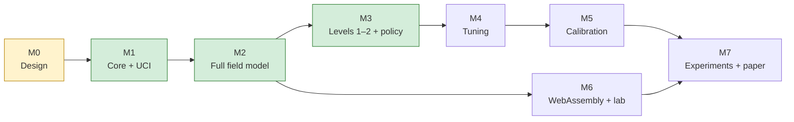

# Roadmap

> **Status:** Living plan · A milestone is complete only when **every** exit
> criterion is met and recorded in the commit that closes it.

---

## Dependency graph

Green: complete. Yellow: partly complete. M6 can proceed in parallel with M3–M5
once the field API of M2 is stable.

---

## Milestones

| ID | Milestone | Deliverables | Exit criteria | Status |
| --- | --- | --- | --- | --- |
| M0 | Design | This documentation set (specification v0.2) | Author has reviewed documents 02–04; their status moves from *Draft* to *Accepted* | **In review** |
| M1 | Core and UCI | Cargo workspace; `shakmaty` adapter; fields; boundary conditions; Level 0; UCI loop with `eval` and `bench`; CI workflow | Correctness gates of protocol §3 pass; exact colour antisymmetry; `bench` checksum committed | **Done** (v0.1; gate results in protocol §13) |
| M2 | Full field model | X-ray transport; all terms of 02 §5; ablation switches; `explain` and `fields` | Golden-field and property tests pass; classical-limit tests pass; P-1 measured | **Done** (classical-limit tests landed in `92cdf98`; diagnostic fields $𝐉$ and $\nabla_{xy}\Phi$ moved to M6) |
| M3 | Levels 1–2 and policy | Quiescence; Level 2; Boltzmann policy; counter-based RNG | Policy tests pass; preliminary comparison of Level 1 with Level 0; P-2 measured | **Done** (a 200-game match stood in for the SPRT; protocol §13) |
| M4 | Tuning | `nabla-tune` coordinate descent; then a gauntlet before any default changes | H5 resolved; tuned parameter set committed with its new hash | **Started.** The tuner runs and prints a fit. Defaults stay the hand-set values until a gauntlet confirms a gain. |
| M5 | Calibration | Pool set-up; calibration grid; `calibration/elo-map.toml`; `UCI_LimitStrength` and `UCI_Elo` | H6 acceptance criterion met; staleness check in CI | Not started |
| M6 | WebAssembly and lab | `nabla-wasm`; Astro page in `web/`; the remaining layers; cross-target test; figure export | Bit-identity on the golden set; all eleven layers working; P-3 measured | **Started.** You, Nabla against Nabla, and Stockfish 19 lite can play; native/WASM bit-identity verified across bench × Levels 0–2. Flux lines, king gauge, pawn cones, confinement, and figure export remain. |
| M7 | Experiments and paper | Full protocol run, including the AB-*d* control and H11; data deposit; paper draft | All confirmatory hypotheses resolved; every figure regenerates from one command | Not started |

## Next tasks, in order

1. The remaining lab layers: flux lines, king gauge, pawn cones, confinement.
2. Texel / SPSA tuning (`M4`) and anchored gauntlet validation.
3. Full protocol run and calibration (`M5`, `M7`).
