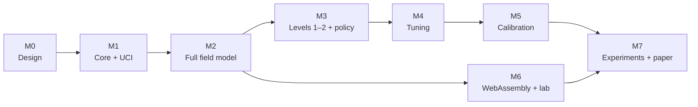

# Roadmap

> **Status:** Living plan · A milestone is complete only when **every** exit
> criterion is met and recorded in the commit that closes it.

---

## Dependency graph

M6 can proceed in parallel with M3–M5 once the field API of M2 is stable.

---

## Milestones

| ID | Milestone | Deliverables | Exit criteria | Status |
| --- | --- | --- | --- | --- |
| M0 | Design | This documentation set | Author has reviewed documents 01–04; their status moves from *Draft* to *Accepted* | **In review** |
| M1 | Core and UCI | Cargo workspace; `shakmaty` adapter; direct fields; $E_\text{mat}$, $E_\text{flux}$, $E_\text{ex}$; boundary conditions; Level 0; UCI loop with `eval` and `bench`; CI workflow | Correctness gates of protocol §3 pass at Level 0; exact colour antisymmetry; `bench` checksum committed | Not started |
| M2 | Full field model | X-ray transport; all terms of 02 §5; ablation switches; `explain` and `fields`; parameter TOML with hash | Golden-field, property, and classical-limit tests pass; P-1 measured | Not started |
| M3 | Levels 1–2 and policy | Quiescence; Level 2; Boltzmann policy; counter-based RNG | Policy tests pass; preliminary SPRT of Level 1 versus Level 0; P-2 measured | Not started |
| M4 | Tuning | Texel pipeline in `tools/`; SPSA stage | H5 resolved; tuned parameter set committed with its new hash | Not started |
| M5 | Calibration | Pool set-up; calibration grid; `calibration/elo-map.toml`; `UCI_Elo` | H6 acceptance criterion met; staleness check in CI | Not started |
| M6 | WebAssembly and lab | `nabla-wasm`; cross-target test; lab per 06; figure export | Bit-identity on the golden set; all ten layers working; P-3 measured | Not started |
| M7 | Experiments and paper | Full protocol run; data deposit; paper draft | All confirmatory hypotheses resolved; every figure regenerates from one command | Not started |
